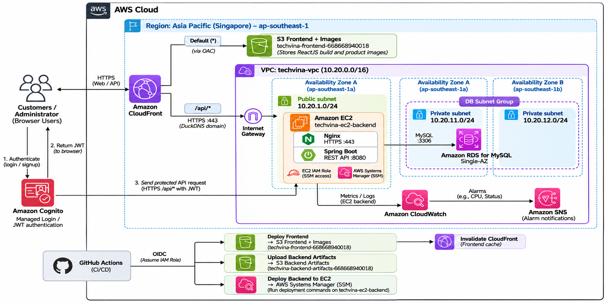

## Introduction to the System

In this workshop, we will build the AWS infrastructure required to deploy a **mobile phone e-commerce web application** for **customers** and **administrators**. Customers can browse and search for products, register, sign in, and place orders. Administrators can manage products, images, and orders according to the features implemented by the development team.

The application consists of three common components:

1. **Frontend (user interface):** ReactJS displays the website in a browser.
2. **Backend (application server):** Java Spring Boot exposes REST APIs and processes requests from the frontend.
3. **Database:** MySQL stores products, users, and orders according to the application's data model.

Instead of running these components only on local computers, we will deploy them on AWS so that the website can be accessed and tested over the Internet.

## Workshop Overview

### 1. Objectives

By the end of this workshop, participants should be able to:

- Create and configure a network environment with **Amazon VPC** and manage access with **AWS IAM**.
- Deploy **Spring Boot** on **Amazon EC2** and connect it to **Amazon RDS for MySQL**.
- Upload the production **ReactJS** build to **Amazon S3** and deliver the frontend through **Amazon CloudFront**.
- Store product images in the same S3 bucket as the Frontend.
- Integrate **Amazon Cognito** for user registration, sign-in, and JWT authentication.
- Observe server and application activity with **Amazon CloudWatch**.
- Validate end-to-end browser, API, database, and image flows, then clean up lab resources.

### 2. System Architecture

**AWS Services and Their Roles**

| Service | Role in the project |
|---|---|
| Amazon VPC | Provides networking for EC2 and RDS and separates public and private subnets. |
| AWS IAM | Grants deployment permissions and EC2 instance-role permissions as needed. |
| Amazon EC2 | Runs Spring Boot on port 8080 and Nginx HTTPS on port 443. |
| Amazon RDS for MySQL | Hosts and manages the application's MySQL database. |
| Amazon S3 | Uses one bucket for the ReactJS build and product images, and another for Backend Artifacts. |
| Amazon CloudFront | Delivers frontend/images using S3 OAC and forwards `/api/*` to the DuckDNS HTTPS origin. |
| Amazon Cognito | Supports registration, sign-in, and JWT authentication. |
| Amazon CloudWatch | Collects metrics and logs and enables operational alarms. |

**How the components work together**

1. **Website access:** Users open the CloudFront HTTPS URL. CloudFront retrieves the ReactJS assets from S3 and returns them to the browser.
2. **Product images:** The browser requests product images through CloudFront, which retrieves the corresponding objects from the Frontend bucket.
3. **API requests:** ReactJS sends `/api/*` requests to CloudFront; CloudFront forwards these requests to Spring Boot on EC2.
4. **Database access:** Spring Boot connects to RDS MySQL over the private VPC network to query and update data.
5. **Sign-in:** Users authenticate with Cognito. After sign-in, the frontend includes a JWT in protected API requests; Spring Boot validates the token before processing the requests.
6. **Monitoring:** CloudWatch provides metrics and logs to help operators inspect service health.

### 3. Deployment Scope and Resources

| Resource group | Proposed workshop setup |
|---|---|
| Networking | 1 VPC; 1 Public Subnet for EC2; 2 Private Subnets in different Availability Zones for RDS; Internet Gateway; Route Tables; Security Groups. |
| Compute | 1 EC2 instance running Spring Boot, with an EBS volume. |
| Database | 1 Single-AZ RDS MySQL instance and 1 DB Subnet Group with 2 Private Subnets. |
| Storage | 2 S3 buckets: Frontend (including images) and Backend Artifacts. |
| Content delivery | 1 CloudFront distribution with appropriate origins and behaviors for frontend, images, and API requests. |
| Authentication | A Cognito User Pool and App Client integrated into the application. |
| Permissions | IAM Role/Policy for EC2 and the permissions needed to use S3. |
| Monitoring | CloudWatch metrics, logs, and an alarm for validation. |

### 4. Workshop Implementation Steps

1. **5.2 – Prerequisites:** Prepare the AWS account, deployment permissions, application source/build artifacts, and required tools.
2. **5.3 – IAM and VPC Setup:** Create a Role/Policy, VPC, Subnets, Internet Gateway, Route Tables, and Security Groups.
3. **5.4 – Amazon RDS Deployment:** Create a DB Subnet Group, RDS MySQL instance, and network rules allowing database connections from EC2 only.
4. **5.5 – Backend Deployment on EC2:** Launch an instance, install Java, deploy Spring Boot, configure RDS connectivity, and test the API.
5. **5.6 – Amazon S3 Deployment:** Create two private S3 buckets and manually upload product images to the Frontend bucket.
6. **5.7 – CloudFront and System Integration:** Configure DuckDNS/Nginx HTTPS, CloudFront origins, `/api/*` routing, the SPA Function and Cognito callbacks; manually build and deploy the frontend.
7. **5.8 – CI/CD, Monitoring and Testing:** Configure GitHub Actions OIDC, automate frontend/backend deployments, and verify CloudWatch metrics, logs, alarms, and end-to-end flows.
8. **5.9 – Resource Clean-up:** Remove lab resources in the appropriate order to avoid unnecessary charges.

### 5. Security Requirements

- **S3:** Keep buckets private and use CloudFront Origin Access Control (OAC) to deliver content from S3.
- **RDS:** Deploy the database in Private Subnets, disable public access, and allow MySQL traffic on port 3306 only from the EC2 Security Group.
- **EC2 and IAM:** Use an IAM Role instead of embedding access keys in application code, and restrict Internet-facing ports. Use HTTPS port 443 between CloudFront and EC2 Nginx with a valid certificate; do not expose Spring Boot port 8080 publicly.
- **Authentication:** Spring Boot must validate JWTs and user authorization for protected API operations.
- **Monitoring:** Observe operational metrics, application logs, and alarms during testing.

### 6. Expected Validation Results

| Component | Expected result |
|---|---|
| Website | The frontend loads using the CloudFront HTTPS URL. |
| API | The frontend sends requests and receives responses from Spring Boot. |
| Database | The backend successfully reads and writes data in RDS MySQL. |
| Images | Product images are delivered from S3 via CloudFront. |
| Sign-in | Users authenticate with Cognito and access protected APIs with valid JWTs. |
| Security | RDS is not directly accessible from the Internet; S3 objects are not publicly readable through direct bucket access. |
| Monitoring | Logs and metrics are visible and one CloudWatch alarm can be verified. |
| Clean-up | Lab resources are removed or int