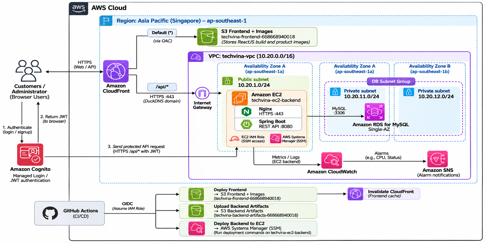

## Giới thiệu về hệ thống

Trong workshop này, chúng ta sẽ xây dựng hạ tầng AWS để triển khai **ứng dụng web bán điện thoại** dành cho **khách hàng** và **quản trị viên**. Khách hàng có thể xem, tìm kiếm sản phẩm, đăng ký, đăng nhập và đặt hàng; quản trị viên có thể quản lý sản phẩm, hình ảnh và đơn hàng trong phạm vi chức năng ứng dụng đã được nhóm phát triển.

Ứng dụng gồm ba thành phần quen thuộc:

1. **Frontend (giao diện):** ReactJS hiển thị website trên trình duyệt.
2. **Backend (máy chủ xử lý):** Java Spring Boot cung cấp REST API để xử lý yêu cầu từ giao diện.
3. **Database (cơ sở dữ liệu):** MySQL lưu trữ dữ liệu sản phẩm, người dùng và đơn hàng theo thiết kế của ứng dụng.

Thay vì chỉ chạy các thành phần trên máy cá nhân, chúng ta triển khai chúng lên AWS để website có thể được truy cập và kiểm thử qua Internet.

## Tổng quan về workshop

### 1. Mục tiêu

Sau khi hoàn thành workshop, người thực hành có thể:

- Tạo và cấu hình môi trường mạng bằng **Amazon VPC**, cùng **AWS IAM** để quản lý quyền truy cập.
- Triển khai ứng dụng **Spring Boot** lên **Amazon EC2** và kết nối **Amazon RDS for MySQL**.
- Đưa bản build **ReactJS** lên **Amazon S3**, phân phối giao diện qua **Amazon CloudFront**.
- Lưu hình ảnh sản phẩm trong cùng bucket S3 với Frontend.
- Kết nối hệ thống với **Amazon Cognito** để hỗ trợ đăng ký, đăng nhập và xác thực JWT.
- Theo dõi máy chủ và ứng dụng thông qua **Amazon CloudWatch**.
- Kiểm thử luồng truy cập từ trình duyệt đến API, cơ sở dữ liệu và hình ảnh; sau đó dọn dẹp tài nguyên thực hành.

### 2. Kiến trúc hệ thống

**Vai trò của các dịch vụ AWS**

| Dịch vụ | Chức năng trong dự án |
|---|---|
| Amazon VPC | Tạo mạng riêng cho EC2 và RDS; phân tách mạng con công khai và riêng tư. |
| AWS IAM | Cấp quyền cho người triển khai và IAM Role của EC2 theo nhu cầu thực tế. |
| Amazon EC2 | Chạy Java Spring Boot cổng 8080 và Nginx HTTPS cổng 443. |
| Amazon RDS for MySQL | Lưu trữ dữ liệu ứng dụng trong cơ sở dữ liệu được quản lý. |
| Amazon S3 | Sử dụng một bucket cho bản build ReactJS và hình ảnh; một bucket cho Backend Artifacts. |
| Amazon CloudFront | Phân phối Frontend/ảnh qua S3 OAC; chuyển `/api/*` tới origin DuckDNS HTTPS. |
| Amazon Cognito | Cung cấp cơ chế đăng ký, đăng nhập và mã xác thực JWT. |
| Amazon CloudWatch | Thu thập chỉ số, nhật ký và hỗ trợ cảnh báo khi có sự cố. |

**Cách các thành phần phối hợp với nhau**

1. **Truy cập website:** Người dùng mở địa chỉ HTTPS của CloudFront. CloudFront lấy các tệp giao diện ReactJS từ S3 và gửi về trình duyệt.
2. **Xem hình ảnh:** Trình duyệt yêu cầu hình ảnh sản phẩm qua CloudFront; CloudFront lấy tệp tương ứng từ S3 bucket Frontend.
3. **Gọi API:** ReactJS gửi `/api/*` đến CloudFront; CloudFront chuyển qua HTTPS 443 tới Nginx trên EC2; Nginx proxy về Spring Boot cổng 8080.
4. **Truy cập dữ liệu:** Spring Boot kết nối RDS MySQL qua mạng riêng trong VPC để truy vấn hoặc cập nhật dữ liệu.
5. **Đăng nhập:** Người dùng xác thực qua Cognito. Sau khi đăng nhập thành công, giao diện gửi JWT cùng những yêu cầu API được bảo vệ; Spring Boot xác minh mã trước khi xử lý.
6. **Giám sát:** CloudWatch cung cấp chỉ số và nhật ký để kiểm tra trạng thái vận hành.

### 3. Phạm vi triển khai và các tài nguyên cần tạo

| Nhóm tài nguyên | Cấu hình dự kiến cho workshop |
|---|---|
| Mạng | 1 VPC; 1 Public Subnet dành cho EC2; 2 Private Subnets ở hai Availability Zones dành cho RDS; Internet Gateway; Route Tables; Security Groups. |
| Máy chủ | 1 EC2 chạy Spring Boot; ổ đĩa EBS đi kèm. |
| Cơ sở dữ liệu | 1 RDS MySQL Single-AZ; 1 DB Subnet Group gồm 2 Private Subnets. |
| Lưu trữ | 2 S3 buckets: Frontend (bao gồm hình ảnh) và Backend Artifacts. |
| Phân phối | 1 CloudFront distribution; các origins và behaviors phù hợp cho giao diện, hình ảnh và API. |
| Xác thực | Cognito User Pool và App Client để tích hợp với ứng dụng. |
| Quyền truy cập | IAM Role/Policy cho EC2 và quyền truy cập cần thiết đến S3. |
| Giám sát | CloudWatch metrics, logs và alarm phù hợp để kiểm thử. |

### 4. Các bước thực hiện trong workshop

1. **5.2 – Các bước chuẩn bị:** Chuẩn bị tài khoản, quyền truy cập AWS, mã nguồn/bản build của ứng dụng và công cụ cần thiết.
2. **5.3 – Thiết lập IAM và VPC:** Tạo Role/Policy, VPC, Subnets, Internet Gateway, Route Tables và Security Groups.
3. **5.4 – Triển khai Amazon RDS:** Tạo DB Subnet Group, RDS MySQL và giới hạn quyền kết nối từ EC2.
4. **5.5 – Triển khai Backend trên EC2:** Tạo máy chủ, cài môi trường Java, đưa Spring Boot lên EC2, cấu hình kết nối RDS và thử API.
5. **5.6 – Triển khai S3:** Tạo hai bucket riêng tư và tải thủ công hình ảnh sản phẩm lên bucket Frontend.
6. **5.7 – CloudFront và tích hợp hệ thống:** Cấu hình DuckDNS/Nginx HTTPS, CloudFront Origins, `/api/*`, SPA Function, Cognito callback; build và upload Frontend thủ công để kiểm thử website.
7. **5.8 – CI/CD, giám sát và kiểm thử:** Thiết lập GitHub Actions OIDC, tự động triển khai Frontend/Backend, CloudWatch và kiểm thử tổng thể.
8. **5.9 – Dọn dẹp tài nguyên:** Xóa các thành phần thực hành theo thứ tự phù hợp nhằm tránh phát sinh phí không cần thiết.

### 5. Các yêu cầu bảo mật sẽ áp dụng

- **S3:** Không mở quyền truy cập công khai cho bucket; sử dụng CloudFront Origin Access Control (OAC) để phân phối nội dung đọc từ S3.
- **RDS:** Đặt cơ sở dữ liệu trong các Private Subnets; không cho phép truy cập công khai; Security Group chỉ cho phép kết nối MySQL (cổng 3306) từ Security Group của EC2.
- **EC2 và IAM:** Cấp quyền qua IAM Role, tránh lưu Access Key trực tiếp trong mã nguồn; hạn chế các cổng mạng mở ra Internet. Cấu hình kết nối HTTPS giữa CloudFront và EC2 cần được xác định ở bước triển khai CloudFront, không mặc định mọi kết nối đều đã được mã hóa.
- **Xác thực:** Các API yêu cầu đăng nhập phải kiểm tra JWT và quyền của người dùng ở phía Spring Boot.
- **Giám sát:** Theo dõi chỉ số, nhật ký và cảnh báo để phát hiện vấn đề trong quá trình thử nghiệm.

### 6. Kết quả cần kiểm thử

| Hạng mục | Kết quả mong đợi |
|---|---|
| Website | Truy cập được giao diện qua địa chỉ CloudFront bằng HTTPS. |
| API | Frontend gửi yêu cầu và nhận được phản hồi từ Spring Boot. |
| Cơ sở dữ liệu | Backend đọc/ghi dữ liệu trên RDS MySQL thành công. |
| Hình ảnh | Hình ảnh sản phẩm hiển thị từ S3 qua CloudFront. |
| Đăng nhập | Có thể đăng nhập qua Cognito và gọi API được bảo vệ bằng JWT hợp lệ. |
| Bảo mật | RDS không truy cập trực tiếp từ Internet; S3 không cấp quyền đọc công khai trực tiếp. |
| Giám sát | Xem được logs, metrics và kiểm tra một CloudWatch alarm. |
| Dọn dẹp | Các tài nguyên tạo cho bài thực hành được xóa hoặc giữ lại có chủ đích sau khi kiểm tra. |