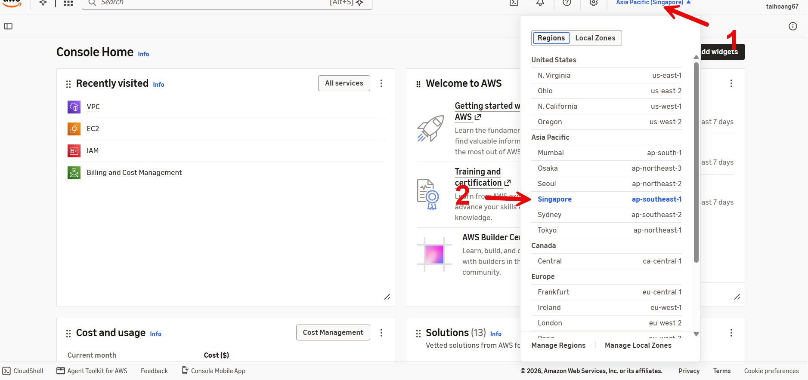
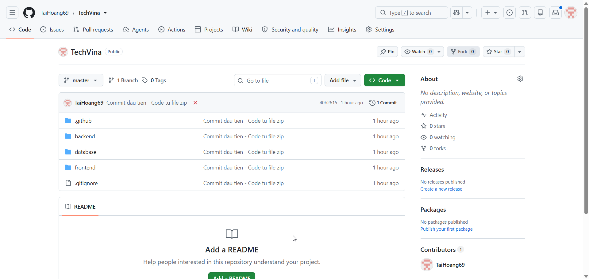
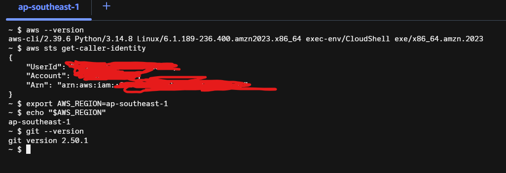

## Step 1 – Chuẩn bị tài khoản AWS

1. Đăng nhập [AWS Management Console](https://console.aws.amazon.com/) bằng tài khoản AWS thực hành có quyền tạo IAM, VPC, EC2, RDS, S3, CloudFront, Cognito, CloudWatch và Systems Manager.
2. Vào **Billing and Cost Management → Credits** để xem credit và ngày hết hạn. Trong **AWS Budgets → Create budget**, thiết lập cảnh báo chi phí qua email.
3. Chọn Region **Asia Pacific (Singapore) – `ap-southeast-1`** ở góc trên bên phải. Sử dụng Region này cho các tài nguyên theo khu vực; CloudFront là dịch vụ toàn cục.
4. Xác nhận đúng AWS Account ID và quyền sử dụng các dịch vụ trong Region Singapore trước khi tạo tài nguyên.



## Step 2 – Chuẩn bị repository GitHub

1. Đăng nhập [GitHub](https://github.com/) và mở repository mã nguồn [TechVina](https://github.com/TaiHoang69/TechVina).
2. Nhấn **Fork → Create fork** để tạo repository trong tài khoản GitHub của bạn. Đường dẫn repository sau khi fork có dạng `https://github.com/<GITHUB_OWNER>/TechVina`.
3. Mở repository của bạn và kiểm tra nhánh **`master`** cùng các thư mục `.github/workflows/`, `.github/scripts/`, `.github/tests/`, `backend/`, `frontend/` và `database/`.
4. Sử dụng repository thuộc tài khoản của bạn để cấu hình GitHub Actions và GitHub OIDC ở mục **5.8**.



## Step 3 – Cài đặt Git for Windows

1. Mở trang [Git for Windows](https://git-scm.com/downloads/win), tải phiên bản phù hợp với Windows và chạy bộ cài.
2. Hoàn tất trình cài đặt với **Git Bash** được bật. Git Bash cung cấp môi trường chạy các lệnh `git` và script Bash trên máy Windows.
3. Mở **Git Bash** từ Start Menu và kiểm tra phiên bản Git:

```bash
git --version
```

Kết quả hiển thị phiên bản Git đã cài đặt. Trong các bước CI/CD, Git Bash được sử dụng để chạy `git add`, `git commit`, `git push` và bài kiểm thử script rollback của Backend.

## Step 4 – Cài đặt Visual Studio Code

1. Truy cập [Visual Studio Code](https://code.visualstudio.com/Download) và cài đặt bản dành cho Windows.
2. Mở **Visual Studio Code**. Trên thanh menu, chọn **Terminal → New Terminal**.
3. Tại Terminal, nhấn mũi tên bên cạnh nút **`+`**, chọn **Git Bash** làm terminal thao tác. Nếu không có tùy chọn này, kiểm tra lại quá trình cài Git for Windows.

Visual Studio Code được sử dụng để chỉnh sửa các file `.github/workflows/*.yml`, `.github/scripts/*.sh` và mã nguồn dự án trước khi commit lên GitHub.

## Step 5 – Clone mã nguồn TechVina về máy Windows

1. Trong Git Bash, chuyển đến thư mục muốn lưu dự án. Ví dụ, để tạo thư mục dự án tại ổ `C:`, chạy:

```bash
cd /c
git clone https://github.com/<GITHUB_OWNER>/TechVina.git
cd TechVina
git branch --show-current
git status --short
```

2. Thay `<GITHUB_OWNER>` bằng tên tài khoản GitHub chứa repository của bạn. `git branch --show-current` cần trả về `master` khi repository sử dụng nhánh chính `master` như trong Workshop. `git status --short` không hiển thị dòng nào khi thư mục làm việc chưa có thay đổi.
3. Trong Visual Studio Code, chọn **File → Open Folder**, chọn thư mục dự án vừa clone (ví dụ `C:\TechVina`). Kiểm tra các thư mục `frontend/`, `backend/` và `.github/` ở Explorer.

Khi sửa workflow trong mục **5.8**, mở Git Bash tại thư mục gốc của repository để chạy lệnh Git và kiểm thử các script Bash. Không chạy lệnh Bash trực tiếp trong PowerShell nếu `bash` chưa được cấu hình trong `PATH`.

## Step 6 – Chuẩn bị môi trường thao tác AWS

Workshop sử dụng **AWS Management Console**, **AWS CloudShell**, **EC2 Session Manager**, **Visual Studio Code**, **Git Bash** và **GitHub Actions**:

- **AWS Management Console:** tạo và cấu hình tài nguyên AWS.
- **AWS CloudShell:** kiểm tra thông tin tài khoản và chạy AWS CLI trong trình duyệt.
- **EC2 Session Manager:** thực hiện các lệnh cài đặt, kiểm tra và vận hành Spring Boot trên EC2 Ubuntu.
- **Visual Studio Code và Git Bash:** chỉnh sửa mã nguồn, quản lý Git và chạy bài kiểm thử rollback trên Windows.
- **GitHub Actions:** dùng môi trường runner để cài Node.js **22** cho Frontend và Java **21** cho Backend, thực hiện build và triển khai. Không bắt buộc cài Node.js, Java, Maven hoặc AWS CLI trên Windows để chạy hai workflow này.

Ghi lại các thông số sẽ được tạo trong các bước tiếp theo:

| Tên biến | Giá trị |
|---|---|
| `AWS_REGION` | `ap-southeast-1` |
| `AWS_ACCOUNT_ID` | AWS Account ID gồm 12 chữ số |
| `GITHUB_OWNER` | Tài khoản GitHub chứa repository triển khai |
| `EC2_INSTANCE_ID`, `EC2_PUBLIC_IP` | Ghi sau khi tạo EC2 |
| `RDS_ENDPOINT` | Ghi sau khi tạo RDS |
| `CF_DISTRIBUTION_ID`, `CF_DOMAIN` | Ghi sau khi tạo CloudFront |
| `COGNITO_POOL_ID`, `COGNITO_CLIENT_ID`, `COGNITO_DOMAIN` | Ghi sau khi tạo Cognito |

Dự án sử dụng **hai S3 buckets**: `techvina-frontend-<AWS_ACCOUNT_ID>` (Frontend và hình ảnh sản phẩm) và `techvina-backend-artifacts-<AWS_ACCOUNT_ID>` (JAR và script CI/CD). Tên bucket phải duy nhất trên Amazon S3.

## Step 7 – Mở AWS CloudShell và kiểm tra tài khoản

1. Trong **AWS Management Console**, chọn Region **Asia Pacific (Singapore) – `ap-southeast-1`**.
2. Nhấn biểu tượng **CloudShell (`>_`)** để mở terminal trong trình duyệt.
3. Chạy các lệnh sau **trong CloudShell**:

```bash
aws --version
aws sts get-caller-identity
export AWS_REGION=ap-southeast-1
echo "$AWS_REGION"
```

4. Đối chiếu giá trị `Account` với AWS Account ID của tài khoản thực hành. AWS CloudShell sử dụng thông tin xác thực từ phiên AWS Console, không cần tạo AWS Access Key trên máy Windows.

