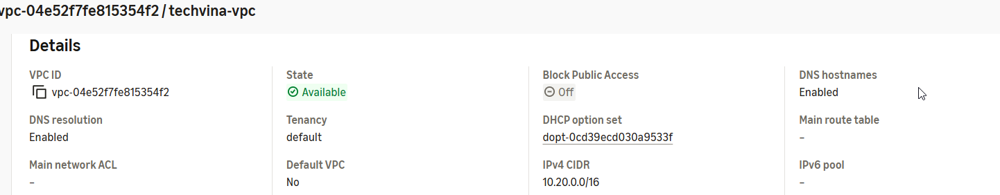
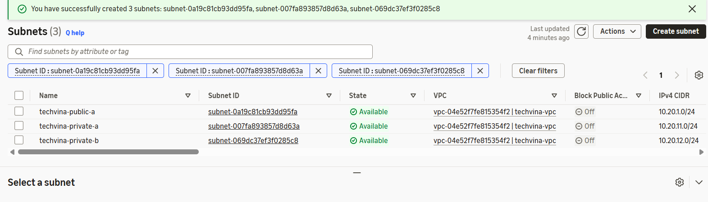
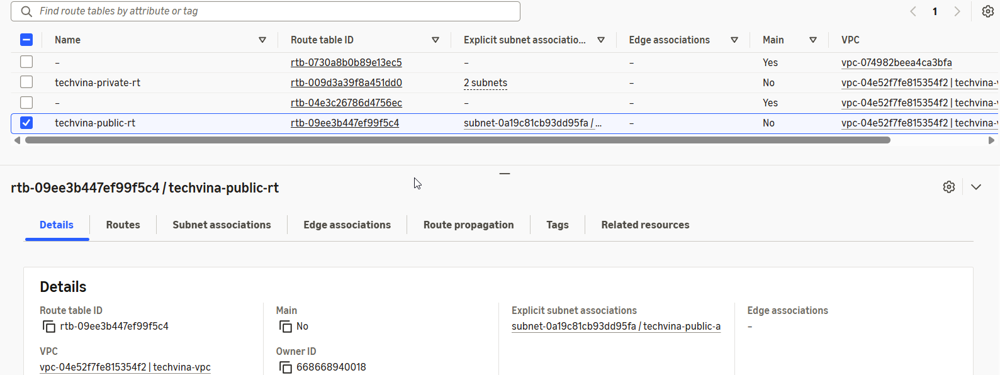

## Step 1 – Tạo VPC

1. Mở **VPC Console → Your VPCs → Create VPC**.
2. Chọn **VPC only**, Name `techvina-vpc`, IPv4 CIDR `10.20.0.0/16`, Tenancy `Default`.
3. Nhấn **Create VPC**. Mở **Actions → Edit VPC settings**, bật **DNS resolution** và **DNS hostnames**.

## Step 2 – Tạo ba subnet

Trong **VPC → Subnets → Create subnet**, chọn `techvina-vpc` và tạo:

| Subnet | AZ | IPv4 CIDR | Chức năng |
|---|---|---|---|
| `techvina-public-a` | `ap-southeast-1a` | `10.20.1.0/24` | EC2 |
| `techvina-private-a` | `ap-southeast-1a` | `10.20.11.0/24` | RDS |
| `techvina-private-b` | `ap-southeast-1b` | `10.20.12.0/24` | RDS |

Chọn public subnet → **Actions → Edit subnet settings** → bật **Enable auto-assign public IPv4 address**. Private subnets để tắt.

## Step 3 – Internet Gateway và Route Tables

1. **Internet gateways → Create internet gateway**, Name `techvina-igw`; sau khi tạo chọn **Attach to VPC** → `techvina-vpc`.
2. **Route tables → Create route table**, Name `techvina-public-rt`, chọn VPC.
3. Chọn **Routes → Edit routes → Add route**, Destination `0.0.0.0/0`, Target `techvina-igw`.
4. Trong **Subnet associations → Edit**, liên kết `techvina-public-a`.
5. Tạo route table thứ hai `techvina-private-rt` và liên kết `techvina-private-a`, `techvina-private-b`. Giữ route nội bộ `10.20.0.0/16 → local`; không thêm tuyến ra Internet cho hai private subnets.

## Step 4 – Xác minh

Trong **VPC → Resource map**, kiểm tra public subnet có tuyến đến IGW, private subnets không có tuyến mặc định ra Internet. Ghi **VPC ID**, ba **Subnet IDs** để dùng khi tạo EC2 và RDS.