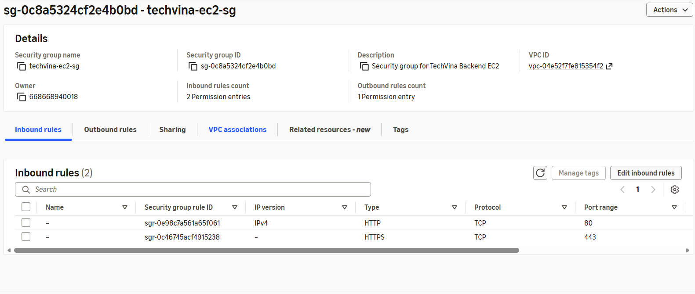
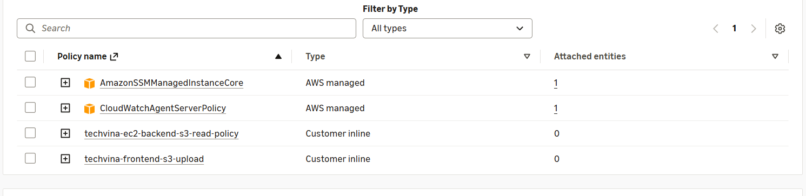

## Step 1 – Tạo Security Groups

Trong **AWS Console**, chọn Region **Asia Pacific (Singapore) – `ap-southeast-1`**, sau đó mở **VPC → Security groups → Create security group**. Tạo lần lượt hai Security Group dưới đây.

### Step 1.1 – Tạo Security Group cho EC2 Backend

1. Tại phần **Basic details**, nhập đúng các giá trị:

   | Trường trên màn hình | Giá trị |
   |---|---|
   | **Security group name** | `techvina-ec2-sg` |
   | **Description** | `Security group for TechVina Backend EC2` |
   | **VPC** | Chọn `techvina-vpc` (`10.20.0.0/16`), **không chọn Default VPC** |

   `techvina-vpc` là **tên VPC**, không phải tên Security Group. Tên Security Group không thể đổi sau khi tạo.

2. Ở **Inbound rules**, tạo **hai** quy tắc cho Nginx HTTPS và Let's Encrypt:

   | Type | Port | Source | Description |
   |---|---|---|---|
   | `HTTP` | `80` | `0.0.0.0/0` | `LetsEncrypt-HTTP` |
   | `HTTPS` | `443` | AWS-managed prefix list `com.amazonaws.global.cloudfront.origin-facing` | `Allow-CloudFront-HTTPS` |

   Chọn **Source type = Custom**, tìm `cloudfront.origin-facing` và chọn đúng prefix list AWS (ví dụ `pl-31a34658` ở Region Singapore). Không nhập prefix list ID của Region khác. **Không mở TCP 8080 ra Internet:** Nginx sẽ chuyển request HTTPS trên 443 tới Spring Boot lắng nghe nội bộ ở `127.0.0.1:8080`.

   Cổng `80` cho phép xác thực/gia hạn chứng chỉ Let's Encrypt qua HTTP-01 và chuyển HTTP sang HTTPS. Chỉ cổng `443` nhận lưu lượng HTTPS từ CloudFront. Mục **5.7.1** sẽ cấu hình Nginx, DuckDNS và chứng chỉ sau khi EC2 được tạo.

   Trường **Description** chỉ sử dụng ký tự mà AWS Security Group cho phép; các giá trị `LetsEncrypt-HTTP` và `Allow-CloudFront-HTTPS` đều hợp lệ.

3. Ở **Outbound rules**, giữ nguyên quy tắc AWS tạo sẵn:

   | Type | Destination |
   |---|---|
   | `All traffic` | `0.0.0.0/0` |

4. Nhấn **Create security group**. Trong trang chi tiết, xác nhận **Security group name** là `techvina-ec2-sg`, VPC là `techvina-vpc`, Inbound có **TCP 80** từ `0.0.0.0/0` và **TCP 443** từ CloudFront prefix list. Không thêm Inbound SSH `22`; những bước truy cập EC2 trong Workshop sử dụng **AWS Systems Manager Session Manager**.

### Step 1.2 – Tạo Security Group cho Amazon RDS MySQL

1. Quay lại **VPC → Security groups → Create security group**. Tại **Basic details**, nhập:

   | Trường | Giá trị |
   |---|---|
   | **Security group name** | `techvina-rds-sg` |
   | **Description** | `Security group for TechVina RDS MySQL` |
   | **VPC** | `techvina-vpc` |

2. Ở **Inbound rules**, nhấn **Add rule** và cấu hình:

   | Trường | Giá trị |
   |---|---|
   | **Type** | `MYSQL/Aurora` (AWS tự đặt Port `3306`), hoặc `Custom TCP` với Port `3306` |
   | **Source type** | `Custom` |
   | **Source** | Tìm `techvina-ec2-sg` và chọn đúng **Security Group ID `sg-...`** thuộc `techvina-vpc` |
   | **Description – optional** | `MySQL access from TechVina EC2` |

   **Không chọn `Anywhere-IPv4` hoặc `0.0.0.0/0`** cho MySQL. Nguồn của quy tắc phải là Security Group của EC2, không phải địa chỉ IP của máy tính cá nhân.

3. Ở **Outbound rules**, giữ cấu hình mặc định `All traffic → 0.0.0.0/0`. Nhấn **Create security group**.

### Step 1.3 – Kiểm tra Security Groups

Trong **VPC → Security groups**, xác nhận có hai Security Group thuộc `techvina-vpc`:

| Security Group | Inbound rule | Outbound rule |
|---|---|---|
| `techvina-ec2-sg` | TCP `80` từ `0.0.0.0/0`; TCP `443` từ CloudFront origin-facing prefix list | `All traffic` |
| `techvina-rds-sg` | TCP `3306` từ `techvina-ec2-sg` | `All traffic` |



## Step 2 – Tạo IAM Role cho EC2

### Step 2.1 – Tạo Role và gán quyền SSM, CloudWatch

1. Mở **IAM → Roles → Create role**. Chọn **AWS service** tại **Trusted entity type**, chọn **EC2** tại **Service or use case** và **Use case**, sau đó nhấn **Next**.
2. Trong **Add permissions**, tìm và tích chọn cả **`AmazonSSMManagedInstanceCore`** và **`CloudWatchAgentServerPolicy`**. Nhấn **Next**.
3. Tại **Role name**, nhập **`techvina-ec2-ssm-role`**. Kiểm tra lại hai policy đã chọn rồi nhấn **Create role**.

| Policy | Chức năng |
|---|---|
| `AmazonSSMManagedInstanceCore` | Kết nối EC2 với AWS Systems Manager, Session Manager và nhận lệnh SSM |
| `CloudWatchAgentServerPolicy` | Cho CloudWatch Agent gửi log và metric của EC2 lên CloudWatch |

### Step 2.2 – Thêm quyền đọc Backend Artifacts từ S3

1. Tại **IAM → Roles**, mở **`techvina-ec2-ssm-role`**.
2. Trong tab **Permissions**, chọn **Add permissions → Create inline policy** rồi chọn trình soạn thảo **JSON**.
3. Dán policy sau; thay **`<AWS_ACCOUNT_ID>`** bằng Account ID của tài khoản AWS đang thực hành (có thể xem trong góc trên bên phải AWS Console hoặc chạy `aws sts get-caller-identity --query Account --output text` trên CloudShell):

```json
{
  "Version": "2012-10-17",
  "Statement": [
    {
      "Sid": "ReadTechVinaBackendReleases",
      "Effect": "Allow",
      "Action": "s3:GetObject",
      "Resource": "arn:aws:s3:::techvina-backend-artifacts-<AWS_ACCOUNT_ID>/releases/*"
    }
  ]
}
```

4. Nhấn **Next**, nhập tên policy **`techvina-ec2-backend-s3-read-policy`** và chọn **Create policy**.

ARN này tham chiếu đến bucket **`techvina-backend-artifacts-<AWS_ACCOUNT_ID>`** được tạo ở **5.6.1**. IAM policy có thể cấu hình trước khi bucket tồn tại. Tên bucket tại 5.6.1 phải khớp chính xác với ARN trong policy; nếu đổi tên bucket do bị trùng, cập nhật ARN của policy cho phù hợp. Quyền `s3:GetObject` chỉ áp dụng cho các object trong `releases/`.

### Step 2.3 – Cấp quyền upload Frontend thủ công từ EC2

Tại **IAM → Roles → `techvina-ec2-ssm-role` → Permissions → Add permissions → Create inline policy → JSON**, thêm quyền `s3:ListBucket` và `s3:PutObject` cho bucket Frontend. Đây là quyền cần dùng ở **5.7.3** để build trên EC2 và đồng bộ `dist/` lên S3.

```json
{
  "Version": "2012-10-17",
  "Statement": [
    {
      "Sid": "ListFrontendBucket",
      "Effect": "Allow",
      "Action": "s3:ListBucket",
      "Resource": "arn:aws:s3:::techvina-frontend-<AWS_ACCOUNT_ID>"
    },
    {
      "Sid": "UploadFrontendObjects",
      "Effect": "Allow",
      "Action": "s3:PutObject",
      "Resource": "arn:aws:s3:::techvina-frontend-<AWS_ACCOUNT_ID>/*"
    }
  ]
}
```

Thay `<AWS_ACCOUNT_ID>` theo tài khoản của bạn, đặt tên policy **`techvina-frontend-s3-upload`** và chọn **Create policy**. Policy này không cấp quyền `s3:DeleteObject`, vì lần upload thủ công ở 5.7.3 không sử dụng `--delete`.

### Step 2.4 – Kiểm tra IAM Role

Mở **IAM → Roles → `techvina-ec2-ssm-role` → Permissions** và xác nhận:

| Loại policy | Tên |
|---|---|
| AWS managed | `AmazonSSMManagedInstanceCore` |
| AWS managed | `CloudWatchAgentServerPolicy` |
| Inline | `techvina-ec2-backend-s3-read-policy` |
| Inline | `techvina-frontend-s3-upload` |



## Step 3 – Kiểm tra

Xác nhận hai Security Groups thuộc đúng VPC; EC2 SG không mở cổng 3306, RDS SG không mở `0.0.0.0/0`. Kiểm tra role `techvina-ec2-ssm-role` có đầy đủ hai managed policy và hai inline policies như Step 2.4.