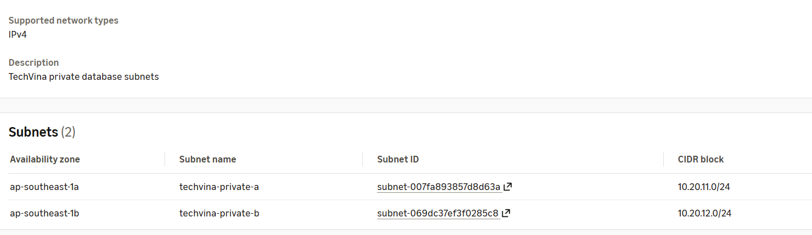
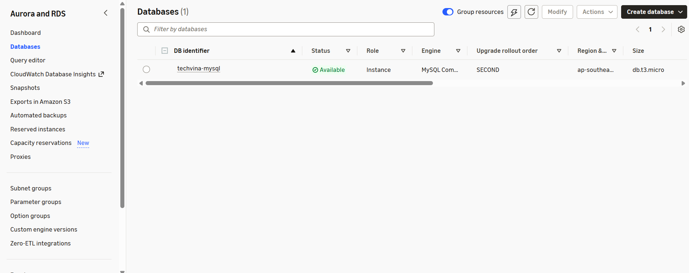

## Step 1 – Create a DB Subnet Group

### Step 1.1 – Open the DB Subnet Group creation page

1. In the **AWS Management Console**, select **Asia Pacific (Singapore) – `ap-southeast-1`**.
2. Open the **RDS** service.
3. In the left navigation menu, choose **Subnet groups**.
4. Select **Create DB subnet group**.

### Step 1.2 – Enter the Subnet Group details

Under **Subnet group details**, complete the following fields:

| AWS Console field | Value |
|---|---|
| **Name** | `techvina-db-subnet-group` |
| **Description** | `TechVina private database subnets` |
| **VPC** | `techvina-vpc` |

Once the VPC is selected, the Availability Zones and Subnets controls below show resources belonging to `techvina-vpc`.

### Step 1.3 – Select two Availability Zones

Under **Add subnets**:

1. Open the **Availability Zones** dropdown (*Choose an availability zone*).
2. Select **`ap-southeast-1a`**.
3. Open the dropdown again and select **`ap-southeast-1b`**.
4. Confirm that both `ap-southeast-1a` and `ap-southeast-1b` appear as selected tags.

### Step 1.4 – Select the two private subnets

1. Open the **Subnets** dropdown (*Select subnets*).
2. Select **`techvina-private-a`** – CIDR `10.20.11.0/24`.
3. Open **Subnets** again and select **`techvina-private-b`** – CIDR `10.20.12.0/24`.
4. Verify the **Subnets selected (2)** table at the bottom of the page:

| Availability Zone | Subnet name | CIDR block |
|---|---|---|
| `ap-southeast-1a` | `techvina-private-a` | `10.20.11.0/24` |
| `ap-southeast-1b` | `techvina-private-b` | `10.20.12.0/24` |

Do not select `techvina-public-a`; the database will be deployed in private subnets.

The Console notice *“For Multi-AZ DB clusters, you must select 3 subnets in 3 different Availability Zones”* applies to **Multi-AZ DB Clusters**. Step 2 creates a **Single DB Instance**, for which two subnets in two different Availability Zones are appropriate.

### Step 1.5 – Create and verify the DB Subnet Group

1. Click **Create** in the bottom-right corner.
2. In **RDS → Subnet groups**, open `techvina-db-subnet-group`.
3. Confirm it belongs to `techvina-vpc` and includes `techvina-private-a` and `techvina-private-b`.


## Step 2 – Create an Amazon RDS MySQL database

### Step 2.1 – Open the Create database page

1. In the **AWS Console**, navigate to **Aurora and RDS → Databases**.
2. Select **Create database** → **Full configuration**.
3. Under **Engine options → Engine type**, choose **MySQL** (not Aurora).
4. Under **Choose a database creation method**, choose **Full configuration**.

### Step 2.2 – Choose the template and MySQL version

1. Under **Templates**, select **Dev/Test**.
2. Under **Availability and durability → Deployment options**, choose **Single-AZ DB instance deployment (1 instance)**.
3. Under **Settings → Edition**, keep **MySQL Community**.
4. Under **Engine version**, select **MySQL 8.4.11** from the version list shown in the Console.
5. Leave **Enable RDS Extended Support** unchecked.

### Step 2.3 – Set the DB identifier and master credentials

Under **Settings → DB instance identifier**, change `database-1` to `techvina-mysql`.

Under **Credentials Settings**, configure:

| AWS Console field | Value |
|---|---|
| **Master username** | `admin` |
| **Credentials management** | **Self managed** |
| **Auto generate password** | Unchecked |
| **Master password** | A strong password you create |
| **Confirm master password** | Re-enter the same password |

Expand **Additional credentials settings → Database authentication options** and keep **Password authentication**. Store the master password privately for use when importing MySQL data.

### Step 2.4 – Choose a DB instance class

Under **Instance configuration → DB instance class**:

1. Select **Burstable classes (includes t classes)**.
2. Open **Instance type** and select **`db.t3.micro`**.

### Step 2.5 – Configure storage

Under **Storage**, set:

| AWS Console field | Value |
|---|---|
| **Storage type** | **General Purpose SSD (gp3)** |
| **Allocated storage** | **20 GiB** |
| **Provisioned IOPS** | Keep the Console default if automatically populated |
| **Storage throughput** | Keep the Console default if automatically populated |

If **Additional storage configuration** is shown, expand it and disable **Enable storage autoscaling** to keep storage capacity fixed during the lab.

### Step 2.6 – Configure Connectivity

Under **Connectivity**, configure the fields in order:

| AWS Console field | Value |
|---|---|
| **Compute resource** | **Don't connect to an EC2 compute resource** |
| **Network type** | **IPv4** |
| **Virtual private cloud (VPC)** | `techvina-vpc` |
| **DB subnet group** | `techvina-db-subnet-group` |
| **Public access** | **No** |
| **VPC security group (firewall)** | **Choose existing** |
| **Existing VPC security groups** | `techvina-rds-sg` only |
| **Availability Zone** | **No preference** |
| **Create an RDS Proxy** | Unchecked |
| **Certificate authority** | Keep the displayed default `rds-ca-rsa2048-g1`, if shown |

Change **Virtual private cloud (VPC)** from **Default VPC** to `techvina-vpc` *before* selecting the **DB subnet group**. Under **Existing VPC security groups**, remove the `default` selection and add `techvina-rds-sg`.

### Step 2.7 – Configure Monitoring

Under **Monitoring**:

1. Select **Database Insights – Standard**.
2. If **Collect detailed database and per-query metrics** is checked, leave **Retention period = 7 days**. You may uncheck it if detailed query metrics are not needed.
3. Expand **Additional monitoring settings**.
4. Uncheck **Enable Enhanced monitoring**.
5. Under **Log exports**, leave all log types unchecked during initial creation.

Standard CloudWatch metrics such as `CPUUtilization`, `FreeStorageSpace`, and `DatabaseConnections` remain available after database creation.

### Step 2.8 – Configure Additional configuration

Expand **Additional configuration** and set or verify:

| AWS Console field | Value |
|---|---|
| **Initial database name** | `phone_store` |
| **DB parameter group** | `default.mysql8.4` |
| **Option group** | `default:mysql-8-4` |
| **Enable encryption** | Enabled |
| **AWS KMS key** | `(default) aws/rds` |
| **Enable automated backup** | Enabled |
| **Backup retention period** | `7 days` |
| **Backup window** | `No preference` |
| **Enable replication in another AWS Region** | Unchecked |
| **Enable auto minor version upgrade** | Enabled |
| **Maintenance window** | `No preference` |
| **Enable deletion protection** | Unchecked |

Keep **Capacity reservations** set to **No capacity reservations**. Tags are optional.

### Step 2.9 – Review and create the database

1. Scroll to **Estimated monthly costs** and review the estimate for the selected settings.
2. Verify: **`db.t3.micro`**, **20 GiB**, **Single-AZ**, **VPC `techvina-vpc`**, **Subnet group `techvina-db-subnet-group`**, **Public access = No**, **Security Group `techvina-rds-sg`**.
3. Select **Create database**.
4. In **Aurora and RDS → Databases**, open `techvina-mysql` and check **Status = Available**.



## Step 3 – Record the connection details

Open the DB instance **Connectivity & security** tab. Record the endpoint (for example `techvina-mysql.xxxxx.ap-southeast-1.rds.amazonaws.com`) and **Port 3306**.

```text
RDS_ENDPOINT=<YOUR_RDS_ENDPOINT>
DB_URL=jdbc:mysql://<YOUR_RDS_ENDPOINT>:3306/phone_store
DB_USERNAME=<APP_DB_USERNAME>
DB_PASSWORD=<APP_DB_PASSWORD>
```

**Expected result:** RDS MySQL stays private and accepts port 3306 only from the EC2 Security Group.