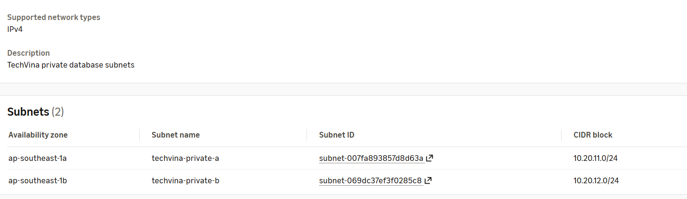
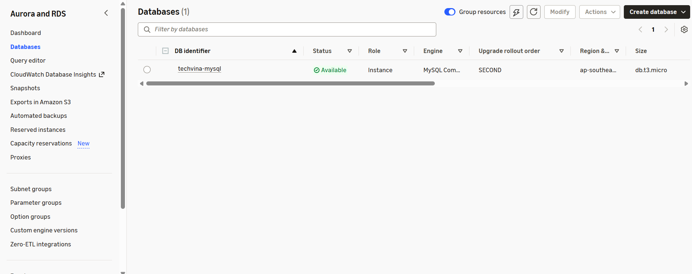

## Step 1 – Tạo DB Subnet Group

### Step 1.1 – Mở màn hình tạo DB Subnet Group

1. Trong **AWS Management Console**, chọn Region **Asia Pacific (Singapore) – `ap-southeast-1`**.
2. Tìm dịch vụ **RDS**.
3. Ở menu bên trái, chọn **Subnet groups**.
4. Nhấn **Create DB subnet group**.

### Step 1.2 – Nhập thông tin Subnet Group

Trong phần **Subnet group details**, điền các trường sau:

| Trường trên AWS Console | Giá trị |
|---|---|
| **Name** | `techvina-db-subnet-group` |
| **Description** | `TechVina private database subnets` |
| **VPC** | `techvina-vpc` |

Sau khi chọn VPC, danh sách Availability Zones và Subnets bên dưới sẽ hiển thị các tài nguyên thuộc `techvina-vpc`.

### Step 1.3 – Chọn hai Availability Zones

Trong phần **Add subnets**:

1. Nhấn ô **Availability Zones** (có dòng *Choose an availability zone*).
2. Chọn **`ap-southeast-1a`**.
3. Mở ô này lần nữa và chọn **`ap-southeast-1b`**.
4. Xác nhận bên dưới ô lựa chọn xuất hiện hai thẻ `ap-southeast-1a` và `ap-southeast-1b`.

### Step 1.4 – Chọn hai Private Subnet

1. Nhấn ô **Subnets** (có dòng *Select subnets*).
2. Chọn **`techvina-private-a`** – CIDR `10.20.11.0/24`.
3. Mở lại ô **Subnets** và chọn **`techvina-private-b`** – CIDR `10.20.12.0/24`.
4. Kiểm tra bảng **Subnets selected (2)** ở cuối trang:

| Availability Zone | Subnet name | CIDR block |
|---|---|---|
| `ap-southeast-1a` | `techvina-private-a` | `10.20.11.0/24` |
| `ap-southeast-1b` | `techvina-private-b` | `10.20.12.0/24` |

Không chọn `techvina-public-a` vì cơ sở dữ liệu sẽ được triển khai trong các Private Subnet.

Thông báo *“For Multi-AZ DB clusters, you must select 3 subnets in 3 different Availability Zones”* trên giao diện dành cho **Multi-AZ DB Cluster**. Ở Step 2, chúng ta tạo **Single DB Instance**, vì vậy hai Subnet thuộc hai Availability Zone khác nhau là phù hợp.

### Step 1.5 – Tạo và kiểm tra DB Subnet Group

1. Nhấn **Create** ở góc dưới bên phải.
2. Trong danh sách **RDS → Subnet groups**, chọn `techvina-db-subnet-group`.
3. Kiểm tra nhóm thuộc `techvina-vpc` và có hai Subnet `techvina-private-a`, `techvina-private-b`.


## Step 2 – Tạo Amazon RDS MySQL

### Step 2.1 – Mở trang Create database

1. Trong **AWS Console**, mở **Aurora and RDS → Databases**.
2. Nhấn **Create database** → **Full configuration**.
3. Tại **Engine options → Engine type**, chọn **MySQL** (không chọn Aurora).
4. Tại **Choose a database creation method**, chọn **Full configuration**.

### Step 2.2 – Chọn mẫu triển khai và phiên bản MySQL

1. Trong **Templates**, chọn **Dev/Test**.
2. Trong **Availability and durability → Deployment options**, chọn **Single-AZ DB instance deployment (1 instance)**.
3. Trong **Settings → Edition**, giữ **MySQL Community**.
4. Trong **Engine version**, chọn **MySQL 8.4.11** theo danh sách hiện trên Console.
5. Không chọn **Enable RDS Extended Support**.

### Step 2.3 – Đặt tên database và cấu hình tài khoản quản trị

Trong **Settings → DB instance identifier**, thay `database-1` thành `techvina-mysql`.

Tại **Credentials Settings**, nhập:

| Trường | Giá trị |
|---|---|
| **Master username** | `admin` |
| **Credentials management** | **Self managed** |
| **Auto generate password** | Không chọn |
| **Master password** | Mật khẩu mạnh do bạn tạo |
| **Confirm master password** | Nhập lại cùng mật khẩu |

Mở **Additional credentials settings → Database authentication options**, giữ **Password authentication**. Lưu mật khẩu quản trị tại nơi riêng tư để dùng khi nhập dữ liệu MySQL.

### Step 2.4 – Chọn loại DB instance

Trong **Instance configuration → DB instance class**:

1. Chọn **Burstable classes (includes t classes)**.
2. Mở **Instance type**, chọn **`db.t3.micro`**.

### Step 2.5 – Cấu hình dung lượng lưu trữ

Trong **Storage**, nhập:

| Trường | Giá trị |
|---|---|
| **Storage type** | **General Purpose SSD (gp3)** |
| **Allocated storage** | **20 GiB** |
| **Provisioned IOPS** | Giữ giá trị mặc định nếu Console tự đặt |
| **Storage throughput** | Giữ giá trị mặc định nếu Console tự đặt |

Nếu có **Additional storage configuration**, mở phần này và bỏ chọn **Enable storage autoscaling** để dung lượng lưu trữ không tự tăng trong quá trình thực hành.

### Step 2.6 – Cấu hình mạng trong phần Connectivity

Trong **Connectivity**, cấu hình theo thứ tự:

| Trường | Giá trị |
|---|---|
| **Compute resource** | **Don't connect to an EC2 compute resource** |
| **Network type** | **IPv4** |
| **Virtual private cloud (VPC)** | `techvina-vpc` |
| **DB subnet group** | `techvina-db-subnet-group` |
| **Public access** | **No** |
| **VPC security group (firewall)** | **Choose existing** |
| **Existing VPC security groups** | Chỉ chọn `techvina-rds-sg` |
| **Availability Zone** | **No preference** |
| **Create an RDS Proxy** | Không chọn |
| **Certificate authority** | Giữ mặc định `rds-ca-rsa2048-g1` nếu đang hiển thị |

Khi chọn **Virtual private cloud (VPC)**, thay **Default VPC** bằng `techvina-vpc` trước, sau đó chọn **DB subnet group**. Tại **Existing VPC security groups**, xóa thẻ `default` và chọn `techvina-rds-sg`.

### Step 2.7 – Cấu hình Monitoring

Trong **Monitoring**:

1. Chọn **Database Insights – Standard**.
2. Nếu bật **Collect detailed database and per-query metrics**, giữ **Retention period = 7 days**. Có thể bỏ chọn mục này nếu không cần số liệu truy vấn chi tiết.
3. Mở **Additional monitoring settings**.
4. Bỏ chọn **Enable Enhanced monitoring**.
5. Trong **Log exports**, không chọn loại log nào ở bước tạo database.

Các chỉ số CloudWatch thông thường như `CPUUtilization`, `FreeStorageSpace` và `DatabaseConnections` vẫn có thể được theo dõi sau khi database được tạo.

### Step 2.8 – Cấu hình Additional configuration

Mở **Additional configuration**, sau đó nhập hoặc kiểm tra các mục:

| Trường | Giá trị |
|---|---|
| **Initial database name** | `phone_store` |
| **DB parameter group** | `default.mysql8.4` |
| **Option group** | `default:mysql-8-4` |
| **Enable encryption** | Bật |
| **AWS KMS key** | `(default) aws/rds` |
| **Enable automated backup** | Bật |
| **Backup retention period** | `7 days` |
| **Backup window** | `No preference` |
| **Enable replication in another AWS Region** | Không chọn |
| **Enable auto minor version upgrade** | Bật |
| **Maintenance window** | `No preference` |
| **Enable deletion protection** | Không chọn |

Giữ **Capacity reservations** ở **No capacity reservations**. Không cần thêm tag nếu chưa sử dụng.

### Step 2.9 – Kiểm tra và tạo database

1. Cuộn đến **Estimated monthly costs** để kiểm tra chi phí ước tính theo các lựa chọn vừa nhập.
2. Kiểm tra lần cuối: **`db.t3.micro`**, **20 GiB**, **Single-AZ**, **VPC `techvina-vpc`**, **Subnet group `techvina-db-subnet-group`**, **Public access = No**, **Security Group `techvina-rds-sg`**.
3. Nhấn **Create database**.
4. Trong **Aurora and RDS → Databases**, mở `techvina-mysql` và kiểm tra **Status = Available**.



## Step 3 – Ghi thông tin kết nối

Trong RDS → Databases → `techvina-mysql` → **Connectivity & security**, ghi **Endpoint** dạng `techvina-mysql.xxxxx.ap-southeast-1.rds.amazonaws.com` và **Port 3306**.

Lưu lại biến:

```text
RDS_ENDPOINT=<YOUR_RDS_ENDPOINT>
DB_URL=jdbc:mysql://<YOUR_RDS_ENDPOINT>:3306/phone_store
DB_USERNAME=<APP_DB_USERNAME>
DB_PASSWORD=<APP_DB_PASSWORD>
```

**Kết quả:** RDS MySQL ở private subnets, không có địa chỉ truy cập công khai, chỉ EC2 SG được phép kết nối cổng 3306.