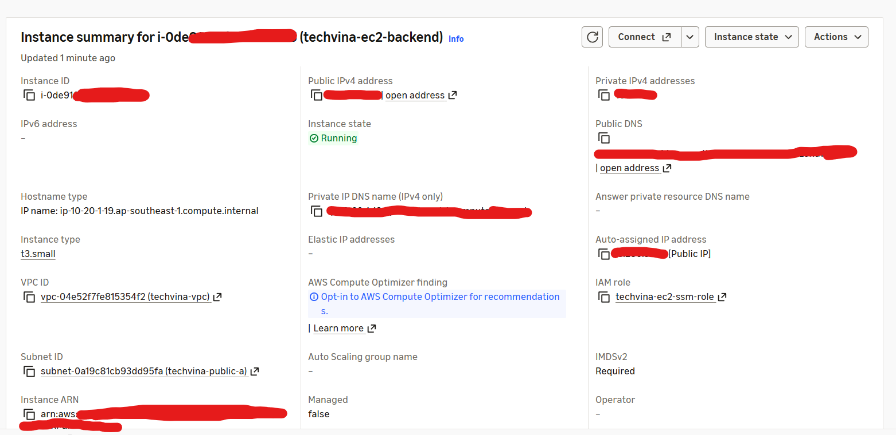

## Step 1 – Launch the Backend EC2 instance

### Step 1.1 – Open the EC2 launch page

1. Sign in to the **AWS Management Console** and choose **Asia Pacific (Singapore) – `ap-southeast-1`**.
2. Open **EC2 → Instances** and select **Launch instances**.
3. Under **Name and tags → Name**, enter `techvina-ec2-backend`.
4. In the **Summary** panel on the right, leave **Number of instances = 1**.

### Step 1.2 – Select the operating system (AMI)

1. In **Application and OS Images (Amazon Machine Image)**, choose **Ubuntu** under **Quick Start**.
2. In **Amazon Machine Image (AMI)**, select **Ubuntu Server 24.04 LTS** published by Canonical.
3. Verify **Architecture = 64-bit (x86)** (`x86_64`), not ARM (`arm64`).

### Step 1.3 – Select the instance type

1. Open **Instance type**, then search for `t3.small`.
2. Select **`t3.small`**.
3. Verify that the instance offers **2 vCPUs and 2 GiB RAM**.

### Step 1.4 – Configure the key pair

1. Under **Key pair (login)**, open **Key pair name**.
2. Choose **Proceed without a key pair (Not recommended)**. This workshop uses **AWS Systems Manager Session Manager** instead of SSH to access the instance.

### Step 1.5 – Configure network settings

1. Under **Network settings**, click **Edit** to expand the fields.
2. Set the following values:

   | AWS Console field | Value |
   |---|---|
   | VPC | `techvina-vpc` |
   | Subnet | `techvina-public-a` |
   | Auto-assign public IP | `Enable` |
   | Firewall (security groups) | `Select existing security group` |
   | Common security groups / Security groups | `techvina-ec2-sg` |

3. If **Create security group** is selected, switch to **Select existing security group**; do not create a new `launch-wizard-*` group.
4. Verify that `techvina-ec2-sg`, created in section 5.3.2, permits **TCP 443** from the CloudFront origin-facing prefix list and **TCP 80** for HTTPS certificate issuance/renewal.
5. Do not add an inbound **SSH (22) from Anywhere (`0.0.0.0/0`)** rule.

### Step 1.6 – Configure storage

1. Under **Configure storage**, keep **one root volume**.
2. Change the default `8 GiB` to **`20 GiB`**.
3. Choose **Volume type = gp3**.
4. Do not add a second EBS volume or an S3/EFS/FSx file system.

### Step 1.7 – Configure advanced details

1. Expand **Advanced details**.
2. Under **IAM instance profile**, select **`techvina-ec2-ssm-role`** created in section 5.3.2.
3. Leave unrelated fields at their defaults and verify these settings:

   | Field | Value |
   |---|---|
   | Shutdown behavior | `Stop` |
   | Detailed CloudWatch monitoring | `Disable` |
   | Credit specification | `Standard` |
   | Purchasing option | `None` (On-Demand) |
   | Metadata accessible | `Enabled` |
   | Metadata version | `V2 only (token required)` |
   | User data | Leave blank |

### Step 1.8 – Review and launch

1. In **Summary**, verify **1 instance**, **Ubuntu Server 24.04 LTS**, **`t3.small`**, **`techvina-ec2-sg`**, and **20 GiB gp3**.
2. Recheck **VPC `techvina-vpc`**, **Subnet `techvina-public-a`**, **Auto-assign public IP = Enable**, and **IAM instance profile `techvina-ec2-ssm-role`**.
3. Click **Launch instance**.
4. Open **EC2 → Instances** and select `techvina-ec2-backend`. Wait for **Instance state = Running** and **Status check = 2/2 checks passed**.
5. Record the **Instance ID**, **Public IPv4 address** and **Public IPv4 DNS** from the instance details; they will be used in later deployment steps.



## Step 2 – Connect to EC2 and install tools

### Step 2.1 – Connect using AWS Systems Manager

1. Go to **EC2 → Instances** and select `techvina-ec2-backend`.
2. Click **Connect**. Under **Choose how to connect**, select **SSM Session Manager**, then click **Connect**.
3. A browser-based terminal opens without an SSH key or inbound port 22.

Check the current user:

```bash
whoami
```

```text
ssm-user
```

Check the operating system:

```bash
cat /etc/os-release
```

```text
PRETTY_NAME="Ubuntu 24.04.5 LTS"
NAME="Ubuntu"
VERSION_ID="24.04"
VERSION="24.04.5 LTS (Noble Numbat)"
VERSION_CODENAME=noble
ID=ubuntu
ID_LIKE=debian
HOME_URL="https://www.ubuntu.com/"
SUPPORT_URL="https://help.ubuntu.com/"
BUG_REPORT_URL="https://bugs.launchpad.net/ubuntu/"
PRIVACY_POLICY_URL="https://www.ubuntu.com/legal/terms-and-policies/privacy-policy"
UBUNTU_CODENAME=noble
LOGO=ubuntu-logo
```

Verify administrator privileges:

```bash
sudo whoami
```

```text
root
```

### Step 2.2 – Refresh Ubuntu package indexes

```bash
sudo apt update
```

The final output was:

```text
Fetched 38.2 MB in 6s (5902 kB/s)
Reading package lists... Done
Building dependency tree... Done
Reading state information... Done
40 packages can be upgraded. Run 'apt list --upgradable' to see them.
```

The package indexes were refreshed. The notice about 40 upgradable packages is not an error.

### Step 2.3 – Install and verify Java 21

```bash
sudo apt install -y openjdk-21-jdk-headless
```

The installation completed with these messages:

```text
Running kernel seems to be up-to-date.
No services need to be restarted.
No containers need to be restarted.
```

Verify Java:

```bash
java -version
```

```text
openjdk version "21.0.13.0.3" 2026-10-24
OpenJDK Runtime Environment (build 21.0.13.0.3+1-1-24.04.1-Ubuntu)
OpenJDK 64-Bit Server VM (build 21.0.13.0.3+1-1-24.04.1-Ubuntu, mixed mode, sharing)
```

### Step 2.4 – Check Git

```bash
git --version
```

```text
git version 2.43.0
```

Git was preinstalled in the Ubuntu AMI used in this deployment.

### Step 2.5 – Install MySQL Client

Check whether the MySQL client is available:

```bash
mysql --version
```

```text
sh: 8: mysql: not found
```

Install the client without installing a MySQL server on EC2:

```bash
sudo apt install -y mysql-client
```

The last installation messages included:

```text
Setting up mysql-client-core-8.0 (8.0.46-0ubuntu0.24.04.5) ...
Setting up mysql-client-8.0 (8.0.46-0ubuntu0.24.04.5) ...
Setting up mysql-client (8.0.46-0ubuntu0.24.04.5) ...
Processing triggers for man-db (2.12.0-4build2) ...
```

Verify the version:

```bash
mysql --version
```

```text
mysql  Ver 8.0.46-0ubuntu0.24.04.5 for Linux on x86_64 ((Ubuntu))
```

### Step 2.6 – Install AWS CLI v2

Check AWS CLI:

```bash
aws --version
```

```text
sh: 11: aws: not found
```

Verify Snap is available:

```bash
snap version
```

```text
snap          2.77.1+ubuntu24.04
snapd         2.77.1+ubuntu24.04
series        16
ubuntu        24.04
kernel        7.0.0-1014-aws
architecture  amd64
```

Install AWS CLI v2:

```bash
sudo snap install aws-cli --classic
```

```text
aws-cli (v2/stable) 2.35.21 from Amazon Web Services (aws✓) installed
```

Verify the installation:

```bash
aws --version
```

```text
aws-cli/2.35.21 Python/3.14.6 Linux/7.0.0-1014-aws exe/x86_64.ubuntu.24
```

### Step 2.7 – Verify the EC2 IAM Role

```bash
aws sts get-caller-identity
```

The output confirms that AWS CLI receives temporary credentials through the `techvina-ec2-ssm-role` instance profile:

```json
{
    "UserId": "<ROLE_SESSION_ID>:<INSTANCE_ID>",
    "Account": "<AWS_ACCOUNT_ID>",
    "Arn": "arn:aws:sts::<AWS_ACCOUNT_ID>:assumed-role/techvina-ec2-ssm-role/<INSTANCE_ID>"
}
```

No `aws configure` command or long-lived Access Keys are required on EC2.

### Step 2.8 – Check disk capacity

```bash
df -h /
```

```text
/dev/root        19G  2.7G   16G  15% /
```

The root filesystem provides approximately 19 GiB of usable space on the configured 20 GiB gp3 EBS volume.

## Step 3 – Connect to Amazon RDS and import data

### Step 3.1 – Obtain the RDS Endpoint

1. Open **Amazon RDS → Databases → techvina-mysql**.
2. Select **Connectivity & security** and locate **Endpoint & port**.
3. Verify **Port = `3306`**, **Publicly accessible = No**, **VPC = `techvina-vpc`**, and **Security group = `techvina-rds-sg`**.

In the EC2 terminal, set `RDS_ENDPOINT` to the endpoint assigned to the RDS instance in the current AWS account:

```bash
export RDS_ENDPOINT='YOUR_RDS_ENDPOINT'
```

### Step 3.2 – Connect using MySQL Client

```bash
mysql -h "$RDS_ENDPOINT" -P 3306 -u admin -p --ssl-mode=REQUIRED --connect-timeout=10
```

Enter the RDS password at the `Enter password:` prompt. A successful connection opens MySQL Monitor with a `mysql>` prompt. The verified database engine was **MySQL 8.4.11**.

List the databases:

```sql
SHOW DATABASES;
```

```text
+--------------------+
| Database           |
+--------------------+
| information_schema |
| mysql              |
| performance_schema |
| phone_store        |
| sys                |
+--------------------+
5 rows in set (0.02 sec)
```

Check the tables before importing:

```sql
SHOW TABLES FROM phone_store;
```

```text
Empty set (0.01 sec)
```

Exit MySQL Monitor:

```sql
exit;
```

```text
Bye
```

### Step 3.3 – Prepare the repository on EC2

Switch from `ssm-user` to `ubuntu`:

```bash
sudo -iu ubuntu
```

Terminal prompt:

```text
ubuntu@ip-10-20-1-19:~$
```

Set the endpoint again in the `ubuntu` login shell (the `ssm-user` variable is not carried over):

```bash
export RDS_ENDPOINT='YOUR_RDS_ENDPOINT'
```

Create the project directory:

```bash
mkdir -p ~/projects
```

Enter the directory:

```bash
cd ~/projects
```

Clone the TechVina GitHub repository (use your own fork if its owner differs):

```bash
git clone https://github.com/TaiHoang69/TechVina.git
```

```text
Cloning into 'TechVina'...
remote: Enumerating objects: 307, done.
remote: Counting objects: 100% (307/307), done.
remote: Compressing objects: 100% (271/271), done.
remote: Total 307 (delta 21), reused 307 (delta 21), pack-reused 0 (from 0)
Receiving objects: 100% (307/307), 2.38 MiB | 34.79 MiB/s, done.
Resolving deltas: 100% (21/21), done.
```

Inspect the source directory:

```bash
ls -la ~/projects/TechVina
```

```text
total 32
drwxrwxr-x 7 ubuntu ubuntu 4096 Nov 12 14:32 .
drwxrwxr-x 3 ubuntu ubuntu 4096 Nov 12 14:32 ..
drwxrwxr-x 8 ubuntu ubuntu 4096 Nov 12 14:32 .git
drwxrwxr-x 5 ubuntu ubuntu 4096 Nov 12 14:32 .github
-rw-rw-r-- 1 ubuntu ubuntu  931 Nov 12 14:32 .gitignore
drwxrwxr-x 4 ubuntu ubuntu 4096 Nov 12 14:32 backend
drwxrwxr-x 4 ubuntu ubuntu 4096 Nov 12 14:32 database
drwxrwxr-x 4 ubuntu ubuntu 4096 Nov 12 14:32 frontend
```

### Step 3.4 – Inspect the SQL dump

Locate SQL files:

```bash
find ~/projects/TechVina/database -type f -name "*.sql"
```

```text
/home/ubuntu/projects/TechVina/database/full/phone_store.sql
```

Inspect the first 40 lines:

```bash
head -n 40 ~/projects/TechVina/database/full/phone_store.sql
```

The beginning confirms a **MySQL 8.0.44** dump of `phone_store` using `utf8mb4`:

```sql
-- MySQL dump 10.13  Distrib 8.0.44, for Win64 (x86_64)
-- Host: localhost    Database: phone_store
-- Server version       8.0.44

CREATE DATABASE /*!32312 IF NOT EXISTS*/ `phone_store` /*!40100 DEFAULT CHARACTER SET utf8mb4 COLLATE utf8mb4_unicode_ci */ /*!80016 DEFAULT ENCRYPTION='N' */;
USE `phone_store`;
-- Table structure for table `anh`
DROP TABLE IF EXISTS `anh`;
```

Look for statements that might require additional permissions on RDS:

```bash
grep -niEm 20 'DEFINER[[:space:]]*=|GTID_PURGED|SQL_LOG_BIN|CREATE[[:space:]]+USER|DROP[[:space:]]+DATABASE' ~/projects/TechVina/database/full/phone_store.sql
```

No matches were returned for this SQL file.

### Step 3.5 – Import the SQL dump into RDS

Import only after verifying that the destination database has no tables:

```bash
mysql -h "$RDS_ENDPOINT" -P 3306 -u admin -p --ssl-mode=REQUIRED --default-character-set=utf8mb4 phone_store < ~/projects/TechVina/database/full/phone_store.sql
```

Enter the password for the MySQL `admin` account when prompted. A successful import displays no confirmation message and returns to the Linux prompt.


### Step 3.6 – Verify table counts

```bash
mysql -h "$RDS_ENDPOINT" -P 3306 -u admin -p --ssl-mode=REQUIRED phone_store -e "SELECT COUNT(*) AS total_tables FROM information_schema.tables WHERE table_schema = 'phone_store';"
```

```text
+--------------+
| total_tables |
+--------------+
|           36 |
+--------------+
```

List the tables:

```bash
mysql -h "$RDS_ENDPOINT" -P 3306 -u admin -p --ssl-mode=REQUIRED phone_store -e "SHOW TABLES;"
```

```text
+---------------------------+
| Tables_in_phone_store     |
+---------------------------+
| anh                       |
| cauhinhdungluong          |
| chitietdonhang            |
| chitietgiamgia            |
| chitietgiohang            |
| chitietphieunhap          |
| chitietthongso            |
| danhmuc                   |
| diachi                    |
| donhang                   |
| giamgia                   |
| giohang                   |
| hang                      |
| khachhang                 |
| kho                       |
| lichsugia                 |
| lichsutrangthainhacungcap |
| mausac                    |
| nhacungcap                |
| nhanvien                  |
| nhomthongso               |
| phienban                  |
| phieunhap                 |
| ram                       |
| refreshtoken              |
| rom                       |
| sanpham                   |
| thanhtoan                 |
| thitruong                 |
| thongsokythuat            |
| tonkho                    |
| trangthaidonhang          |
| trangthainhacungcap       |
| trangthaiphieunhap        |
| vaitro                    |
| video                     |
+---------------------------+
```

### Step 3.7 – Verify product data

```bash
mysql -h "$RDS_ENDPOINT" -P 3306 -u admin -p --ssl-mode=REQUIRED phone_store -e "SELECT COUNT(*) AS total_products FROM sanpham;"
```

```text
+----------------+
| total_products |
+----------------+
|             24 |
+----------------+
```

## Step 4 – Build the Backend and prepare environment variables

### Step 4.1 – Inspect Backend source files

```bash
ls -la ~/projects/TechVina/backend
```

```text
total 32
drwxrwxr-x 4 ubuntu ubuntu 4096 Nov 12 14:32 .
drwxrwxr-x 7 ubuntu ubuntu 4096 Nov 12 14:32 ..
-rw-rw-r-- 1 ubuntu ubuntu 1984 Nov 12 14:32 .classpath
-rw-rw-r-- 1 ubuntu ubuntu  930 Nov 12 14:32 .env.example
-rw-rw-r-- 1 ubuntu ubuntu  684 Nov 12 14:32 .project
drwxrwxr-x 2 ubuntu ubuntu 4096 Nov 12 14:32 .settings
-rw-rw-r-- 1 ubuntu ubuntu 3314 Nov 12 14:32 pom.xml
drwxrwxr-x 3 ubuntu ubuntu 4096 Nov 12 14:32 src
```

The `pom.xml` file identifies Apache Maven as the build tool.

### Step 4.2 – Install Apache Maven

Check Maven:

```bash
mvn -version
```

```text
Command 'mvn' not found, but can be installed with:
sudo apt install maven
```

Install Maven:

```bash
sudo apt install -y maven
```

The end of the installation output included:

```text
Setting up libmaven3-core-java (3.8.7-2) ...
Setting up maven (3.8.7-2) ...
update-alternatives: using /usr/share/maven/bin/mvn to provide /usr/bin/mvn (mvn) in auto mode
```

Verify Maven and its Java Runtime:

```bash
mvn -version
```

```text
Apache Maven 3.8.7
Maven home: /usr/share/maven
Java version: 21.0.13.0.3, vendor: Ubuntu, runtime: /usr/lib/jvm/java-21-openjdk-amd64
Default locale: en, platform encoding: UTF-8
OS name: "linux", version: "7.0.0-1014-aws", arch: "amd64", family: "unix"
```

### Step 4.3 – Build the Spring Boot Backend

```bash
mvn -f ~/projects/TechVina/backend/pom.xml -DskipTests package
```

Final output:

```text
[INFO] Replacing main artifact /home/ubuntu/projects/TechVina/backend/target/backend-0.0.1-SNAPSHOT.jar with repackaged archive, adding nested dependencies in BOOT-INF/.
[INFO] The original artifact has been renamed to /home/ubuntu/projects/TechVina/backend/target/backend-0.0.1-SNAPSHOT.jar.original
[INFO] ------------------------------------------------------------------------
[INFO] BUILD SUCCESS
[INFO] ------------------------------------------------------------------------
[INFO] Total time:  34.850 s
[INFO] Finished at: 2026-11-12T14:45:25Z
[INFO] ------------------------------------------------------------------------
```

Verify the generated JAR:

```bash
ls -lh ~/projects/TechVina/backend/target/*.jar
```

```text
-rw-rw-r-- 1 ubuntu ubuntu 63M Nov 12 14:45 /home/ubuntu/projects/TechVina/backend/target/backend-0.0.1-SNAPSHOT.jar
```

### Step 4.4 – Inspect Spring Boot configuration

Read the environment template:

```bash
cat ~/projects/TechVina/backend/.env.example
```

The template defines these variables:

```dotenv
DB_URL=jdbc:mysql://localhost:3306/phone_store
DB_USERNAME=YOUR_DB_USERNAME
DB_PASSWORD=YOUR_DB_PASSWORD
JWT_SECRET=YOUR_JWT_SECRET
COGNITO_ISSUER_URI=https://cognito-idp.ap-southeast-1.amazonaws.com/ap-southeast-1_XXXXXXXXX
COGNITO_CLIENT_ID=YOUR_COGNITO_CLIENT_ID
COGNITO_DOMAIN=https://YOUR_DOMAIN.auth.ap-southeast-1.amazoncognito.com
```

Identify the application configuration file:

```bash
ls -la ~/projects/TechVina/backend/src/main/resources
```

```text
-rw-rw-r-- 1 ubuntu ubuntu 1801 Nov 12 14:32 application.properties
```

Read its content:

```bash
cat ~/projects/TechVina/backend/src/main/resources/application.properties
```

Relevant Spring Boot configuration properties:

```properties
spring.datasource.url=${DB_URL}
spring.datasource.username=${DB_USERNAME}
spring.datasource.password=${DB_PASSWORD}
spring.jpa.hibernate.ddl-auto=validate
jwt.secret=${JWT_SECRET}
spring.security.oauth2.resourceserver.jwt.issuer-uri=${COGNITO_ISSUER_URI}
cognito.client-id=${COGNITO_CLIENT_ID}
cognito.domain=${COGNITO_DOMAIN}
```

With `ddl-auto=validate`, Hibernate validates entities against the imported schema rather than creating tables.

### Step 4.5 – Create `.env` with restricted permissions

Confirm Git ignores `.env`:

```bash
git -C ~/projects/TechVina check-ignore -v backend/.env
```

```text
.gitignore:17:/backend/.env     backend/.env
```

Copy the template to `.env`, readable and writable only by `ubuntu`:

```bash
install -m 600 ~/projects/TechVina/backend/.env.example ~/projects/TechVina/backend/.env
```

Verify permissions:

```bash
ls -l ~/projects/TechVina/backend/.env
```

```text
-rw------- 1 ubuntu ubuntu 930 Nov 12 14:50 /home/ubuntu/projects/TechVina/backend/.env
```

### Step 4.6 – Configure RDS connection variables

Open the editor:

```bash
nano ~/projects/TechVina/backend/.env
```

Set these three variables using the current RDS endpoint and password:

```dotenv
DB_URL=jdbc:mysql://YOUR_RDS_ENDPOINT:3306/phone_store?sslMode=REQUIRED
DB_USERNAME=admin
DB_PASSWORD=YOUR_RDS_PASSWORD
```

Replace `YOUR_RDS_ENDPOINT` and `YOUR_RDS_PASSWORD` with the actual RDS values. Leave Cognito variables at their template values for now. In Nano, press **Ctrl+O**, **Enter**, then **Ctrl+X**.

Verify only non-secret variables:

```bash
grep -E '^(DB_URL|DB_USERNAME)=' ~/projects/TechVina/backend/.env
```

```text
DB_URL=jdbc:mysql://YOUR_RDS_ENDPOINT:3306/phone_store?sslMode=REQUIRED
DB_USERNAME=admin
```

### Step 4.7 – Generate and verify the JWT Secret

Generate 64 random bytes (128 hexadecimal characters) and update `.env` without printing the secret:

```bash
JWT_SECRET="$(openssl rand -hex 64)" && sed -i "s|^JWT_SECRET=.*|JWT_SECRET=${JWT_SECRET}|" ~/projects/TechVina/backend/.env && unset JWT_SECRET
```

Verify the format without exposing the value:

```bash
grep -Eq '^JWT_SECRET=[0-9a-f]{128}$' ~/projects/TechVina/backend/.env && echo "JWT_SECRET: OK" || echo "JWT_SECRET: INVALID"
```

```text
JWT_SECRET: OK
```

**Result:** EC2 is accessible through Session Manager; Java 21, Maven 3.8.7, Git, MySQL Client, and AWS CLI work. The `phone_store` database contains **36 tables** and **24 products**. The Backend has been packaged as a **63 MB** JAR; `.env` contains the RDS connection and JWT Secret. Cognito variables still contain their template values.
