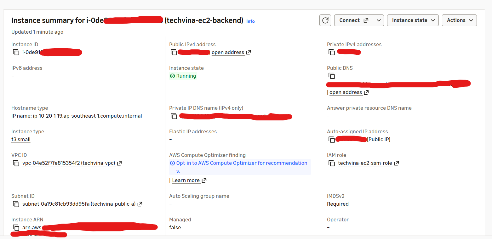

## Step 1 – Tạo EC2 Backend

### Step 1.1 – Mở trang tạo EC2

1. Đăng nhập **AWS Management Console**, chọn Region **Asia Pacific (Singapore) – `ap-southeast-1`**.
2. Mở **EC2 → Instances** và chọn **Launch instances**.
3. Trong **Name and tags → Name**, nhập `techvina-ec2-backend`.
4. Trong bảng **Summary** bên phải, giữ **Number of instances = 1**.

### Step 1.2 – Chọn hệ điều hành (AMI)

1. Tại **Application and OS Images (Amazon Machine Image)**, chọn ô **Ubuntu** trong mục **Quick Start**.
2. Trong **Amazon Machine Image (AMI)**, chọn **Ubuntu Server 24.04 LTS** do Canonical cung cấp.
3. Kiểm tra **Architecture = 64-bit (x86)** (`x86_64`), không chọn ARM (`arm64`).

### Step 1.3 – Chọn cấu hình máy chủ

1. Tại **Instance type**, mở danh sách và tìm `t3.small`.
2. Chọn chính xác **`t3.small`**.
3. Kiểm tra thông số của instance: **2 vCPU, 2 GiB RAM**.

### Step 1.4 – Cấu hình Key pair

1. Trong **Key pair (login)**, mở danh sách **Key pair name**.
2. Chọn **Proceed without a key pair (Not recommended)**. Workshop sử dụng **AWS Systems Manager Session Manager** để truy cập EC2, không mở SSH.

### Step 1.5 – Cấu hình Network settings

1. Tại **Network settings**, nhấn **Edit** để hiển thị đầy đủ các trường.
2. Nhập hoặc chọn theo bảng:

   | Trường trong AWS Console | Giá trị |
   |---|---|
   | VPC | `techvina-vpc` |
   | Subnet | `techvina-public-a` |
   | Auto-assign public IP | `Enable` |
   | Firewall (security groups) | `Select existing security group` |
   | Common security groups / Security groups | `techvina-ec2-sg` |

3. Nếu đang hiện **Create security group**, chuyển sang **Select existing security group**; không để EC2 tạo nhóm `launch-wizard-*` mới.
4. Kiểm tra đúng Security Group `techvina-ec2-sg` đã tạo ở mục 5.3.2; nhóm này cho phép **TCP 443** từ CloudFront origin-facing prefix list và **TCP 80** để cấp/gia hạn chứng chỉ HTTPS.
5. Không thêm quy tắc **SSH (22) từ Anywhere (`0.0.0.0/0`)**.

### Step 1.6 – Cấu hình ổ đĩa

1. Trong **Configure storage**, giữ **1 root volume**.
2. Đổi dung lượng mặc định `8 GiB` thành **`20 GiB`**.
3. Chọn **Volume type = gp3**.
4. Không thêm volume EBS thứ hai hoặc các file system S3/EFS/FSx.

### Step 1.7 – Cấu hình Advanced details

1. Mở **Advanced details**.
2. Tại **IAM instance profile**, chọn **`techvina-ec2-ssm-role`** đã tạo ở mục 5.3.2.
3. Giữ những trường không cần chỉnh sửa ở giá trị mặc định và kiểm tra các lựa chọn quan trọng:

   | Trường | Giá trị |
   |---|---|
   | Shutdown behavior | `Stop` |
   | Detailed CloudWatch monitoring | `Disable` |
   | Credit specification | `Standard` |
   | Purchasing option | `None` (On-Demand) |
   | Metadata accessible | `Enabled` |
   | Metadata version | `V2 only (token required)` |
   | User data | Để trống |

### Step 1.8 – Kiểm tra và khởi tạo

1. Trong **Summary**, xác nhận: **1 instance**, **Ubuntu Server 24.04 LTS**, **`t3.small`**, **`techvina-ec2-sg`**, **20 GiB gp3**.
2. Kiểm tra lại **VPC `techvina-vpc`**, **Subnet `techvina-public-a`**, **Auto-assign public IP = Enable** và **IAM instance profile `techvina-ec2-ssm-role`**.
3. Chọn **Launch instance**.
4. Mở **EC2 → Instances**. Chọn `techvina-ec2-backend`; đợi **Instance state = Running** và **Status check = 2/2 checks passed**.
5. Ghi lại **Instance ID**, **Public IPv4 address** và **Public IPv4 DNS** trong trang chi tiết EC2 để cấu hình triển khai ở các mục tiếp theo.



## Step 2 – Kết nối EC2 và cài công cụ

### Step 2.1 – Kết nối bằng AWS Systems Manager

1. Mở **EC2 → Instances**, chọn `techvina-ec2-backend`.
2. Nhấn **Connect**. Trong giao diện kết nối, chọn **SSM Session Manager** ở phần **Choose how to connect** rồi nhấn **Connect**.
3. Terminal mở trực tiếp trên trình duyệt, không yêu cầu SSH key hoặc mở cổng 22.

Kiểm tra người dùng đang đăng nhập:

```bash
whoami
```

```text
ssm-user
```

Kiểm tra hệ điều hành:

```bash
cat /etc/os-release
```

```text
PRETTY_NAME="Ubuntu 24.04.5 LTS"
NAME="Ubuntu"
VERSION_ID="24.04"
VERSION="24.04.5 LTS (Noble Numbat)"
VERSION_CODENAME=noble
ID=ubuntu
ID_LIKE=debian
HOME_URL="https://www.ubuntu.com/"
SUPPORT_URL="https://help.ubuntu.com/"
BUG_REPORT_URL="https://bugs.launchpad.net/ubuntu/"
PRIVACY_POLICY_URL="https://www.ubuntu.com/legal/terms-and-policies/privacy-policy"
UBUNTU_CODENAME=noble
LOGO=ubuntu-logo
```

Xác minh quyền quản trị:

```bash
sudo whoami
```

```text
root
```

### Step 2.2 – Cập nhật danh sách gói Ubuntu

```bash
sudo apt update
```

Phần cuối kết quả:

```text
Fetched 38.2 MB in 6s (5902 kB/s)
Reading package lists... Done
Building dependency tree... Done
Reading state information... Done
40 packages can be upgraded. Run 'apt list --upgradable' to see them.
```

Danh sách gói đã cập nhật thành công. Thông báo có 40 gói có thể nâng cấp không phải lỗi.

### Step 2.3 – Cài đặt và kiểm tra Java 21

```bash
sudo apt install -y openjdk-21-jdk-headless
```

Quá trình cài đặt hoàn tất với các thông báo:

```text
Running kernel seems to be up-to-date.
No services need to be restarted.
No containers need to be restarted.
```

Kiểm tra Java:

```bash
java -version
```

```text
openjdk version "21.0.13.0.3" 2026-10-24
OpenJDK Runtime Environment (build 21.0.13.0.3+1-1-24.04.1-Ubuntu)
OpenJDK 64-Bit Server VM (build 21.0.13.0.3+1-1-24.04.1-Ubuntu, mixed mode, sharing)
```

### Step 2.4 – Kiểm tra Git

```bash
git --version
```

```text
git version 2.43.0
```

Git đã có sẵn trên Ubuntu AMI được sử dụng, không cần cài lại.

### Step 2.5 – Cài MySQL Client

Kiểm tra công cụ kết nối MySQL:

```bash
mysql --version
```

```text
sh: 8: mysql: not found
```

Cài MySQL Client, không cài MySQL Server trên EC2:

```bash
sudo apt install -y mysql-client
```

Phần cuối kết quả cài đặt:

```text
Setting up mysql-client-core-8.0 (8.0.46-0ubuntu0.24.04.5) ...
Setting up mysql-client-8.0 (8.0.46-0ubuntu0.24.04.5) ...
Setting up mysql-client (8.0.46-0ubuntu0.24.04.5) ...
Processing triggers for man-db (2.12.0-4build2) ...
```

Kiểm tra lại:

```bash
mysql --version
```

```text
mysql  Ver 8.0.46-0ubuntu0.24.04.5 for Linux on x86_64 ((Ubuntu))
```

### Step 2.6 – Cài AWS CLI v2

Kiểm tra phiên bản AWS CLI:

```bash
aws --version
```

```text
sh: 11: aws: not found
```

Kiểm tra Snap đã có trên hệ điều hành:

```bash
snap version
```

```text
snap          2.77.1+ubuntu24.04
snapd         2.77.1+ubuntu24.04
series        16
ubuntu        24.04
kernel        7.0.0-1014-aws
architecture  amd64
```

Cài AWS CLI v2:

```bash
sudo snap install aws-cli --classic
```

```text
aws-cli (v2/stable) 2.35.21 from Amazon Web Services (aws✓) installed
```

Kiểm tra lại:

```bash
aws --version
```

```text
aws-cli/2.35.21 Python/3.14.6 Linux/7.0.0-1014-aws exe/x86_64.ubuntu.24
```

### Step 2.7 – Kiểm tra IAM Role của EC2

```bash
aws sts get-caller-identity
```

Kết quả cho biết AWS CLI nhận thông tin xác thực tạm thời từ instance profile `techvina-ec2-ssm-role`:

```json
{
    "UserId": "<ROLE_SESSION_ID>:<INSTANCE_ID>",
    "Account": "<AWS_ACCOUNT_ID>",
    "Arn": "arn:aws:sts::<AWS_ACCOUNT_ID>:assumed-role/techvina-ec2-ssm-role/<INSTANCE_ID>"
}
```

Không cần chạy `aws configure` hoặc tạo Access Key trên EC2.

### Step 2.8 – Kiểm tra dung lượng ổ đĩa

```bash
df -h /
```

```text
/dev/root        19G  2.7G   16G  15% /
```

Phân vùng gốc có dung lượng sử dụng được khoảng 19 GiB trên volume EBS 20 GiB gp3 đã cấu hình.

## Step 3 – Kết nối Amazon RDS và nhập dữ liệu

### Step 3.1 – Lấy RDS Endpoint

1. Mở **Amazon RDS → Databases → techvina-mysql**.
2. Vào tab **Connectivity & security** và tìm **Endpoint & port**.
3. Xác nhận **Port = `3306`**, **Publicly accessible = No**, **VPC = `techvina-vpc`** và **Security group = `techvina-rds-sg`**.

Trong terminal EC2, đặt biến `RDS_ENDPOINT` thành Endpoint được cấp cho RDS của tài khoản đang triển khai:

```bash
export RDS_ENDPOINT='YOUR_RDS_ENDPOINT'
```

### Step 3.2 – Kết nối RDS bằng MySQL Client

```bash
mysql -h "$RDS_ENDPOINT" -P 3306 -u admin -p --ssl-mode=REQUIRED --connect-timeout=10
```

Nhập mật khẩu RDS khi có dòng `Enter password:`. Kết nối thành công hiển thị MySQL Monitor và dấu nhắc `mysql>`. Máy chủ được kiểm tra thực tế sử dụng **MySQL 8.4.11**.

Liệt kê database:

```sql
SHOW DATABASES;
```

```text
+--------------------+
| Database           |
+--------------------+
| information_schema |
| mysql              |
| performance_schema |
| phone_store        |
| sys                |
+--------------------+
5 rows in set (0.02 sec)
```

Kiểm tra bảng trước khi import:

```sql
SHOW TABLES FROM phone_store;
```

```text
Empty set (0.01 sec)
```

Thoát MySQL Monitor:

```sql
exit;
```

```text
Bye
```

### Step 3.3 – Chuẩn bị mã nguồn trên EC2

Chuyển từ `ssm-user` sang tài khoản `ubuntu`:

```bash
sudo -iu ubuntu
```

Dấu nhắc terminal:

```text
ubuntu@ip-10-20-1-19:~$
```

Thiết lập lại biến Endpoint trong phiên `ubuntu` (biến của `ssm-user` không được chuyển sang phiên đăng nhập mới):

```bash
export RDS_ENDPOINT='YOUR_RDS_ENDPOINT'
```

Tạo thư mục dự án:

```bash
mkdir -p ~/projects
```

Chuyển đến thư mục dự án:

```bash
cd ~/projects
```

Clone repository TechVina từ GitHub (dùng repository đã fork nếu GitHub owner khác):

```bash
git clone https://github.com/TaiHoang69/TechVina.git
```

```text
Cloning into 'TechVina'...
remote: Enumerating objects: 307, done.
remote: Counting objects: 100% (307/307), done.
remote: Compressing objects: 100% (271/271), done.
remote: Total 307 (delta 21), reused 307 (delta 21), pack-reused 0 (from 0)
Receiving objects: 100% (307/307), 2.38 MiB | 34.79 MiB/s, done.
Resolving deltas: 100% (21/21), done.
```

Kiểm tra thư mục nguồn:

```bash
ls -la ~/projects/TechVina
```

```text
total 32
drwxrwxr-x 7 ubuntu ubuntu 4096 Nov 12 14:32 .
drwxrwxr-x 3 ubuntu ubuntu 4096 Nov 12 14:32 ..
drwxrwxr-x 8 ubuntu ubuntu 4096 Nov 12 14:32 .git
drwxrwxr-x 5 ubuntu ubuntu 4096 Nov 12 14:32 .github
-rw-rw-r-- 1 ubuntu ubuntu  931 Nov 12 14:32 .gitignore
drwxrwxr-x 4 ubuntu ubuntu 4096 Nov 12 14:32 backend
drwxrwxr-x 4 ubuntu ubuntu 4096 Nov 12 14:32 database
drwxrwxr-x 4 ubuntu ubuntu 4096 Nov 12 14:32 frontend
```

### Step 3.4 – Kiểm tra file SQL

Tìm file SQL trong repository:

```bash
find ~/projects/TechVina/database -type f -name "*.sql"
```

```text
/home/ubuntu/projects/TechVina/database/full/phone_store.sql
```

Kiểm tra 40 dòng đầu:

```bash
head -n 40 ~/projects/TechVina/database/full/phone_store.sql
```

Phần đầu file xác nhận MySQL dump được xuất từ MySQL **8.0.44**, database `phone_store`, charset `utf8mb4`:

```sql
-- MySQL dump 10.13  Distrib 8.0.44, for Win64 (x86_64)
-- Host: localhost    Database: phone_store
-- Server version       8.0.44

CREATE DATABASE /*!32312 IF NOT EXISTS*/ `phone_store` /*!40100 DEFAULT CHARACTER SET utf8mb4 COLLATE utf8mb4_unicode_ci */ /*!80016 DEFAULT ENCRYPTION='N' */;
USE `phone_store`;
-- Table structure for table `anh`
DROP TABLE IF EXISTS `anh`;
```

Kiểm tra các câu lệnh đặc biệt có thể yêu cầu quyền bổ sung trên RDS:

```bash
grep -niEm 20 'DEFINER[[:space:]]*=|GTID_PURGED|SQL_LOG_BIN|CREATE[[:space:]]+USER|DROP[[:space:]]+DATABASE' ~/projects/TechVina/database/full/phone_store.sql
```

Lệnh không trả về dòng nào trong file SQL đã kiểm tra.

### Step 3.5 – Import file SQL vào RDS

Thực hiện khi database đích chưa có bảng:

```bash
mysql -h "$RDS_ENDPOINT" -P 3306 -u admin -p --ssl-mode=REQUIRED --default-character-set=utf8mb4 phone_store < ~/projects/TechVina/database/full/phone_store.sql
```

Nhập mật khẩu của tài khoản MySQL `admin` khi được hỏi. Nếu import thành công, lệnh không hiển thị thông báo và trả về dấu nhắc Linux.


### Step 3.6 – Xác minh số lượng bảng

```bash
mysql -h "$RDS_ENDPOINT" -P 3306 -u admin -p --ssl-mode=REQUIRED phone_store -e "SELECT COUNT(*) AS total_tables FROM information_schema.tables WHERE table_schema = 'phone_store';"
```

```text
+--------------+
| total_tables |
+--------------+
|           36 |
+--------------+
```

Kiểm tra danh sách bảng:

```bash
mysql -h "$RDS_ENDPOINT" -P 3306 -u admin -p --ssl-mode=REQUIRED phone_store -e "SHOW TABLES;"
```

```text
+---------------------------+
| Tables_in_phone_store     |
+---------------------------+
| anh                       |
| cauhinhdungluong          |
| chitietdonhang            |
| chitietgiamgia            |
| chitietgiohang            |
| chitietphieunhap          |
| chitietthongso            |
| danhmuc                   |
| diachi                    |
| donhang                   |
| giamgia                   |
| giohang                   |
| hang                      |
| khachhang                 |
| kho                       |
| lichsugia                 |
| lichsutrangthainhacungcap |
| mausac                    |
| nhacungcap                |
| nhanvien                  |
| nhomthongso               |
| phienban                  |
| phieunhap                 |
| ram                       |
| refreshtoken              |
| rom                       |
| sanpham                   |
| thanhtoan                 |
| thitruong                 |
| thongsokythuat            |
| tonkho                    |
| trangthaidonhang          |
| trangthainhacungcap       |
| trangthaiphieunhap        |
| vaitro                    |
| video                     |
+---------------------------+
```

### Step 3.7 – Xác minh dữ liệu sản phẩm

```bash
mysql -h "$RDS_ENDPOINT" -P 3306 -u admin -p --ssl-mode=REQUIRED phone_store -e "SELECT COUNT(*) AS total_products FROM sanpham;"
```

```text
+----------------+
| total_products |
+----------------+
|             24 |
+----------------+
```

## Step 4 – Build Backend và chuẩn bị biến môi trường

### Step 4.1 – Kiểm tra mã nguồn Backend

```bash
ls -la ~/projects/TechVina/backend
```

```text
total 32
drwxrwxr-x 4 ubuntu ubuntu 4096 Nov 12 14:32 .
drwxrwxr-x 7 ubuntu ubuntu 4096 Nov 12 14:32 ..
-rw-rw-r-- 1 ubuntu ubuntu 1984 Nov 12 14:32 .classpath
-rw-rw-r-- 1 ubuntu ubuntu  930 Nov 12 14:32 .env.example
-rw-rw-r-- 1 ubuntu ubuntu  684 Nov 12 14:32 .project
drwxrwxr-x 2 ubuntu ubuntu 4096 Nov 12 14:32 .settings
-rw-rw-r-- 1 ubuntu ubuntu 3314 Nov 12 14:32 pom.xml
drwxrwxr-x 3 ubuntu ubuntu 4096 Nov 12 14:32 src
```

`pom.xml` cho biết Backend được build bằng Apache Maven.

### Step 4.2 – Cài đặt Apache Maven

Kiểm tra Maven:

```bash
mvn -version
```

```text
Command 'mvn' not found, but can be installed with:
sudo apt install maven
```

Cài đặt:

```bash
sudo apt install -y maven
```

Phần cuối kết quả:

```text
Setting up libmaven3-core-java (3.8.7-2) ...
Setting up maven (3.8.7-2) ...
update-alternatives: using /usr/share/maven/bin/mvn to provide /usr/bin/mvn (mvn) in auto mode
```

Kiểm tra phiên bản và Java Runtime:

```bash
mvn -version
```

```text
Apache Maven 3.8.7
Maven home: /usr/share/maven
Java version: 21.0.13.0.3, vendor: Ubuntu, runtime: /usr/lib/jvm/java-21-openjdk-amd64
Default locale: en, platform encoding: UTF-8
OS name: "linux", version: "7.0.0-1014-aws", arch: "amd64", family: "unix"
```

### Step 4.3 – Build Backend Spring Boot

```bash
mvn -f ~/projects/TechVina/backend/pom.xml -DskipTests package
```

Phần cuối kết quả:

```text
[INFO] Replacing main artifact /home/ubuntu/projects/TechVina/backend/target/backend-0.0.1-SNAPSHOT.jar with repackaged archive, adding nested dependencies in BOOT-INF/.
[INFO] The original artifact has been renamed to /home/ubuntu/projects/TechVina/backend/target/backend-0.0.1-SNAPSHOT.jar.original
[INFO] ------------------------------------------------------------------------
[INFO] BUILD SUCCESS
[INFO] ------------------------------------------------------------------------
[INFO] Total time:  34.850 s
[INFO] Finished at: 2026-11-12T14:45:25Z
[INFO] ------------------------------------------------------------------------
```

Xác nhận file JAR:

```bash
ls -lh ~/projects/TechVina/backend/target/*.jar
```

```text
-rw-rw-r-- 1 ubuntu ubuntu 63M Nov 12 14:45 /home/ubuntu/projects/TechVina/backend/target/backend-0.0.1-SNAPSHOT.jar
```

### Step 4.4 – Xác định cấu hình Spring Boot

Kiểm tra file mẫu biến môi trường:

```bash
cat ~/projects/TechVina/backend/.env.example
```

Các biến được sử dụng:

```dotenv
DB_URL=jdbc:mysql://localhost:3306/phone_store
DB_USERNAME=YOUR_DB_USERNAME
DB_PASSWORD=YOUR_DB_PASSWORD
JWT_SECRET=YOUR_JWT_SECRET
COGNITO_ISSUER_URI=https://cognito-idp.ap-southeast-1.amazonaws.com/ap-southeast-1_XXXXXXXXX
COGNITO_CLIENT_ID=YOUR_COGNITO_CLIENT_ID
COGNITO_DOMAIN=https://YOUR_DOMAIN.auth.ap-southeast-1.amazoncognito.com
```

Xác định file cấu hình ứng dụng:

```bash
ls -la ~/projects/TechVina/backend/src/main/resources
```

```text
-rw-rw-r-- 1 ubuntu ubuntu 1801 Nov 12 14:32 application.properties
```

Đọc cấu hình:

```bash
cat ~/projects/TechVina/backend/src/main/resources/application.properties
```

Các thuộc tính kết nối và xác thực của Spring Boot:

```properties
spring.datasource.url=${DB_URL}
spring.datasource.username=${DB_USERNAME}
spring.datasource.password=${DB_PASSWORD}
spring.jpa.hibernate.ddl-auto=validate
jwt.secret=${JWT_SECRET}
spring.security.oauth2.resourceserver.jwt.issuer-uri=${COGNITO_ISSUER_URI}
cognito.client-id=${COGNITO_CLIENT_ID}
cognito.domain=${COGNITO_DOMAIN}
```

`ddl-auto=validate` yêu cầu Entity khớp với cấu trúc database đã import, không tự tạo bảng.

### Step 4.5 – Tạo file `.env` và thiết lập quyền

Xác nhận `.env` không bị Git theo dõi:

```bash
git -C ~/projects/TechVina check-ignore -v backend/.env
```

```text
.gitignore:17:/backend/.env     backend/.env
```

Tạo `.env` từ file mẫu với quyền đọc/ghi dành riêng cho `ubuntu`:

```bash
install -m 600 ~/projects/TechVina/backend/.env.example ~/projects/TechVina/backend/.env
```

Kiểm tra quyền:

```bash
ls -l ~/projects/TechVina/backend/.env
```

```text
-rw------- 1 ubuntu ubuntu 930 Nov 12 14:50 /home/ubuntu/projects/TechVina/backend/.env
```

### Step 4.6 – Cập nhật biến kết nối RDS

Mở trình chỉnh sửa:

```bash
nano ~/projects/TechVina/backend/.env
```

Cập nhật ba biến MySQL theo RDS đang sử dụng:

```dotenv
DB_URL=jdbc:mysql://YOUR_RDS_ENDPOINT:3306/phone_store?sslMode=REQUIRED
DB_USERNAME=admin
DB_PASSWORD=YOUR_RDS_PASSWORD
```

Thay `YOUR_RDS_ENDPOINT` và `YOUR_RDS_PASSWORD` bằng thông số của RDS. Giữ nguyên các biến Cognito ở giá trị mẫu tại bước này. Trong Nano, nhấn **Ctrl+O**, **Enter**, sau đó **Ctrl+X**.

Chỉ kiểm tra hai biến không chứa mật khẩu:

```bash
grep -E '^(DB_URL|DB_USERNAME)=' ~/projects/TechVina/backend/.env
```

```text
DB_URL=jdbc:mysql://YOUR_RDS_ENDPOINT:3306/phone_store?sslMode=REQUIRED
DB_USERNAME=admin
```

### Step 4.7 – Tạo và kiểm tra JWT Secret

Tạo chuỗi ngẫu nhiên 64 byte (128 ký tự hexadecimal), ghi vào `.env` mà không in khóa ra terminal:

```bash
JWT_SECRET="$(openssl rand -hex 64)" && sed -i "s|^JWT_SECRET=.*|JWT_SECRET=${JWT_SECRET}|" ~/projects/TechVina/backend/.env && unset JWT_SECRET
```

Kiểm tra định dạng khóa mà không hiển thị giá trị:

```bash
grep -Eq '^JWT_SECRET=[0-9a-f]{128}$' ~/projects/TechVina/backend/.env && echo "JWT_SECRET: OK" || echo "JWT_SECRET: INVALID"
```

```text
JWT_SECRET: OK
```

**Kết quả:** EC2 truy cập được bằng Session Manager; Java 21, Maven 3.8.7, Git, MySQL Client và AWS CLI đã hoạt động. Database `phone_store` có **36 bảng** và **24 sản phẩm**. Backend được đóng gói thành JAR **63 MB**; `.env` đã có kết nối RDS và JWT Secret. Các biến Cognito vẫn sử dụng giá trị mẫu.
