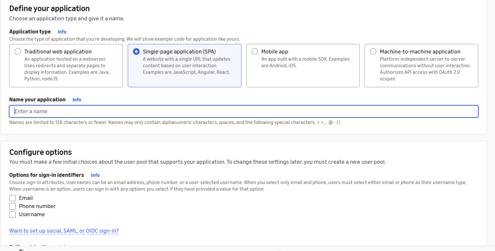
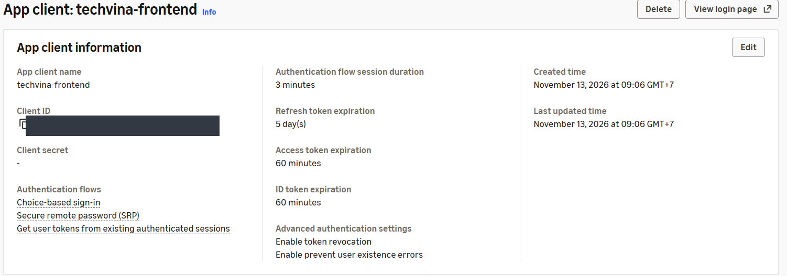
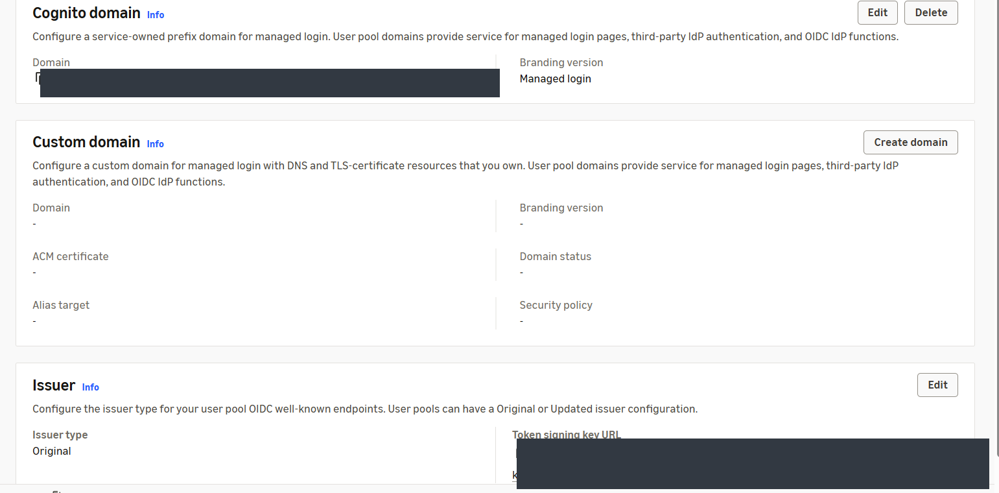
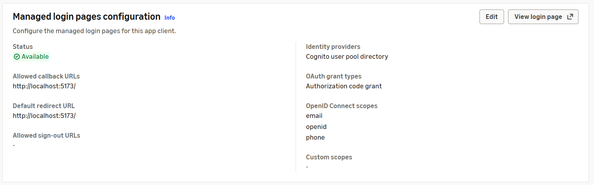
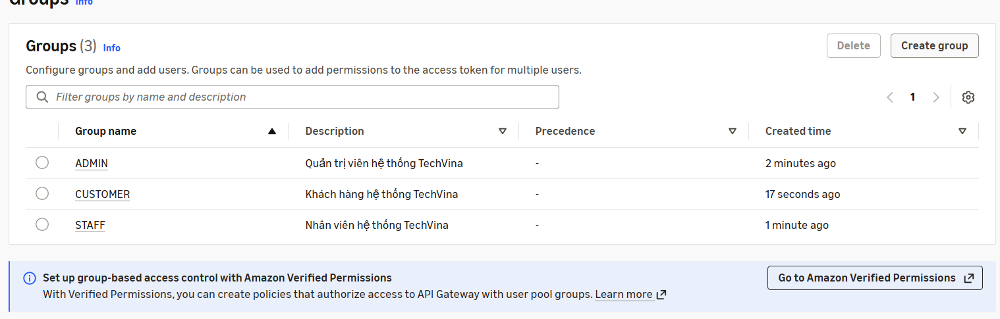
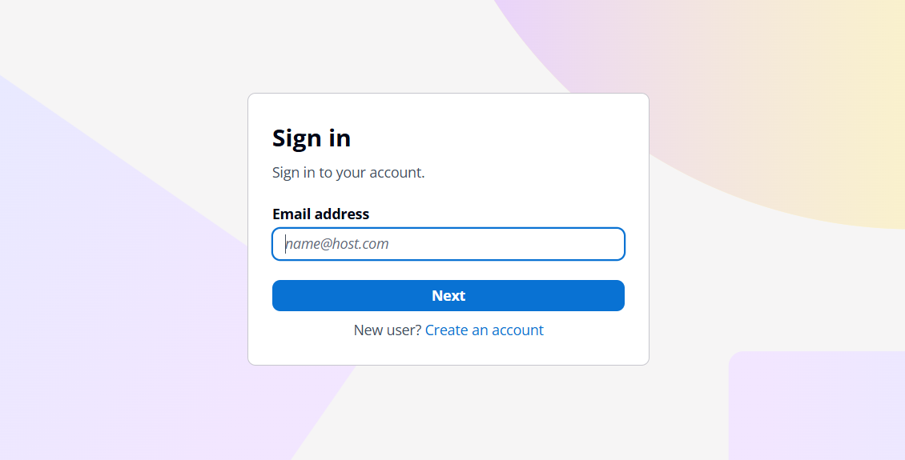
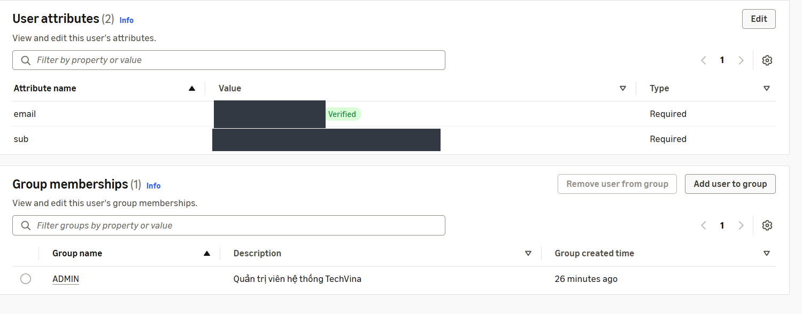
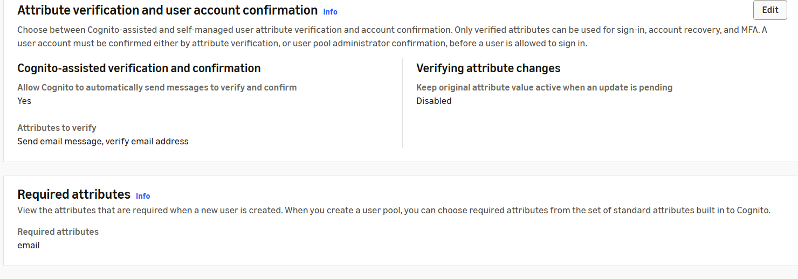
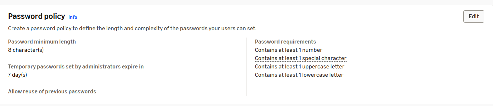
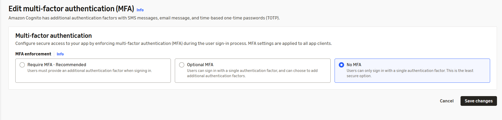

## Step 1 – Open Amazon Cognito

1. In **AWS Management Console**, select **Asia Pacific (Singapore) – `ap-southeast-1`**.
2. Open **Amazon Cognito → User pools**. The new AWS account initially has no user pools.
3. Select **Create user pool** to open **Set up resources for your application**.

## Step 2 – Define the SPA application

In **Define your application**, choose:

| Field | Value |
|---|---|
| Application type | **Single-page application (SPA)** |
| Name your application | `techvina-frontend` |

The TechVina React frontend runs in browsers and therefore uses a **public client**, without a client secret.



## Step 3 – Configure sign-up and sign-in

Under **Configure options**, select:

| Field | Value |
|---|---|
| Options for sign-in identifiers | **Email** only; do not select Phone number or Username |
| Self-registration | **Enable self-registration** |
| Required attributes for sign-up | `email` |
| Add a return URL – optional | Leave empty during initial creation |

Select **Create user directory**. This wizard creates the user pool, app client, and default managed-login domain together.

## Step 4 – Rename the user pool

1. Open the new user pool **Overview**. AWS may assign an initial name such as `User pool - ...`.
2. Select **Rename** and enter `techvina-user-pool`.
3. Under **User pool information**, find the **User pool ID**, with the form `ap-southeast-1_XXXXXXXXX`. The pool in this deployment uses Region `ap-southeast-1` and the **Essentials** plan.

## Step 5 – Verify the app client

Open **Applications → App clients → techvina-frontend**. The wizard already created the client; do not create a duplicate.

| Setting | Observed configuration |
|---|---|
| App client name | `techvina-frontend` |
| Client secret | None (`-`) |
| Authentication flows | Choice-based sign-in, Secure Remote Password (SRP) |
| Access token expiration | 60 minutes |
| ID token expiration | 60 minutes |
| Refresh token expiration | 5 days |
| Token revocation | Enabled |

Record the **Client ID** for the backend and frontend configuration in later sections.



## Step 6 – Verify the Cognito domain

1. Open **Branding → Domain** in the user pool.
2. The **Cognito domain** is already provisioned by AWS; **Branding version** is **Managed login**.
3. No **Custom domain** is configured. Keep the AWS-provided domain.
4. The **Issuer** type is **Original**.

The managed-login domain follows this format:

```text
https://<COGNITO_PREFIX>.auth.ap-southeast-1.amazoncognito.com
```

The JWT issuer URL is derived from the user pool ID:

```text
https://cognito-idp.ap-southeast-1.amazonaws.com/<USER_POOL_ID>
```



## Step 7 – Configure managed login and callback URL

1. Open **Applications → App clients → techvina-frontend → Login pages**.
2. Under **Managed login pages configuration**, select **Edit**.
3. Configure:

| Field | Value |
|---|---|
| Allowed callback URLs | `http://localhost:5173/` |
| Default redirect URL | `http://localhost:5173/` |
| Identity providers | Cognito user pool directory |
| OAuth 2.0 grant types | Authorization code grant |
| OpenID Connect scopes | `openid`, `email`, `phone` |
| Allowed sign-out URLs | Not configured at this stage |

If AWS has prefilled a CloudFront URL that does not belong to this deployment, replace it with `http://localhost:5173/`. Select **Save changes** and verify **Status: Available**.

These scopes match `scope: "openid email phone"` in `frontend/src/services/authConfig.js`. The SPA uses Authorization Code Flow with PKCE. Configure the deployed CloudFront HTTPS URL and sign-out URL later in **5.7.2**.



## Step 8 – Create Cognito groups

Under **User management → Groups**, select **Create group** and create:

| Group name | Description | Precedence | IAM permissions |
|---|---|---|---|
| `ADMIN` | Quản trị viên hệ thống TechVina | Blank | Do not choose an IAM Role |
| `STAFF` | Nhân viên hệ thống TechVina | Blank | Do not choose an IAM Role |
| `CUSTOMER` | Khách hàng hệ thống TechVina | Blank | Do not choose an IAM Role |

Use the exact uppercase names. In `backend/src/main/java/com/phoneshop/config/CognitoRoleConfig.java`, the `cognito:groups` claim is mapped to `ROLE_ADMIN`, `ROLE_STAFF`, and `ROLE_CUSTOMER`.



## Step 9 – Create an ADMIN account

1. Open **User management → Users → Create user**.
2. Select **Invitation message: Send an email invitation**.
3. Enter an email address that you control; leave **Phone number** blank.
4. Choose **Temporary password → Generate a password**.
5. Select **Create user**.

The new account initially shows **Status: Enabled** and **Confirmation status: Force change password**. For this deployment, the invitation **Your temporary password** arrived from `no-reply@verificationemail.com`.

## Step 10 – Assign the ADMIN group

1. Open the new account in **Users**.
2. Under **Group memberships**, select **Add user to group**.
3. Select only **ADMIN**, then **Add**.
4. Verify **Group memberships (1)** with **Group name: ADMIN**.

## Step 11 – Sign in and change the temporary password

1. Open **Applications → App clients → techvina-frontend → View login page**.
2. On **Sign in**, enter the ADMIN email, select **Next**, and enter the temporary password from the invitation.
3. On **Change password**, set and confirm a new password that meets the pool's password policy.
4. Return to **Cognito → Users** and select **Refresh**. The account changes to **Confirmation status: Confirmed** and remains **Enabled**.



After the password change, Cognito redirects to `http://localhost:5173/?code=...`. The browser may report `ERR_CONNECTION_REFUSED` because the frontend is not running on localhost. This does not indicate a failed password change. The `code` value is an authorization code, not an access token; no token exchange occurs while the frontend is unavailable.

## Step 12 – Verify the ADMIN email

During account creation, the email may initially remain **Not verified** even after the invitation was received.

1. Open **Users → ADMIN account → User attributes → Edit**.
2. After confirming you control the mailbox, check **Mark email address as verified**.
3. Save and verify **Verified**. The account remains in the `ADMIN` group.



## Step 13 – Verify email confirmation for self-registration

Open **Authentication → Sign-up** and check:

| Setting | Value |
|---|---|
| Cognito-assisted verification and confirmation | **Yes** |
| Attributes to verify | **Send email message, verify email address** |
| Required attributes | `email` |
| Custom attributes | 0 |

Cognito is configured to send email verification messages to new self-registered users.



## Step 14 – Check password policy and MFA

Under **Authentication → Authentication methods → Password policy**:

| Setting | Value |
|---|---|
| Password minimum length | 8 characters |
| Password requirements | Uppercase, lowercase, number, special character |
| Temporary password expiry | 7 days |



Under **Authentication → Sign-in → Multi-factor authentication**, the observed configuration is **No MFA**. Keep this setting for this deployment and select **Cancel** after inspection.



## Step 15 – Cognito values for the backend

Use the values from the current AWS account to complete `backend/.env` in **5.5.3**:

```dotenv
COGNITO_ISSUER_URI=https://cognito-idp.ap-southeast-1.amazonaws.com/<USER_POOL_ID>
COGNITO_CLIENT_ID=<APP_CLIENT_ID>
COGNITO_DOMAIN=https://<COGNITO_PREFIX>.auth.ap-southeast-1.amazoncognito.com
```

**Result:** `techvina-user-pool`, a public `techvina-frontend` app client without a client secret, managed login, `ADMIN`/`STAFF`/`CUSTOMER` groups, and an ADMIN account marked **Confirmed**, **Enabled**, and email **Verified**.
