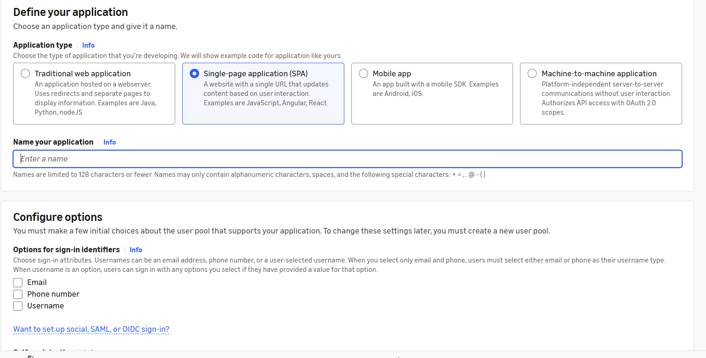
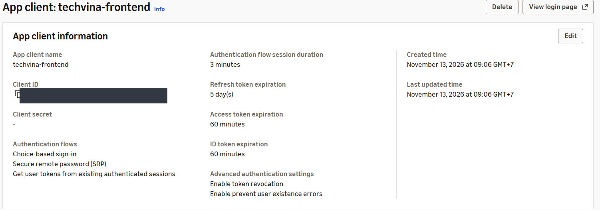
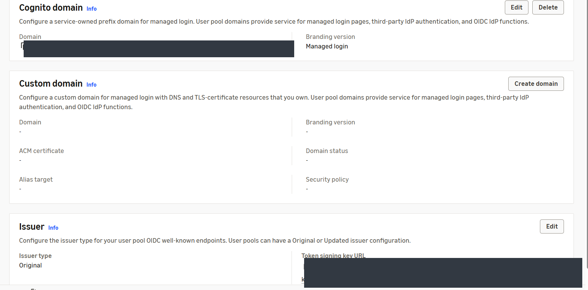
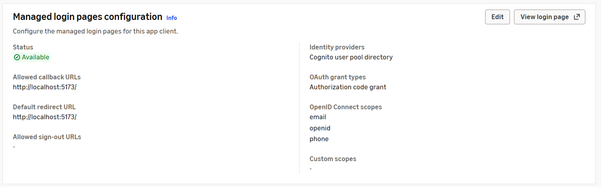
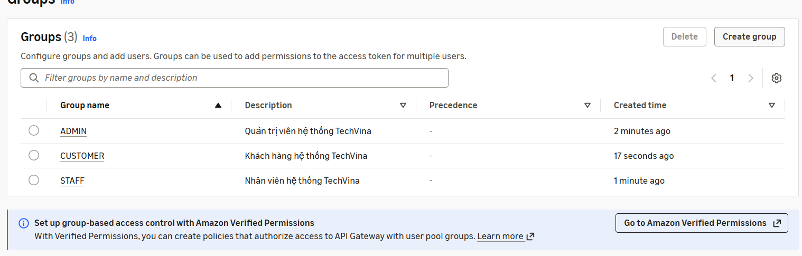
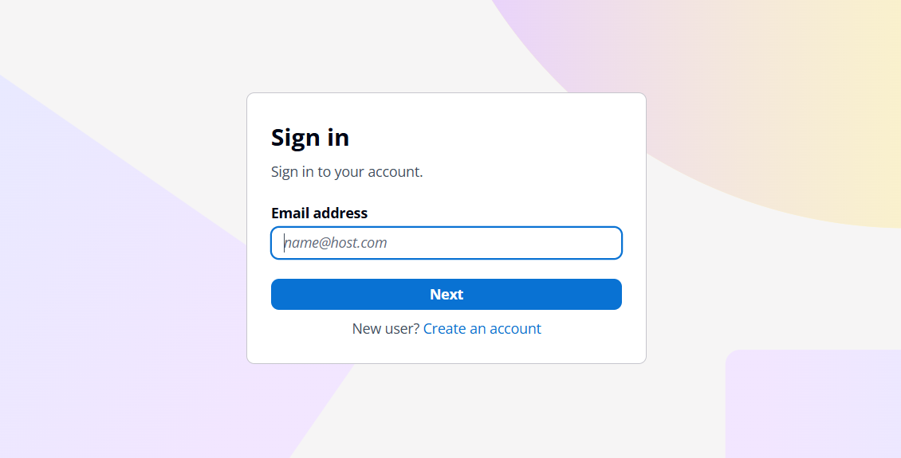
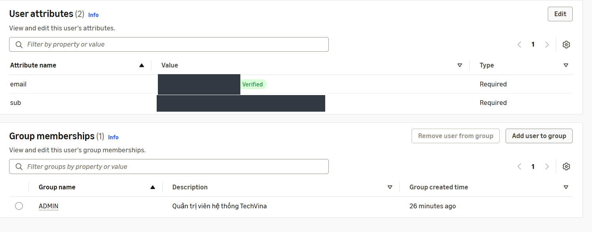
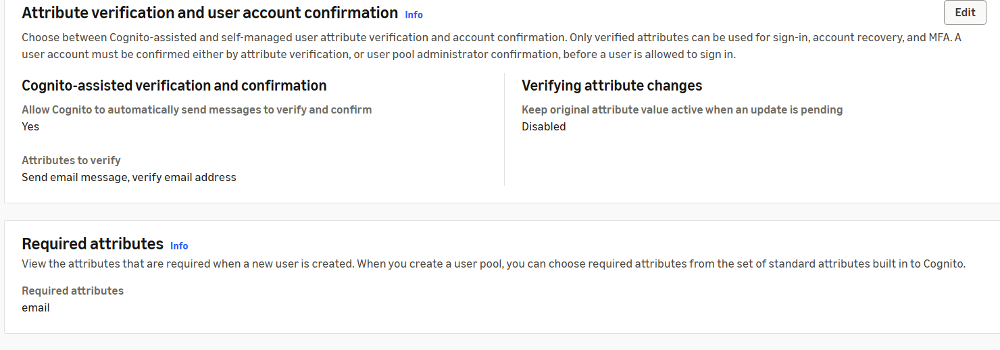
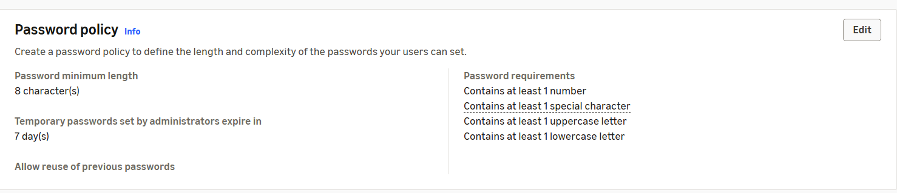
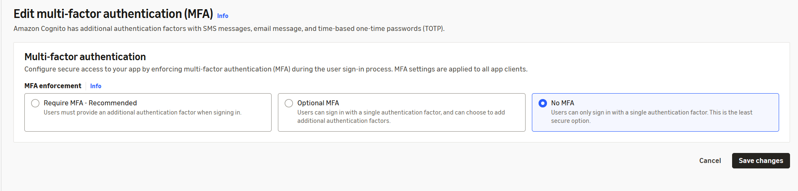

## Step 1 – Truy cập Amazon Cognito

1. Trên **AWS Management Console**, chọn Region **Asia Pacific (Singapore) – `ap-southeast-1`**.
2. Mở **Amazon Cognito → User pools**. Trong tài khoản AWS mới, danh sách ban đầu chưa có User Pool.
3. Chọn **Create user pool** để mở trang **Set up resources for your application**.

## Step 2 – Tạo ứng dụng SPA

Trong **Define your application**, thiết lập:

| Trường | Giá trị |
|---|---|
| Application type | **Single-page application (SPA)** |
| Name your application | `techvina-frontend` |

Frontend React của TechVina chạy trên trình duyệt nên sử dụng **public client**, không dùng client secret.



## Step 3 – Thiết lập đăng ký và đăng nhập

Trong **Configure options**, chọn các giá trị:

| Trường | Giá trị |
|---|---|
| Options for sign-in identifiers | **Email**; không chọn Phone number hoặc Username |
| Self-registration | **Enable self-registration** |
| Required attributes for sign-up | `email` |
| Add a return URL – optional | Để trống khi tạo User Pool |

Nhấn **Create user directory**. Cognito tạo User Pool, App Client và domain đăng nhập mặc định trong cùng quy trình.

## Step 4 – Đổi tên User Pool

1. Mở trang **Overview** của User Pool vừa tạo. AWS có thể đặt tên ban đầu theo dạng `User pool - ...`.
2. Chọn **Rename**, nhập `techvina-user-pool`, sau đó lưu.
3. Tại **User pool information**, xác định **User pool ID** có dạng `ap-southeast-1_XXXXXXXXX`. User Pool được tạo trong Region `ap-southeast-1` và sử dụng gói **Essentials** trong lần triển khai này.

## Step 5 – Kiểm tra App Client

Vào **Applications → App clients → techvina-frontend**. AWS đã tạo một App Client, không cần tạo thêm.

| Thành phần | Kết quả triển khai |
|---|---|
| App client name | `techvina-frontend` |
| Client secret | Không có (`-`) |
| Authentication flows | Choice-based sign-in, Secure Remote Password (SRP) |
| Access token expiration | 60 phút |
| ID token expiration | 60 phút |
| Refresh token expiration | 5 ngày |
| Token revocation | Enabled |

Ghi lại **Client ID** trên trang này để cấu hình Backend và Frontend ở các mục sau.



## Step 6 – Kiểm tra Cognito Domain

1. Trong User Pool, mở **Branding → Domain**.
2. Phần **Cognito domain** đã có domain do AWS tạo tự động; **Branding version** là **Managed login**.
3. **Custom domain** chưa cấu hình. Giữ nguyên domain được cấp.
4. Phần **Issuer** sử dụng loại **Original**.

Cấu trúc domain đăng nhập:

```text
https://<COGNITO_PREFIX>.auth.ap-southeast-1.amazoncognito.com
```

Địa chỉ User Pool phát hành JWT được tạo theo **User pool ID**:

```text
https://cognito-idp.ap-southeast-1.amazonaws.com/<USER_POOL_ID>
```



## Step 7 – Cấu hình trang đăng nhập và Callback URL

1. Vào **Applications → App clients → techvina-frontend → Login pages**.
2. Trong **Managed login pages configuration**, chọn **Edit**.
3. Cấu hình:

| Trường | Giá trị |
|---|---|
| Allowed callback URLs | `http://localhost:5173/` |
| Default redirect URL | `http://localhost:5173/` |
| Identity providers | Cognito user pool directory |
| OAuth 2.0 grant types | Authorization code grant |
| OpenID Connect scopes | `openid`, `email`, `phone` |
| Allowed sign-out URLs | Chưa cấu hình trong bước này |

Nếu ô **Allowed callback URLs** đã chứa một CloudFront URL không thuộc hệ thống đang triển khai, thay bằng `http://localhost:5173/` trước khi lưu. Chọn **Save changes** và kiểm tra **Status: Available**.

Các scope trên khớp với `scope: "openid email phone"` trong `frontend/src/services/authConfig.js`. Với SPA, ứng dụng sử dụng Authorization Code Flow kết hợp PKCE. URL HTTPS của CloudFront và sign-out URL được cấu hình sau khi triển khai Frontend ở **5.7.2**.



## Step 8 – Tạo nhóm quyền Cognito

Trong **User management → Groups**, nhấn **Create group** và lần lượt tạo ba nhóm:

| Group name | Description | Precedence | IAM permissions |
|---|---|---|---|
| `ADMIN` | Quản trị viên hệ thống TechVina | Để trống | Không chọn IAM Role |
| `STAFF` | Nhân viên hệ thống TechVina | Để trống | Không chọn IAM Role |
| `CUSTOMER` | Khách hàng hệ thống TechVina | Để trống | Không chọn IAM Role |

Giữ đúng chữ hoa của tên nhóm. Trong `backend/src/main/java/com/phoneshop/config/CognitoRoleConfig.java`, claim `cognito:groups` được chuyển tương ứng thành `ROLE_ADMIN`, `ROLE_STAFF`, `ROLE_CUSTOMER`.



## Step 9 – Tạo tài khoản ADMIN

1. Mở **User management → Users → Create user**.
2. Thiết lập **Invitation message: Send an email invitation**.
3. Nhập email có thể nhận thư ở **Email address**; để trống **Phone number**.
4. Chọn **Temporary password → Generate a password**.
5. Chọn **Create user**.

Tài khoản mới có **Status: Enabled** và **Confirmation status: Force change password**. Cognito gửi email **Your temporary password** từ `no-reply@verificationemail.com` trong lần triển khai này.

## Step 10 – Thêm tài khoản vào nhóm ADMIN

1. Trong **Users**, mở tài khoản vừa tạo.
2. Tại **Group memberships**, nhấn **Add user to group**.
3. Chọn riêng nhóm **ADMIN** rồi nhấn **Add**.
4. Kiểm tra **Group memberships (1)** và **Group name: ADMIN**.

## Step 11 – Đăng nhập và đổi mật khẩu tạm thời

1. Mở **Applications → App clients → techvina-frontend → View login page**.
2. Trên trang **Sign in**, nhập email tài khoản ADMIN, chọn **Next**, rồi nhập mật khẩu tạm thời nhận qua email.
3. Khi hiện **Change password**, đặt mật khẩu mới đáp ứng chính sách mật khẩu và xác nhận.
4. Quay lại **Cognito → Users**, nhấn **Refresh**. **Confirmation status** chuyển thành **Confirmed**; **Status** vẫn là **Enabled**.



Sau bước đổi mật khẩu, Cognito chuyển hướng về `http://localhost:5173/?code=...`. Trình duyệt có thể hiển thị `ERR_CONNECTION_REFUSED` do Frontend chưa chạy tại localhost; điều này không ảnh hưởng đến việc xác nhận đổi mật khẩu. Mã `code` là Authorization Code, chưa phải Access Token và chưa được đổi thành token khi Frontend chưa hoạt động.

## Step 12 – Xác minh email ADMIN

Trong lần tạo tài khoản này, email ban đầu hiển thị **Not verified** dù đã nhận được thư mời.

1. Mở **Users → tài khoản ADMIN → User attributes → Edit**.
2. Sau khi xác nhận địa chỉ email thuộc quyền kiểm soát của bạn, chọn **Mark email address as verified**.
3. Lưu và kiểm tra nhãn **Verified**; tài khoản vẫn thuộc nhóm `ADMIN`.



## Step 13 – Kiểm tra xác minh email khi tự đăng ký

Mở **Authentication → Sign-up** và kiểm tra:

| Thành phần | Giá trị |
|---|---|
| Cognito-assisted verification and confirmation | **Yes** |
| Attributes to verify | **Send email message, verify email address** |
| Required attributes | `email` |
| Custom attributes | 0 |

Cognito được cấu hình để gửi thông báo xác minh email cho tài khoản đăng ký mới.



## Step 14 – Kiểm tra chính sách mật khẩu và MFA

Tại **Authentication → Authentication methods → Password policy**:

| Thành phần | Giá trị |
|---|---|
| Password minimum length | 8 ký tự |
| Password requirements | Chữ hoa, chữ thường, chữ số, ký tự đặc biệt |
| Temporary password expiry | 7 ngày |



Mở **Authentication → Sign-in → Multi-factor authentication**: cấu hình thực tế là **No MFA**. Giữ nguyên thiết lập này trong lần triển khai và chọn **Cancel** khi kiểm tra xong.



## Step 15 – Thông số Cognito cho Backend

Sau khi tạo User Pool, sử dụng thông tin tương ứng của tài khoản AWS hiện tại để hoàn thiện `backend/.env` ở mục **5.5.3**:

```dotenv
COGNITO_ISSUER_URI=https://cognito-idp.ap-southeast-1.amazonaws.com/<USER_POOL_ID>
COGNITO_CLIENT_ID=<APP_CLIENT_ID>
COGNITO_DOMAIN=https://<COGNITO_PREFIX>.auth.ap-southeast-1.amazoncognito.com
```

**Kết quả:** Có User Pool `techvina-user-pool`, App Client `techvina-frontend` không có Client Secret, Managed login, ba nhóm `ADMIN`/`STAFF`/`CUSTOMER` và một tài khoản ADMIN ở trạng thái **Confirmed**, **Enabled**, email **Verified**.
