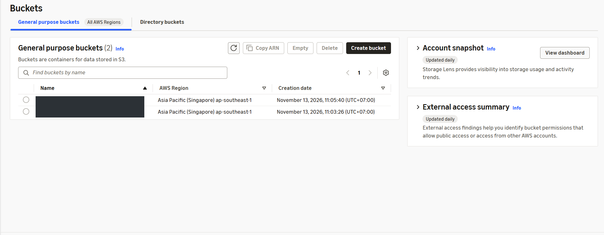
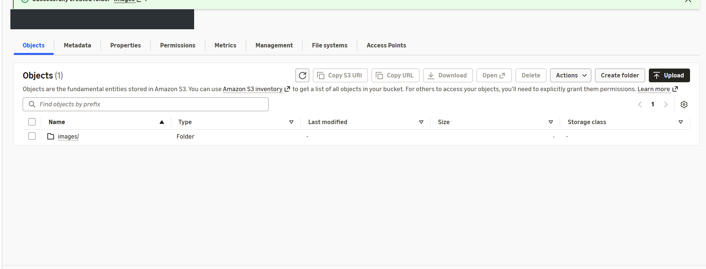
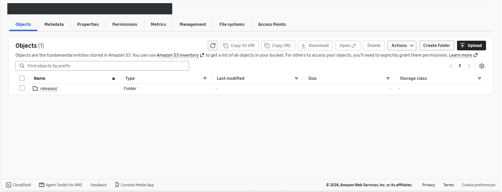

## Step 1 – Truy cập Amazon S3

Mở **AWS Console → Amazon S3 → General purpose buckets** tại Region **Asia Pacific (Singapore) – `ap-southeast-1`**. Nhấn **Create bucket**.

## Step 2 – Tạo bucket lưu Frontend và hình ảnh

Trong **General configuration**, chọn:

| Trường | Giá trị |
|---|---|
| AWS Region | `ap-southeast-1` |
| Bucket type | General purpose |
| Bucket namespace | Global namespace |
| Bucket name | `techvina-frontend-<AWS_ACCOUNT_ID>` |
| Object Ownership | ACLs disabled (Bucket owner enforced) |
| Block all public access | Bật tất cả |
| Bucket Versioning | Disable |
| Default encryption | SSE-S3 |
| Object Lock | Disable |

Giữ nguyên các cấu hình trên và nhấn **Create bucket**. Bucket này chứa cả bản build React/Vite (`index.html`, `assets/`) lẫn hình ảnh (`images/`). Không bật S3 static website hosting; CloudFront sẽ truy cập S3 bằng **Origin Access Control (OAC)**.

## Step 3 – Tạo bucket Backend Artifacts

Quay về **General purpose buckets → Create bucket**. Sử dụng cùng cấu hình bảo mật với Step 2, nhưng đặt tên:

```text
techvina-backend-artifacts-<AWS_ACCOUNT_ID>
```

Nhấn **Create bucket**. Bucket này lưu JAR và các tệp phục vụ CI/CD dưới tiền tố `releases/`. Tên phải khớp với ARN `s3:GetObject` đã cấp cho EC2 Role tại mục 5.3.2.



## Step 4 – Tạo tiền tố images trong bucket Frontend

Mở **`techvina-frontend-<AWS_ACCOUNT_ID>` → Objects → Create folder**. Nhập **Folder name** là `images` (không thêm `/`), chọn **Don't specify an encryption key** để dùng SSE-S3 mặc định, rồi nhấn **Create folder**.



## Step 5 – Tạo tiền tố releases trong bucket Backend Artifacts

Mở **`techvina-backend-artifacts-<AWS_ACCOUNT_ID>` → Objects → Create folder**. Nhập **Folder name** là `releases`, giữ tùy chọn mã hóa mặc định và nhấn **Create folder**.



## Step 6 – Kiểm tra kết quả

Sau khi tạo, cấu trúc S3 gồm:

```text
techvina-frontend-<AWS_ACCOUNT_ID>/
└── images/

techvina-backend-artifacts-<AWS_ACCOUNT_ID>/
└── releases/
```

Cả hai bucket giữ **Block all public access = On**. Các folder ở bước này là tiền tố S3; ảnh và JAR thực tế sẽ được đưa lên khi triển khai Frontend/CI/CD ở mục 5.8. Quyền đọc S3 cho CloudFront được cấu hình trong mục **5.7.1**.
