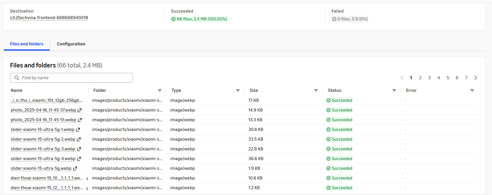

## Step 1 – Xác định nguồn hình ảnh

Trong repository TechVina (nhánh `master`), mở thư mục `frontend/public/images/`:

```text
frontend/public/images/
├── banners/
├── categories/
└── products/
    ├── apple/
    └── xiaomi/
        └── xiaomi-series/
```

Các bản ghi trong cơ sở dữ liệu `phone_store` lưu đường dẫn ảnh tương đối, ví dụ:

```text
/images/products/xiaomi/xiaomi-series/xiaomi-15/image_1262703568.webp
```

Để ảnh hiển thị đúng, đối tượng S3 phải có key `images/products/xiaomi/xiaomi-series/xiaomi-15/image_1262703568.webp` trong bucket Frontend. Không thay đổi giá trị đường dẫn trong MySQL.

## Step 2 – Tải thư mục ảnh lên Amazon S3

1. Mở **Amazon S3 → Buckets → `techvina-frontend-<AWS_ACCOUNT_ID>`**.
2. Ở **thư mục gốc của bucket** (không mở thư mục `images/`), nhấn **Upload → Add folder**.
3. Trên máy tính, chọn nguyên thư mục **`frontend/public/images`**, bao gồm `banners`, `categories` và `products`.
4. Xác nhận tên các đường dẫn đích bắt đầu bằng `images/`, **không phải** `images/images/`.
5. Nhấn **Upload** và kiểm tra mục **Succeeded**.

Trong lần triển khai TechVina đã thực hiện, kết quả là **66 file, tổng dung lượng 2,4 MB, không có file lỗi**.



## Step 3 – Kiểm tra đối tượng S3

Mở `techvina-frontend-<AWS_ACCOUNT_ID> → images/` và xác nhận có ba tiền tố:

```text
images/banners/
images/categories/
images/products/
```

Mở một file ảnh thuộc `images/products/`, kiểm tra **Object key** có cấu trúc giống đường dẫn trong MySQL. Giữ **Block all public access** của bucket; không bật ACL `public-read` và không dùng S3 Website Hosting.

## Step 4 – Đối chiếu đường dẫn với bản build Vite

Khi chạy `npm run build` ở mục **5.7.3**, Vite sao chép thư mục `frontend/public/images/` vào `frontend/dist/images/`:

```text
frontend/dist/
├── index.html
├── assets/
├── favicon.svg
└── images/
    ├── banners/
    ├── categories/
    └── products/
```

Các bản triển khai Frontend tiếp theo sử dụng `aws s3 sync` và **không dùng `--delete`**, nhờ đó không xóa các hình ảnh đã tải lên. Ở mục **5.7.1**, CloudFront OAC sẽ cấp quyền đọc ảnh từ bucket riêng tư; truy cập ảnh qua domain CloudFront thay vì URL S3 trực tiếp.
