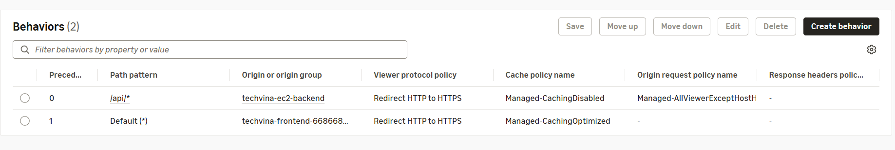
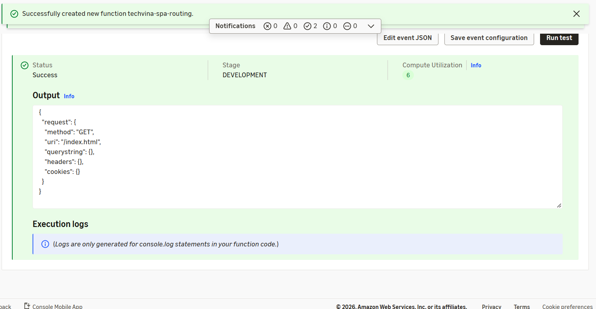

## Step 1 – Create a CloudFront distribution and S3 origin

1. Open **CloudFront → Distributions → Create distribution**.
2. Use the description `techvina-cloudfront` and select **`techvina-frontend-<AWS_ACCOUNT_ID>`** as the first origin. Choose the S3 REST endpoint, not the website endpoint.
3. Select **Origin access control settings (recommended)**, create an OAC, and choose `Sign requests`.
4. Set the **Default (*) cache behavior** to **Redirect HTTP to HTTPS** and **CachingOptimized**. Set **Default root object** to `index.html`.
5. Create the distribution and record its **Distribution ID** and domain (`dxxxxxxxxxxxxx.cloudfront.net`). The actual TechVina deployment uses the distribution `techvina-cloudfront` and domain `d3mmtr3bxttvgc.cloudfront.net`.

The finished distribution has **two origins**: one S3 origin serving the frontend and images, and one HTTPS custom origin for Spring Boot. The backend origin is added in Step 4.

## Step 2 – Grant private S3 access through OAC

1. Open **Origins**, select the frontend S3 origin, and verify that OAC is configured.
2. If AWS Console offers **Copy policy / Go to S3 bucket permissions**, apply a bucket policy based on this template, substituting the Account ID and Distribution ID:

```json
{
  "Version": "2012-10-17",
  "Statement": [
    {
      "Sid": "AllowCloudFrontReadFrontend",
      "Effect": "Allow",
      "Principal": { "Service": "cloudfront.amazonaws.com" },
      "Action": "s3:GetObject",
      "Resource": "arn:aws:s3:::techvina-frontend-<AWS_ACCOUNT_ID>/*",
      "Condition": {
        "StringEquals": {
          "AWS:SourceArn": "arn:aws:cloudfront::<AWS_ACCOUNT_ID>:distribution/<CF_DISTRIBUTION_ID>"
        }
      }
    }
  ]
}
```

3. Keep **Block all public access** enabled. Test an image already uploaded in 5.6.2:

```text
https://<CF_DOMAIN>/images/products/xiaomi/xiaomi-series/xiaomi-15/image_1262703568.webp
```

The image should load through CloudFront while a direct unauthenticated S3 object URL remains inaccessible.

## Step 3 – Configure DuckDNS and HTTPS for EC2

### Step 3.1 – Create the DuckDNS hostname

1. In **DuckDNS**, create a subdomain using the pattern `techvina-api-<AWS_ACCOUNT_ID>`.
2. Point the hostname to the **Public IPv4** of `techvina-ec2-backend` and save it. The hostname used in the actual deployment is:

```text
techvina-api-668668940018.duckdns.org
```

3. Connect to EC2 using Session Manager as `ubuntu` and verify the IPv4 resolution:

```bash
getent ahostsv4 techvina-api-<AWS_ACCOUNT_ID>.duckdns.org | head -n 1
```

The returned address must match the instance public IPv4. Using a dynamic DNS hostname avoids configuring CloudFront with a temporary EC2 public DNS name that can change after Stop/Start.

### Step 3.2 – Set up automatic DuckDNS updates

Create a root-only token file:

```bash
sudo install -d -m 700 /etc/techvina/duckdns
sudo nano /etc/techvina/duckdns/token
sudo chmod 600 /etc/techvina/duckdns/token
```

Enter your own DuckDNS token. Do not include it in the workshop, GitHub, logs, or screenshots.

Create `/usr/local/sbin/techvina-duckdns-update.sh`:

```bash
sudo nano /usr/local/sbin/techvina-duckdns-update.sh
```

```bash
#!/usr/bin/env bash
set -euo pipefail
DOMAIN="techvina-api-<AWS_ACCOUNT_ID>"
TOKEN_FILE="/etc/techvina/duckdns/token"
TOKEN="$(tr -d '\r\n' < "$TOKEN_FILE")"
if [[ ! "$TOKEN" =~ ^[a-zA-Z0-9-]+$ ]]; then
  echo "Invalid DuckDNS token" >&2
  exit 1
fi
RESPONSE="$(
  printf 'url = "https://www.duckdns.org/update?domains=%s&token=%s&ip="\n' "$DOMAIN" "$TOKEN" \
    | curl --fail --silent --show-error --max-time 20 --config -
)"
if [[ "$RESPONSE" == "OK" ]]; then
  echo "DuckDNS update OK"
else
  echo "DuckDNS update failed" >&2
  exit 1
fi
```

Replace `<AWS_ACCOUNT_ID>` with your account ID, then make the script executable and test it:

```bash
sudo chmod 700 /usr/local/sbin/techvina-duckdns-update.sh
sudo /usr/local/sbin/techvina-duckdns-update.sh
```

**Verified output:** `DuckDNS update OK`.

Create `/etc/systemd/system/techvina-duckdns-update.service`:

```ini
[Unit]
Description=TechVina DuckDNS IP Update
Wants=network-online.target
After=network-online.target

[Service]
Type=oneshot
User=root
ExecStart=/usr/local/sbin/techvina-duckdns-update.sh
```

Create `/etc/systemd/system/techvina-duckdns-update.timer`:

```ini
[Unit]
Description=TechVina DuckDNS Update Timer

[Timer]
OnBootSec=1min
OnUnitActiveSec=5min
AccuracySec=30s
Unit=techvina-duckdns-update.service

[Install]
WantedBy=timers.target
```

Verify, reload systemd, and enable the timer:

```bash
sudo systemd-analyze verify /etc/systemd/system/techvina-duckdns-update.service /etc/systemd/system/techvina-duckdns-update.timer
sudo systemctl daemon-reload
sudo systemctl enable --now techvina-duckdns-update.timer
systemctl list-timers --all | grep techvina-duckdns
```

### Step 3.3 – Set up Nginx and Let's Encrypt

The EC2 Security Group configured in **5.3.2** must allow **TCP 80 from `0.0.0.0/0`** for HTTP-01 certificate issuance/renewal, and **TCP 443 from the CloudFront origin-facing prefix list**. Spring Boot continues to run on `127.0.0.1:8080`; port 8080 is not exposed publicly.

Install Nginx and Certbot:

```bash
sudo apt update
sudo apt install -y nginx certbot python3-certbot-nginx
```

Create `/etc/nginx/sites-available/techvina-backend`:

```nginx
server {
    listen 80;
    server_name techvina-api-<AWS_ACCOUNT_ID>.duckdns.org;

    location / {
        proxy_pass http://127.0.0.1:8080;
        proxy_set_header Host $host;
        proxy_set_header X-Real-IP $remote_addr;
        proxy_set_header X-Forwarded-For $proxy_add_x_forwarded_for;
        proxy_set_header X-Forwarded-Proto $scheme;
    }
}
```

Replace the Account ID, activate Nginx, and issue the certificate:

```bash
sudo ln -s /etc/nginx/sites-available/techvina-backend /etc/nginx/sites-enabled/techvina-backend
sudo nginx -t
sudo systemctl reload nginx
sudo certbot --nginx -d techvina-api-<AWS_ACCOUNT_ID>.duckdns.org
```

Choose **Redirect HTTP to HTTPS** when prompted. Certbot adds the TLS configuration and manages automated renewal. Verify:

```bash
sudo nginx -t
sudo systemctl status nginx --no-pager
```

Before restricting origin port 443 to CloudFront, the actual deployment verified `https://techvina-api-668668940018.duckdns.org/actuator/health` returned **HTTP 200** and `{"status":"UP"}`. Requests to HTTP port 80 redirected with `301` to HTTPS.

## Step 4 – Create the backend HTTPS origin

Under the distribution, open **Origins → Create origin**:

| Field | Value |
|---|---|
| Origin domain | `techvina-api-<AWS_ACCOUNT_ID>.duckdns.org` (without `https://`) |
| Origin type | `Custom origin` |
| Name | `techvina-ec2-backend` |
| Protocol | **HTTPS only** |
| HTTPS port | `443` |
| Minimum Origin SSL protocol | `TLSv1.2` |
| Origin path | Empty |
| Origin IP address type | `IPv4-only` |

Keep the default timeouts, do not add secret custom headers, and choose **Create origin**. The Origin domain must match the hostname on the valid TLS certificate.


## Step 5 – Create the `/api/*` behavior

Open **Behaviors → Create behavior**:

| Field | Value |
|---|---|
| Path pattern | `/api/*` |
| Origin | `techvina-ec2-backend` |
| Viewer protocol policy | `Redirect HTTP to HTTPS` |
| Allowed HTTP methods | `GET, HEAD, OPTIONS, PUT, POST, PATCH, DELETE` |
| Cache HTTP OPTIONS | Not selected |
| Cache policy | `CachingDisabled` |
| Origin request policy | `AllViewerExceptHostHeader` |
| Response headers policy | None |

`AllViewerExceptHostHeader` forwards the required headers (including `Authorization`), cookies and query strings while using the DuckDNS host at the origin, which is appropriate for TLS and Nginx.

Verify the ordered behaviors:

| Precedence | Path pattern | Origin |
|---|---|---|
| `0` | `/api/*` | `techvina-ec2-backend` |
| `1` | `Default (*)` | Frontend S3 + images |



Test:

```text
https://<CF_DOMAIN>/api/san-pham/noi-bat
```

**Actual result:** HTTP 200 with JSON for **four featured products**. Dynamic API responses are not cached by CloudFront.

## Step 6 – Create a CloudFront Function for React Router

Routes such as `/login` and `/san-pham/21/21` are handled by React Router, not by individual S3 files. Open **CloudFront → Functions → Create function**:

- **Function name:** `techvina-spa-routing`
- **Runtime:** `cloudfront-js-2.0`

In **Build (Development)** replace the example code with:

```javascript
function handler(event) {
    var request = event.request;
    var uri = request.uri;

    if (
        uri === '/api' || uri.startsWith('/api/') ||
        uri === '/images' || uri.startsWith('/images/') ||
        uri === '/assets' || uri.startsWith('/assets/')
    ) {
        return request;
    }

    var lastSegment = uri.substring(uri.lastIndexOf('/') + 1);
    if (uri !== '/' && !lastSegment.includes('.')) {
        request.uri = '/index.html';
    }

    return request;
}
```

1. Choose **Save changes**.
2. Open **Test** in **Development**, simulate `GET /san-pham/21/21`, and choose **Run test**. Verify `Status = Success` and `request.uri = "/index.html"`.
3. Choose **Publish → Publish function** to promote the tested code to `LIVE`.
4. Choose **Add association**, select the TechVina distribution, **Event type = Viewer request**, and **Cache behavior = Default (*)**. If a replacement warning appears, first inspect **Behaviors → Default (*) → Edit → Function associations** to check for an existing function.
5. Choose **Add association** and allow the distribution configuration to deploy.



Associate the function only with **Default (*)**, not `/api/*`. The function preserves `/assets/...`, `/images/...` and actual file URLs. Once the frontend is uploaded in 5.7.3, `/san-pham/21/21` can render the product page instead of S3's XML `AccessDenied` response.

## Step 7 – Verify CloudFront routing

1. Open `https://<CF_DOMAIN>/images/products/xiaomi/xiaomi-series/xiaomi-15/image_1262703568.webp` to verify image delivery from S3.
2. Open `https://<CF_DOMAIN>/api/san-pham/noi-bat` to verify the Spring Boot JSON response through the HTTPS origin.
3. Verify the S3 and `techvina-ec2-backend` origins and the order of `/api/*` and `Default (*)` behaviors.
4. Once the frontend build has been deployed in **5.7.3**, test `/`, `/login`, `/san-pham/21/21`, and `/assets/`.
