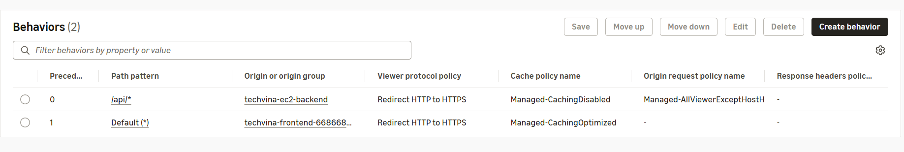
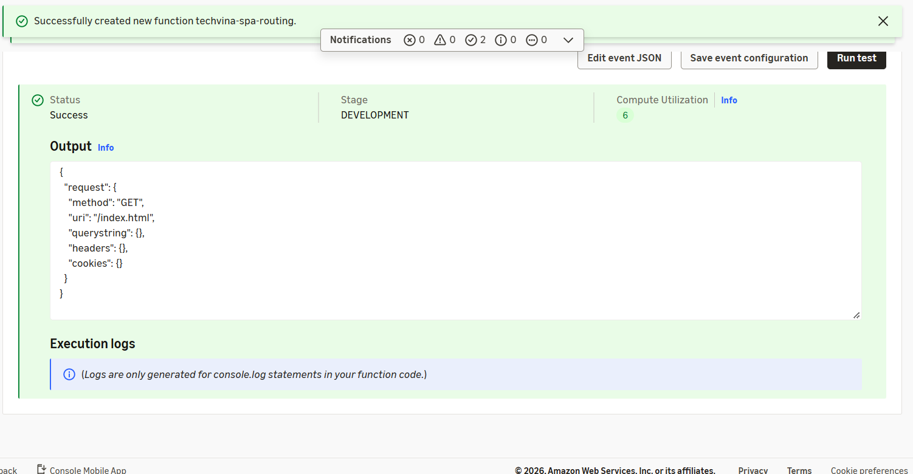

## Step 1 – Tạo CloudFront Distribution và S3 Origin

1. Mở **CloudFront → Distributions → Create distribution**.
2. Đặt tên mô tả `techvina-cloudfront`; chọn bucket **`techvina-frontend-<AWS_ACCOUNT_ID>`** làm origin đầu tiên. Sử dụng S3 REST endpoint, không dùng S3 Website endpoint.
3. Chọn **Origin access control settings (recommended)** và tạo **OAC** với tùy chọn ký request `Sign requests`.
4. Ở **Default (*) cache behavior**, chọn **Redirect HTTP to HTTPS**, cache policy **CachingOptimized**; đặt **Default root object = `index.html`**.
5. Tạo distribution; ghi lại **Distribution ID** và domain dạng `dxxxxxxxxxxxxx.cloudfront.net`. Ở lần triển khai thực tế, tên distribution là `techvina-cloudfront` và domain là `d3mmtr3bxttvgc.cloudfront.net`.

CloudFront distribution của TechVina dùng **hai origins**: một S3 origin phục vụ Frontend/ảnh và một custom origin HTTPS phục vụ Backend. Origin Backend được bổ sung tại Step 4.

## Step 2 – Cấu hình quyền truy cập bucket bằng OAC

1. Trong distribution, mở **Origins**, chọn S3 origin và kiểm tra OAC đã gắn.
2. Nếu AWS Console đề xuất **Copy policy / Go to S3 bucket permissions**, cập nhật bucket policy theo mẫu dưới đây (thay Account ID và Distribution ID):

```json
{
  "Version": "2012-10-17",
  "Statement": [
    {
      "Sid": "AllowCloudFrontReadFrontend",
      "Effect": "Allow",
      "Principal": { "Service": "cloudfront.amazonaws.com" },
      "Action": "s3:GetObject",
      "Resource": "arn:aws:s3:::techvina-frontend-<AWS_ACCOUNT_ID>/*",
      "Condition": {
        "StringEquals": {
          "AWS:SourceArn": "arn:aws:cloudfront::<AWS_ACCOUNT_ID>:distribution/<CF_DISTRIBUTION_ID>"
        }
      }
    }
  ]
}
```

3. Giữ **Block all public access**. Mở thử ảnh đã tải ở 5.6.2 qua CloudFront:

```text
https://<CF_DOMAIN>/images/products/xiaomi/xiaomi-series/xiaomi-15/image_1262703568.webp
```

Kết quả là hình ảnh hiển thị; truy cập trực tiếp object S3 bằng URL công khai vẫn bị từ chối.

## Step 3 – Cấu hình tên miền DuckDNS và HTTPS cho EC2

### Step 3.1 – Tạo DuckDNS và kiểm tra phân giải

1. Truy cập **DuckDNS**, tạo subdomain theo mẫu `techvina-api-<AWS_ACCOUNT_ID>`.
2. Đặt địa chỉ IPv4 của subdomain bằng **Public IPv4** của instance `techvina-ec2-backend`, sau đó lưu. Tên miền triển khai thực tế:

```text
techvina-api-668668940018.duckdns.org
```

3. Vào **EC2 → Instances** để lấy đúng IP; trên EC2 dùng Session Manager, chuyển sang user `ubuntu` rồi kiểm tra DNS:

```bash
getent ahostsv4 techvina-api-<AWS_ACCOUNT_ID>.duckdns.org | head -n 1
```

IP trả về phải trùng **Public IPv4** của EC2. Sử dụng tên miền thay cho EC2 public DNS, vì IP public có thể đổi sau Stop/Start.

### Step 3.2 – Tự động cập nhật địa chỉ IP bằng systemd

Tạo nơi lưu DuckDNS token với quyền chỉ root được đọc:

```bash
sudo install -d -m 700 /etc/techvina/duckdns
sudo nano /etc/techvina/duckdns/token
sudo chmod 600 /etc/techvina/duckdns/token
```

Nhập **token riêng của DuckDNS** vào file, không thêm ký tự khác và không đưa token vào Markdown, GitHub hoặc ảnh chụp màn hình.

Tạo file `/usr/local/sbin/techvina-duckdns-update.sh`:

```bash
sudo nano /usr/local/sbin/techvina-duckdns-update.sh
```

```bash
#!/usr/bin/env bash
set -euo pipefail
DOMAIN="techvina-api-<AWS_ACCOUNT_ID>"
TOKEN_FILE="/etc/techvina/duckdns/token"
TOKEN="$(tr -d '\r\n' < "$TOKEN_FILE")"
if [[ ! "$TOKEN" =~ ^[a-zA-Z0-9-]+$ ]]; then
  echo "Invalid DuckDNS token" >&2
  exit 1
fi
RESPONSE="$(
  printf 'url = "https://www.duckdns.org/update?domains=%s&token=%s&ip="\n' "$DOMAIN" "$TOKEN" \
    | curl --fail --silent --show-error --max-time 20 --config -
)"
if [[ "$RESPONSE" == "OK" ]]; then
  echo "DuckDNS update OK"
else
  echo "DuckDNS update failed" >&2
  exit 1
fi
```

Thay `<AWS_ACCOUNT_ID>` bằng Account ID thực tế. Cấp quyền chạy và kiểm tra:

```bash
sudo chmod 700 /usr/local/sbin/techvina-duckdns-update.sh
sudo /usr/local/sbin/techvina-duckdns-update.sh
```

**Kết quả đã kiểm chứng:** `DuckDNS update OK`.

Tạo `/etc/systemd/system/techvina-duckdns-update.service`:

```ini
[Unit]
Description=TechVina DuckDNS IP Update
Wants=network-online.target
After=network-online.target

[Service]
Type=oneshot
User=root
ExecStart=/usr/local/sbin/techvina-duckdns-update.sh
```

Tạo `/etc/systemd/system/techvina-duckdns-update.timer`:

```ini
[Unit]
Description=TechVina DuckDNS Update Timer

[Timer]
OnBootSec=1min
OnUnitActiveSec=5min
AccuracySec=30s
Unit=techvina-duckdns-update.service

[Install]
WantedBy=timers.target
```

Nạp và bật timer:

```bash
sudo systemd-analyze verify /etc/systemd/system/techvina-duckdns-update.service /etc/systemd/system/techvina-duckdns-update.timer
sudo systemctl daemon-reload
sudo systemctl enable --now techvina-duckdns-update.timer
systemctl list-timers --all | grep techvina-duckdns
```

### Step 3.3 – Cài Nginx và chứng chỉ Let's Encrypt

EC2 Security Group ở **5.3.2** phải cho phép **TCP 80 từ `0.0.0.0/0`** để cấp/gia hạn chứng chỉ HTTP-01 và **TCP 443 từ CloudFront origin-facing prefix list**. Spring Boot vẫn lắng nghe nội bộ tại `127.0.0.1:8080`; không mở 8080 trực tiếp ra Internet.

Cài Nginx và Certbot trên EC2 Ubuntu:

```bash
sudo apt update
sudo apt install -y nginx certbot python3-certbot-nginx
```

Tạo file `/etc/nginx/sites-available/techvina-backend`:

```nginx
server {
    listen 80;
    server_name techvina-api-<AWS_ACCOUNT_ID>.duckdns.org;

    location / {
        proxy_pass http://127.0.0.1:8080;
        proxy_set_header Host $host;
        proxy_set_header X-Real-IP $remote_addr;
        proxy_set_header X-Forwarded-For $proxy_add_x_forwarded_for;
        proxy_set_header X-Forwarded-Proto $scheme;
    }
}
```

Thay Account ID rồi kích hoạt cấu hình và cấp chứng chỉ:

```bash
sudo ln -s /etc/nginx/sites-available/techvina-backend /etc/nginx/sites-enabled/techvina-backend
sudo nginx -t
sudo systemctl reload nginx
sudo certbot --nginx -d techvina-api-<AWS_ACCOUNT_ID>.duckdns.org
```

Chọn **Redirect HTTP to HTTPS** khi được hỏi. Certbot bổ sung cấu hình TLS vào file Nginx và sử dụng bộ gia hạn chứng chỉ của Certbot. Kiểm tra:

```bash
sudo nginx -t
sudo systemctl status nginx --no-pager
```

Với cấu hình thực tế, `https://techvina-api-668668940018.duckdns.org/actuator/health` đã trả về **HTTP 200** và `{"status":"UP"}` trước khi giới hạn nguồn 443 ở CloudFront. HTTP cổng 80 được chuyển hướng `301` sang HTTPS.

## Step 4 – Thêm Backend HTTPS Origin

Trong CloudFront distribution → **Origins → Create origin**, đặt:

| Trường | Giá trị |
|---|---|
| Origin domain | `techvina-api-<AWS_ACCOUNT_ID>.duckdns.org` (không thêm `https://`) |
| Origin type | `Custom origin` |
| Name | `techvina-ec2-backend` |
| Protocol | **HTTPS only** |
| HTTPS port | `443` |
| Minimum Origin SSL protocol | `TLSv1.2` |
| Origin path | Để trống |
| Origin IP address type | `IPv4-only` |

Giữ các timeout mặc định, không thêm custom header chứa token hoặc mật khẩu. Chọn **Create origin**. CloudFront phải xác minh được chứng chỉ TLS của DuckDNS, vì vậy **Origin domain** phải khớp tên miền trên chứng chỉ.


## Step 5 – Tạo Behavior `/api/*`

Trong **Behaviors → Create behavior**:

| Trường | Giá trị |
|---|---|
| Path pattern | `/api/*` |
| Origin | `techvina-ec2-backend` |
| Viewer protocol policy | `Redirect HTTP to HTTPS` |
| Allowed HTTP methods | `GET, HEAD, OPTIONS, PUT, POST, PATCH, DELETE` |
| Cache HTTP OPTIONS | Không chọn |
| Cache policy | `CachingDisabled` |
| Origin request policy | `AllViewerExceptHostHeader` |
| Response headers policy | Để trống |

Chính sách `AllViewerExceptHostHeader` chuyển các header cần thiết (bao gồm `Authorization`), cookie và query string đến Backend mà không chuyển `Host` của CloudFront. CloudFront dùng hostname DuckDNS khi kết nối origin, phù hợp với cấu hình TLS và Nginx.

Sau khi tạo, kiểm tra thứ tự behaviors:

| Thứ tự | Path pattern | Origin |
|---|---|---|
| `0` | `/api/*` | `techvina-ec2-backend` |
| `1` | `Default (*)` | Frontend S3 + images |



Kiểm thử API:

```text
https://<CF_DOMAIN>/api/san-pham/noi-bat
```

**Kết quả thực tế:** HTTP 200, trả về JSON gồm **4 sản phẩm nổi bật**. Nội dung API không được cache bởi CloudFront.

## Step 6 – Tạo CloudFront Function xử lý React Router

Các trang `/login`, `/san-pham/21/21` là đường dẫn của React Router chứ không phải object trên S3. Mở **CloudFront → Functions → Create function**:

- **Function name:** `techvina-spa-routing`
- **Runtime:** `cloudfront-js-2.0`

Ở tab **Build** (Development), thay mã mặc định bằng:

```javascript
function handler(event) {
    var request = event.request;
    var uri = request.uri;

    if (
        uri === '/api' || uri.startsWith('/api/') ||
        uri === '/images' || uri.startsWith('/images/') ||
        uri === '/assets' || uri.startsWith('/assets/')
    ) {
        return request;
    }

    var lastSegment = uri.substring(uri.lastIndexOf('/') + 1);
    if (uri !== '/' && !lastSegment.includes('.')) {
        request.uri = '/index.html';
    }

    return request;
}
```

1. Nhấn **Save changes**.
2. Mở tab **Test**, chọn **Development**, mô phỏng request `GET /san-pham/21/21`, rồi **Run test**. Kiểm tra `Status = Success` và output `request.uri = "/index.html"`.
3. Mở tab **Publish → Publish function** để đưa code lên `LIVE`.
4. Chọn **Add association**, **Distribution** là distribution TechVina, **Event type = Viewer request**, **Cache behavior = Default (*)**. Nếu AWS hiển thị cảnh báo ghi đè Function, kiểm tra **Behaviors → Default (*) → Edit → Function associations** trước khi xác nhận.
5. Chọn **Add association** và đợi distribution triển khai cấu hình mới.



Chỉ gắn Function với **Default (*)**, không gắn với `/api/*`. Mã giữ nguyên `/assets/...`, `/images/...` và các URL file thật. Khi Frontend đã được upload tại 5.7.3, đường dẫn `/san-pham/21/21` sẽ hiển thị giao diện chi tiết sản phẩm thay vì XML `AccessDenied` từ S3.

## Step 7 – Kiểm tra kết quả CloudFront

1. Kiểm tra `https://<CF_DOMAIN>/images/products/xiaomi/xiaomi-series/xiaomi-15/image_1262703568.webp` trả ảnh từ S3.
2. Kiểm tra `https://<CF_DOMAIN>/api/san-pham/noi-bat` trả JSON từ Spring Boot qua HTTPS origin.
3. Trong **CloudFront → Origins**, xác nhận hai origins là S3 và `techvina-ec2-backend`; trong **Behaviors**, xác nhận `/api/*` và `Default (*)` đúng thứ tự.
4. Sau khi triển khai bản build Frontend ở **5.7.3**, kiểm tra `/`, `/login`, `/san-pham/21/21` và các tài nguyên `/assets/`.
