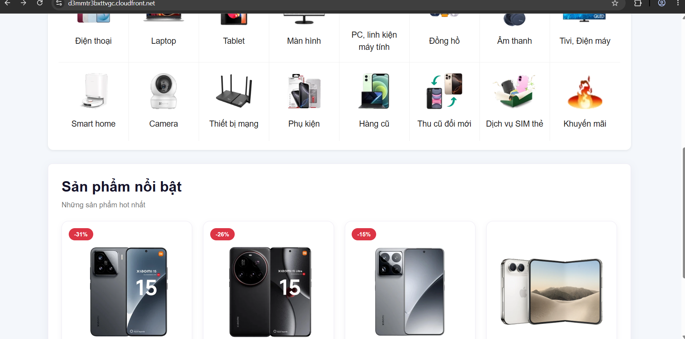
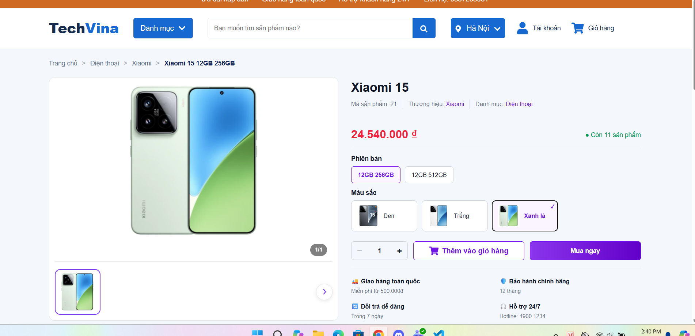
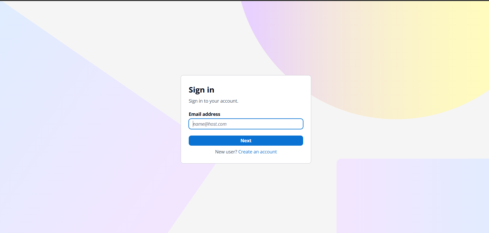

## Step 1 – Prepare Node.js and frontend source on EC2

Connect to `techvina-ec2-backend` using **Session Manager**, switch to `ubuntu`, and inspect the frontend:

```bash
sudo -iu ubuntu
cd /home/ubuntu/projects/TechVina/frontend
cat package.json
```

TechVina uses **React 19**, **Vite 8**, `react-oidc-context`, and `oidc-client-ts`. The EC2 instance initially did not have Node.js; NodeSource 24.x was installed:

```bash
curl -fsSL https://deb.nodesource.com/setup_24.x | sudo -E bash -
sudo apt install -y nodejs
node --version
npm --version
```

**Actual versions:** Node.js `v24.22.3`, npm `11.19.1`.

## Step 2 – Configure frontend environment variables

From `/home/ubuntu/projects/TechVina/frontend`, inspect the example file:

```bash
cat .env.example
```

Create `.env` in the same directory:

```bash
nano .env
```

Use values for **your AWS account**:

```dotenv
VITE_AWS_REGION=ap-southeast-1
VITE_COGNITO_USER_POOL_ID=<COGNITO_USER_POOL_ID>
VITE_COGNITO_CLIENT_ID=<COGNITO_CLIENT_ID>
VITE_COGNITO_DOMAIN=https://<COGNITO_PREFIX>.auth.ap-southeast-1.amazoncognito.com
VITE_COGNITO_REDIRECT_URI=https://<CF_DOMAIN>/
VITE_COGNITO_LOGOUT_URI=https://<CF_DOMAIN>/
VITE_API_BASE_URL=https://<CF_DOMAIN>
```

Actual TechVina API base URL:

```dotenv
VITE_API_BASE_URL=https://d3mmtr3bxttvgc.cloudfront.net
```

**Do not add a trailing `/` to `VITE_API_BASE_URL`.** `frontend/src/services/api.js` concatenates the Base URL with endpoints that already begin with `/`:

```javascript
fetch(`${BASE_URL}${endpoint}`, {
```

A trailing slash in the Base URL creates `//api/...`, which does not match the intended `/api/*` behavior. In contrast, the Redirect and Logout URLs **must have their trailing `/`** to match the Cognito callback and sign-out settings from 5.7.2.

Verify:

```bash
grep '^VITE_API_BASE_URL=' .env
```

Keep `.env` out of Git. Never put DB passwords, JWT secrets, or AWS Access Keys in `VITE_*` variables: Vite exposes them in the compiled browser JavaScript.

## Step 3 – Install dependencies and build React/Vite

From `frontend`:

```bash
npm ci
npm audit
```

The actual initial audit found **two high severity** advisories affecting `vite` and `source-map-js`. They were resolved with:

```bash
npm audit fix
npm audit
```

**Actual result:** `found 0 vulnerabilities`. `npm audit fix` changes dependency versions and `package-lock.json`. Commit the updated lockfile to GitHub before configuring CI/CD in 5.8.2 so GitHub Actions' `npm ci` installs the same resolved versions.

Build for production:

```bash
npm run build
```

**Actual result:** Vite `v8.3.8`, **390 modules transformed**, `✓ built in 1.40s`. The rebuilt bundle after correcting the API URL included `dist/assets/index-BJaK_frI.js`.

Inspect:

```bash
ls -lah dist
ls -lah dist/images
```

The build must contain `dist/index.html`, `dist/assets/`, `dist/images/`, and `dist/favicon.svg`.

## Step 4 – Verify EC2 IAM permissions for frontend S3 uploads

Install **AWS CLI v2** on the Ubuntu x86_64 instance before running `aws s3`:

```bash
cd /tmp
curl -fsSLO https://awscli.amazonaws.com/awscli-exe-linux-x86_64.zip
unzip -oq awscli-exe-linux-x86_64.zip
sudo ./aws/install --update
aws --version
```

If AWS CLI v2 is already installed, check `aws --version` and do not repeat the installation.

In **5.3.2**, the `techvina-ec2-ssm-role` role was assigned the **`techvina-frontend-s3-upload`** inline policy granting `s3:ListBucket` and `s3:PutObject` for `techvina-frontend-<AWS_ACCOUNT_ID>`.

On EC2:

```bash
aws sts get-caller-identity
```

The ARN should include `assumed-role/techvina-ec2-ssm-role/`. Verify the object listing permission:

```bash
aws s3 ls s3://techvina-frontend-<AWS_ACCOUNT_ID>/
```

Before deployment, the bucket includes `PRE images/`. If `s3:ListBucket` returns `AccessDenied`, fix the inline policy from 5.3.2; do not create AWS Access Keys on EC2.

## Step 5 – Upload the frontend build to S3

Run as `ubuntu` on EC2:

```bash
aws s3 sync /home/ubuntu/projects/TechVina/frontend/dist/ \
  s3://techvina-frontend-<AWS_ACCOUNT_ID>/ \
  --exclude "images/*" --no-progress
```

This uploads `index.html`, `favicon.svg`, and the latest `assets/` files. The `--exclude "images/*"` option keeps the image upload from 5.6.2 separate from application builds. Do **not** add `--delete`, which could remove uploaded images.

**Actual output** from the final build:

```text
upload: dist/assets/index-BJaK_frI.js to s3://techvina-frontend-668668940018/assets/index-BJaK_frI.js
upload: dist/index.html to s3://techvina-frontend-668668940018/index.html
upload: dist/favicon.svg to s3://techvina-frontend-668668940018/favicon.svg
upload: dist/assets/index-DRjsPOsz.css to s3://techvina-frontend-668668940018/assets/index-DRjsPOsz.css
```

## Step 6 – Invalidate the CloudFront homepage

Open **CloudFront → Distributions → `techvina-cloudfront` → Invalidations → Create invalidation**, select **By paths**, and enter:

```text
/
/index.html
```

Choose **Create invalidation**. The actual invalidation reached **Completed** and ensured the cached HTML referenced the updated JavaScript bundle.

## Step 7 – Validate API, images, and React Router

Open:

```text
https://<CF_DOMAIN>/
```

Verify the banner, categories, and **four featured products**. Under **F12 → Network → Fetch/XHR**, inspect:

| Request | Expected result |
|---|---|
| `/api/danh-muc/active` | `200`, categories JSON |
| `/api/san-pham/noi-bat` | `200`, four products in JSON |
| `/images/products/...webp` | `200`, S3 image via CloudFront |
| `/san-pham/21/21` | Xiaomi 15 details rendered by React Router |
| `/login` | Frontend login page rendered |

If requests appear as `//api/...` with `401`, remove the trailing slash from `VITE_API_BASE_URL`, then **rebuild → sync to S3 → invalidate**. If a client-side route returns S3 XML `AccessDenied`, verify `techvina-spa-routing` in **5.7.1** is associated with **Default (*) → Viewer request**.





## Step 8 – Test Cognito sign-in, ADMIN role, and sign-out

1. Open **Tài khoản → Đăng nhập với Amazon Cognito**. The browser navigates to the Cognito Managed Login domain set up in 5.5.2.
2. Enter the ADMIN test account email created in 5.5.2, choose **Next**, enter its password, and choose **Continue**.
3. Cognito redirects back to `https://<CF_DOMAIN>/`. The account menu shows the signed-in email and **ADMIN** role.
4. Choose **Đăng xuất**. The website returns to a signed-out state, showing **Tài khoản** in the navigation.
5. Choose **Đăng nhập với Amazon Cognito** again and confirm Cognito displays **Sign in** rather than automatically restoring the previous ADMIN session.



Do not include passwords, authorization codes, tokens, or callback URLs containing a `code` parameter in documentation or screenshots. Seeing the ADMIN role in the frontend confirms authentication and role display, but is not a substitute for authorization tests on protected API operations.
