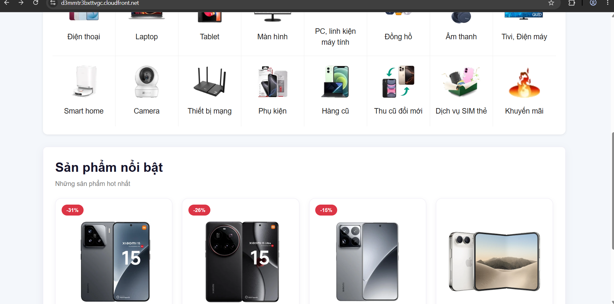
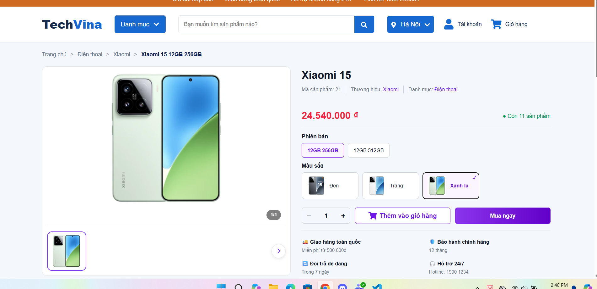
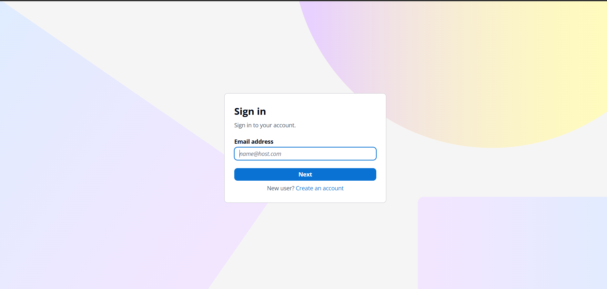

## Step 1 – Chuẩn bị Node.js và mã nguồn Frontend trên EC2

Kết nối instance `techvina-ec2-backend` qua **Session Manager**, sau đó chuyển sang tài khoản `ubuntu`:

```bash
sudo -iu ubuntu
cd /home/ubuntu/projects/TechVina/frontend
cat package.json
```

Frontend của TechVina sử dụng **React 19**, **Vite 8**, `react-oidc-context` và `oidc-client-ts`. Ở lần triển khai thực tế, Node.js chưa có sẵn trên EC2 và đã được cài từ NodeSource 24.x:

```bash
curl -fsSL https://deb.nodesource.com/setup_24.x | sudo -E bash -
sudo apt install -y nodejs
node --version
npm --version
```

**Kết quả thực tế:** Node.js `v24.22.3`, npm `11.19.1`.

## Step 2 – Tạo file cấu hình môi trường Frontend

Trong `/home/ubuntu/projects/TechVina/frontend`, đọc file mẫu:

```bash
cat .env.example
```

Tạo file `.env` trong cùng thư mục:

```bash
nano .env
```

Nhập các giá trị của **tài khoản AWS đang triển khai**:

```dotenv
VITE_AWS_REGION=ap-southeast-1
VITE_COGNITO_USER_POOL_ID=<COGNITO_USER_POOL_ID>
VITE_COGNITO_CLIENT_ID=<COGNITO_CLIENT_ID>
VITE_COGNITO_DOMAIN=https://<COGNITO_PREFIX>.auth.ap-southeast-1.amazoncognito.com
VITE_COGNITO_REDIRECT_URI=https://<CF_DOMAIN>/
VITE_COGNITO_LOGOUT_URI=https://<CF_DOMAIN>/
VITE_API_BASE_URL=https://<CF_DOMAIN>
```

Ví dụ URL API của lần triển khai TechVina:

```dotenv
VITE_API_BASE_URL=https://d3mmtr3bxttvgc.cloudfront.net
```

**Không thêm dấu `/` cuối `VITE_API_BASE_URL`.** File `frontend/src/services/api.js` nối trực tiếp Base URL với endpoint bắt đầu bằng `/`:

```javascript
fetch(`${BASE_URL}${endpoint}`, {
```

Giá trị Base URL có dấu `/` cuối sẽ tạo `//api/...`, không khớp đường dẫn behavior `/api/*` như mong muốn. Hai biến Redirect và Logout URL **có dấu `/` cuối** để khớp với callback/sign-out đã khai báo ở 5.7.2.

Kiểm tra địa chỉ API mà không in thông tin nhạy cảm:

```bash
grep '^VITE_API_BASE_URL=' .env
```

File `.env` chỉ dùng để build trên EC2 và phải nằm trong `.gitignore`. Không đưa mật khẩu MySQL, JWT Secret hay AWS Access Key vào biến `VITE_*` vì các biến này được nhúng vào bản JavaScript của trình duyệt.

## Step 3 – Cài dependencies và build React/Vite

Trong thư mục `frontend`:

```bash
npm ci
npm audit
```

Ở lần triển khai thực tế, `npm audit` phát hiện hai cảnh báo mức **high** trong `vite` và `source-map-js`. Các gói đã được cập nhật bằng:

```bash
npm audit fix
npm audit
```

**Kết quả thực tế:** `found 0 vulnerabilities`. Vì `npm audit fix` thay đổi các gói và `package-lock.json`, đồng bộ file lock đã sửa trở lại GitHub trước khi thiết lập CI/CD ở 5.8.2 để `npm ci` trên GitHub Actions sử dụng cùng phiên bản.

Build bản production:

```bash
npm run build
```

**Kết quả thực tế:** Vite `v8.3.8`, **390 modules transformed**, `✓ built in 1.40s`. Ví dụ file JavaScript của bản build sau khi chuẩn hóa URL API: `dist/assets/index-BJaK_frI.js`.

Kiểm tra output:

```bash
ls -lah dist
ls -lah dist/images
```

Kết quả phải có `dist/index.html`, `dist/assets/`, `dist/images/` và `dist/favicon.svg`.

## Step 4 – Cấp quyền EC2 upload Frontend S3 và kiểm tra IAM

Cài **AWS CLI v2** trên EC2 Ubuntu x86_64 trước khi sử dụng lệnh `aws s3`:

```bash
cd /tmp
curl -fsSLO https://awscli.amazonaws.com/awscli-exe-linux-x86_64.zip
unzip -oq awscli-exe-linux-x86_64.zip
sudo ./aws/install --update
aws --version
```

Nếu AWS CLI v2 đã được cài, lệnh `aws --version` xác nhận phiên bản hiện có và không cần cài lặp lại.

Role `techvina-ec2-ssm-role` đã được cấp inline policy **`techvina-frontend-s3-upload`** trong **5.3.2** với hai quyền `s3:ListBucket` và `s3:PutObject` cho bucket `techvina-frontend-<AWS_ACCOUNT_ID>`.

Trên EC2, kiểm tra IAM Role đang sử dụng:

```bash
aws sts get-caller-identity
```

ARN phải chứa `assumed-role/techvina-ec2-ssm-role/`. Kiểm tra quyền liệt kê object:

```bash
aws s3 ls s3://techvina-frontend-<AWS_ACCOUNT_ID>/
```

Kết quả trước khi triển khai bản build có `PRE images/`. Nếu gặp `AccessDenied` với `s3:ListBucket`, kiểm tra lại inline policy ở 5.3.2, không tạo AWS Access Key trên EC2.

## Step 5 – Tải bản build Frontend lên S3

Từ tài khoản `ubuntu` trên EC2, chạy:

```bash
aws s3 sync /home/ubuntu/projects/TechVina/frontend/dist/ \
  s3://techvina-frontend-<AWS_ACCOUNT_ID>/ \
  --exclude "images/*" --no-progress
```

Lệnh tải `index.html`, `favicon.svg` và các file `assets/` mới lên bucket S3. Tùy chọn `--exclude "images/*"` giữ quy trình ảnh đã tải tại 5.6.2 độc lập với các lần build; **không thêm `--delete`** để tránh xóa file ảnh.

**Kết quả thực tế** ở lần build cuối:

```text
upload: dist/assets/index-BJaK_frI.js to s3://techvina-frontend-668668940018/assets/index-BJaK_frI.js
upload: dist/index.html to s3://techvina-frontend-668668940018/index.html
upload: dist/favicon.svg to s3://techvina-frontend-668668940018/favicon.svg
upload: dist/assets/index-DRjsPOsz.css to s3://techvina-frontend-668668940018/assets/index-DRjsPOsz.css
```

## Step 6 – Làm mới cache CloudFront

Vào **CloudFront → Distributions → `techvina-cloudfront` → Invalidations → Create invalidation**. Chọn **By paths** và nhập mỗi đường dẫn một dòng:

```text
/
/index.html
```

Nhấn **Create invalidation**. Trong quá trình triển khai thực tế, invalidation chuyển sang trạng thái **Completed**; từ đó `index.html` tham chiếu đến file JavaScript mới.

## Step 7 – Kiểm tra API, hình ảnh và React Router

Mở website:

```text
https://<CF_DOMAIN>/
```

Kiểm tra trang chủ hiển thị banner, danh mục nổi bật và **4 sản phẩm nổi bật**. Mở **F12 → Network → Fetch/XHR** rồi kiểm tra:

| Request | Kết quả |
|---|---|
| `/api/danh-muc/active` | `200`, JSON danh mục |
| `/api/san-pham/noi-bat` | `200`, JSON gồm 4 sản phẩm |
| `/images/products/...webp` | `200`, trả ảnh từ S3 qua CloudFront |
| `/san-pham/21/21` | Trang chi tiết Xiaomi 15 hiển thị thông qua React Router |
| `/login` | Trang đăng nhập của Frontend hiển thị |

Nếu Network hiển thị `//api/...` và lỗi `401`, kiểm tra lại dấu `/` cuối của `VITE_API_BASE_URL`, rồi **build → sync S3 → invalidation** lần nữa. Nếu các đường dẫn React Router trả XML `AccessDenied`, kiểm tra Function `techvina-spa-routing` ở 5.7.1 đã gắn với **Default (*) → Viewer request** hay chưa.





## Step 8 – Kiểm thử đăng nhập, vai trò ADMIN và đăng xuất

1. Trên website, mở **Tài khoản → Đăng nhập với Amazon Cognito**. Trình duyệt chuyển sang Cognito Managed Login tại domain đã cấu hình ở 5.5.2.
2. Nhập email của tài khoản ADMIN đã tạo ở 5.5.2, nhấn **Next**, nhập mật khẩu và chọn **Continue**.
3. Sau khi xác thực, Cognito chuyển trình duyệt về `https://<CF_DOMAIN>/`. Menu tài khoản hiển thị email và vai trò **ADMIN**.
4. Chọn **Đăng xuất**; website trở về trạng thái chưa đăng nhập và thanh điều hướng hiển thị **Tài khoản**.
5. Mở lại **Đăng nhập với Amazon Cognito** để kiểm tra Cognito hiển thị màn hình **Sign in** thay vì tự động vào phiên ADMIN vừa đăng xuất.



Không đưa mật khẩu, mã ủy quyền, token hoặc URL callback có tham số `code` vào ảnh chụp hoặc tài liệu. Trạng thái ADMIN hiển thị trên Frontend là bằng chứng đăng nhập và nhận diện nhóm; không thay thế việc kiểm thử phân quyền các API bảo vệ khi có nhu cầu.
