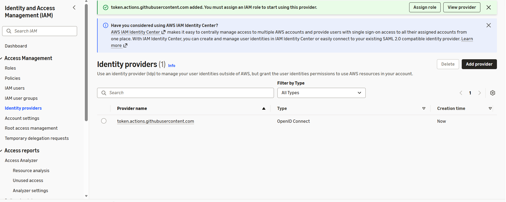
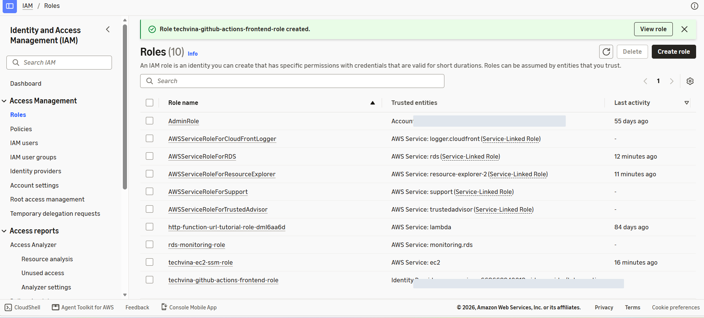
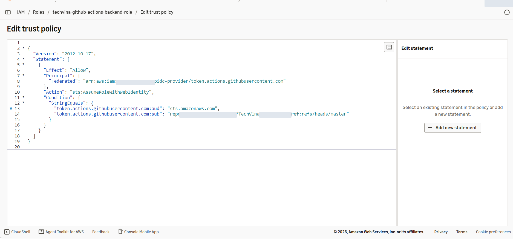
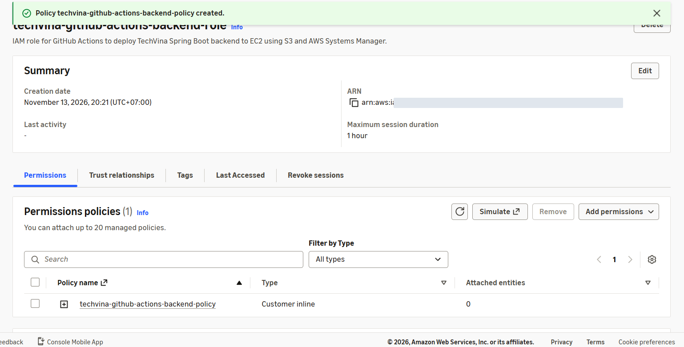

## Step 1 – Tạo GitHub OIDC Identity Provider

1. Truy cập **AWS Console → IAM → Identity providers → Add provider**.
2. Tại **Provider type**, chọn **OpenID Connect**.
3. Nhập các giá trị:

   | Trường | Giá trị |
   |---|---|
   | Provider URL | `https://token.actions.githubusercontent.com` |
   | Audience | `sts.amazonaws.com` |

4. Chọn **Add provider**. Trong danh sách **Identity providers**, kiểm tra provider `token.actions.githubusercontent.com` có loại **OpenID Connect**.



## Step 2 – Tạo hai IAM Roles cho GitHub Actions

1. Mở **IAM → Roles → Create role**.
2. Chọn **Web identity**, chọn provider `token.actions.githubusercontent.com`, audience `sts.amazonaws.com`.
3. Tạo lần lượt hai Role:

   | Role | Mục đích |
   |---|---|
   | `techvina-github-actions-frontend-role` | Đẩy bản build React lên S3 và tạo CloudFront invalidation |
   | `techvina-github-actions-backend-role` | Tải JAR/script lên S3 và gửi lệnh triển khai đến EC2 qua SSM |

4. Mở từng Role, chọn **Trust relationships → Edit trust policy** để cấu hình giới hạn quyền sử dụng theo repository và nhánh GitHub.



## Step 3 – Cấu hình Trust Policy theo GitHub OIDC Subject

Trong quá trình triển khai TechVina, repository được tạo sau **15/07/2026**, vì vậy GitHub phát hành OIDC `sub` có cả **Owner ID** và **Repository ID** dưới dạng:

```text
repo:<GITHUB_OWNER>@<OWNER_ID>/<REPOSITORY>@<REPO_ID>:ref:refs/heads/master
```

Mở **Trust relationships → Edit trust policy** của **cả hai IAM Roles** và sử dụng mẫu JSON sau. Thay các giá trị trong dấu `<...>` bằng thông tin của tài khoản AWS và repository thực tế:

```json
{
  "Version": "2012-10-17",
  "Statement": [
    {
      "Effect": "Allow",
      "Principal": {
        "Federated": "arn:aws:iam::<AWS_ACCOUNT_ID>:oidc-provider/token.actions.githubusercontent.com"
      },
      "Action": "sts:AssumeRoleWithWebIdentity",
      "Condition": {
        "StringEquals": {
          "token.actions.githubusercontent.com:aud": "sts.amazonaws.com",
          "token.actions.githubusercontent.com:sub": "repo:<GITHUB_OWNER>@<OWNER_ID>/TechVina@<REPO_ID>:ref:refs/heads/master"
        }
      }
    }
  ]
}
```

Trong repository **TechVina**, branch triển khai là `master`. Điều kiện `StringEquals` giới hạn quyền AssumeRole cho đúng repository và nhánh đã cấu hình.

Đối chiếu giá trị `sub` với claim thực tế từ GitHub Actions. Với repository phát hành OIDC theo định dạng cũ, giá trị `sub` có thể không chứa các ID; dùng đúng claim thực tế thay vì sao chép máy móc một mẫu khác.



Chọn **Update policy** để lưu, thực hiện tương tự với IAM Role Frontend.

## Step 4 – Cấp quyền cho IAM Role Frontend

1. Mở Role `techvina-github-actions-frontend-role`.
2. Chọn **Add permissions → Create inline policy → JSON**.
3. Nhập policy sau, thay `<AWS_ACCOUNT_ID>` và `<CF_DISTRIBUTION_ID>` bằng tài nguyên AWS hiện tại:

```json
{
  "Version": "2012-10-17",
  "Statement": [
    {
      "Sid": "ListFrontendBucket",
      "Effect": "Allow",
      "Action": "s3:ListBucket",
      "Resource": "arn:aws:s3:::techvina-frontend-<AWS_ACCOUNT_ID>"
    },
    {
      "Sid": "UploadFrontendFiles",
      "Effect": "Allow",
      "Action": "s3:PutObject",
      "Resource": "arn:aws:s3:::techvina-frontend-<AWS_ACCOUNT_ID>/*"
    },
    {
      "Sid": "InvalidateCloudFront",
      "Effect": "Allow",
      "Action": "cloudfront:CreateInvalidation",
      "Resource": "arn:aws:cloudfront::<AWS_ACCOUNT_ID>:distribution/<CF_DISTRIBUTION_ID>"
    }
  ]
}
```

4. Lưu Inline Policy cho Role. Các quyền S3 cho phép `aws s3 sync` tải bản build lên bucket Frontend. Quyền CloudFront chỉ áp dụng cho distribution của TechVina.

## Step 5 – Cấp quyền cho IAM Role Backend

1. Mở Role `techvina-github-actions-backend-role`.
2. Chọn **Add permissions → Create inline policy → JSON**.
3. Cấu hình quyền Upload Artifacts và SSM theo tài nguyên thực tế:

```json
{
  "Version": "2012-10-17",
  "Statement": [
    {
      "Sid": "UploadBackendArtifacts",
      "Effect": "Allow",
      "Action": "s3:PutObject",
      "Resource": "arn:aws:s3:::techvina-backend-artifacts-<AWS_ACCOUNT_ID>/releases/*"
    },
    {
      "Sid": "RunDeployCommandOnEC2",
      "Effect": "Allow",
      "Action": "ssm:SendCommand",
      "Resource": [
        "arn:aws:ssm:ap-southeast-1::document/AWS-RunShellScript",
        "arn:aws:ec2:ap-southeast-1:<AWS_ACCOUNT_ID>:instance/<EC2_INSTANCE_ID>"
      ]
    },
    {
      "Sid": "ReadSSMCommandResult",
      "Effect": "Allow",
      "Action": "ssm:GetCommandInvocation",
      "Resource": "*"
    }
  ]
}
```

4. Đặt tên Inline Policy là `techvina-github-actions-backend-policy`, sau đó lưu. Quyền `ssm:SendCommand` được giới hạn cho tài liệu `AWS-RunShellScript` và EC2 Backend đã chọn.



## Step 6 – Cấp quyền đọc Artifacts cho IAM Role của EC2

Trong **IAM → Roles → `techvina-ec2-ssm-role`**, mở **Permissions** và kiểm tra Inline Policy cho phép máy chủ tải JAR/script về từ bucket Backend Artifacts:

```json
{
  "Version": "2012-10-17",
  "Statement": [
    {
      "Effect": "Allow",
      "Action": "s3:GetObject",
      "Resource": "arn:aws:s3:::techvina-backend-artifacts-<AWS_ACCOUNT_ID>/releases/*"
    }
  ]
}
```

Máy chủ EC2 sử dụng IAM Instance Profile đã gắn cho Role `techvina-ec2-ssm-role` để thực hiện `aws s3 cp`, không lưu AWS Access Key trên máy chủ. Role này cũng đã có quyền quản lý qua Systems Manager.

## Step 7 – Cho phép GitHub Actions sử dụng OIDC

Trong hai file workflow sau:

```text
.github/workflows/deploy-frontend.yml
.github/workflows/deploy-backend.yml
```

Cấu hình quyền cấp token OIDC cho job:

```yaml
permissions:
  contents: read
  id-token: write
```

Trong bước xác thực AWS của mỗi workflow, cấu hình `aws-actions/configure-aws-credentials@v6.3.0` với ARN của IAM Role tương ứng:

```yaml
- name: Configure AWS credentials
  uses: aws-actions/configure-aws-credentials@v6.3.0
  with:
    role-to-assume: arn:aws:iam::<AWS_ACCOUNT_ID>:role/techvina-github-actions-frontend-role
    aws-region: ap-southeast-1
```

Workflow Backend dùng `techvina-github-actions-backend-role` thay cho Role Frontend. Sau bước xác thực, workflow kiểm tra AWS Identity bằng lệnh:

```bash
aws sts get-caller-identity
```

Kết quả xác thực OIDC được kiểm chứng bằng các lần chạy thành công của workflow Frontend và Backend ở mục **5.8.2** và **5.8.3**.
