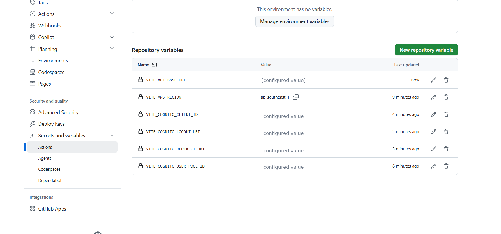
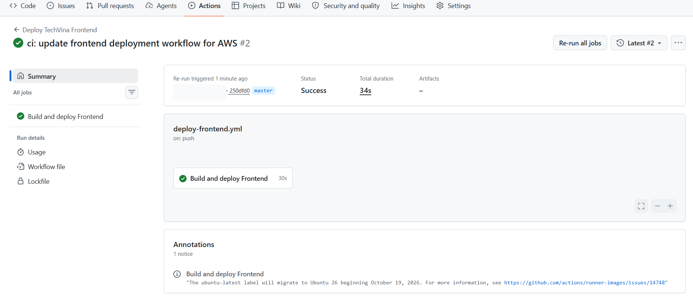
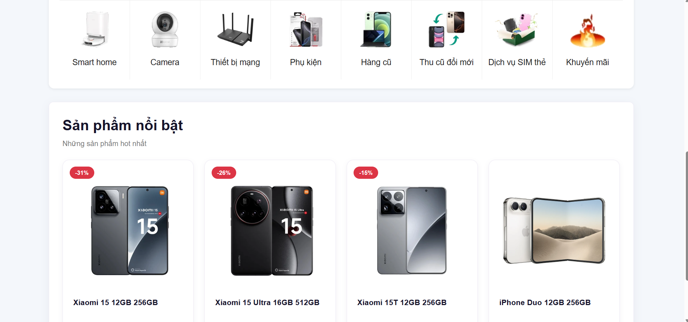

## Step 1 – Prepare the Frontend Source Code on GitHub

The **TechVina** repository uses the `master` branch for automatic deployment. Verify the following project structure:

```text
TechVina/
├── frontend/
│   ├── package.json
│   ├── package-lock.json
│   ├── src/
│   └── public/
└── .github/
    └── workflows/
        └── deploy-frontend.yml
```

Open the project root directory in **VS Code** and check the current Git branch:

```bash
git branch --show-current
```

Expected deployment branch:

```text
master
```

GitHub Actions uses `frontend/package-lock.json` to install pinned dependencies through `npm ci` before building the application. The Frontend does not need to be built on EC2; the GitHub-hosted runner handles the build.

## Step 2 – Configure GitHub Repository Variables

1. Open the **TechVina** repository on GitHub.
2. Select **Settings → Secrets and variables → Actions → Variables**.
3. Click **New repository variable** and create these six variables:

| Repository Variable | Configured value |
|---|---|
| `VITE_API_BASE_URL` | `https://<CLOUDFRONT_DOMAIN>` (without a trailing `/`) |
| `VITE_AWS_REGION` | `ap-southeast-1` |
| `VITE_COGNITO_USER_POOL_ID` | `<COGNITO_USER_POOL_ID>` |
| `VITE_COGNITO_CLIENT_ID` | `<COGNITO_APP_CLIENT_ID>` |
| `VITE_COGNITO_REDIRECT_URI` | `https://<CLOUDFRONT_DOMAIN>/` |
| `VITE_COGNITO_LOGOUT_URI` | `https://<CLOUDFRONT_DOMAIN>/` |



The CloudFront address must match the callback configuration of the Cognito App Client. Values prefixed with `VITE_*` become part of browser-side JavaScript; do not store AWS Access Keys, database passwords, or other secrets in these variables.

## Step 3 – Configure the Frontend Deployment Workflow

Open `.github/workflows/deploy-frontend.yml`. The workflow uses **Node.js 22**, **GitHub OIDC** (configured in section 5.8.1), and the S3/CloudFront resources in `ap-southeast-1`.

Configure the workflow as shown below. Replace `<AWS_ACCOUNT_ID>` and `<CLOUDFRONT_DISTRIBUTION_ID>` with the actual AWS resource identifiers:

```yaml
name: Deploy TechVina Frontend

on:
  push:
    branches:
      - master
    paths:
      - "frontend/**"
      - ".github/workflows/deploy-frontend.yml"
  workflow_dispatch:

permissions:
  contents: read
  id-token: write

concurrency:
  group: deploy-techvina-frontend
  cancel-in-progress: false

jobs:
  deploy:
    name: Build and deploy Frontend
    runs-on: ubuntu-latest
    defaults:
      run:
        working-directory: frontend

    steps:
      - name: Checkout source code
        uses: actions/checkout@v7

      - name: Setup Node.js
        uses: actions/setup-node@v7
        with:
          node-version: "22"
          cache: npm
          cache-dependency-path: frontend/package-lock.json

      - name: Install dependencies
        run: npm ci

      - name: Build Frontend
        env:
          VITE_API_BASE_URL: ${{ vars.VITE_API_BASE_URL }}
          VITE_AWS_REGION: ${{ vars.VITE_AWS_REGION }}
          VITE_COGNITO_USER_POOL_ID: ${{ vars.VITE_COGNITO_USER_POOL_ID }}
          VITE_COGNITO_CLIENT_ID: ${{ vars.VITE_COGNITO_CLIENT_ID }}
          VITE_COGNITO_REDIRECT_URI: ${{ vars.VITE_COGNITO_REDIRECT_URI }}
          VITE_COGNITO_LOGOUT_URI: ${{ vars.VITE_COGNITO_LOGOUT_URI }}
        run: npm run build

      - name: Configure AWS credentials
        uses: aws-actions/configure-aws-credentials@v6.3.0
        with:
          role-to-assume: arn:aws:iam::<AWS_ACCOUNT_ID>:role/techvina-github-actions-frontend-role
          aws-region: ap-southeast-1

      - name: Deploy to Amazon S3
        run: |
          aws s3 sync dist/ s3://techvina-frontend-<AWS_ACCOUNT_ID>/ \
            --exclude "images/*" \
            --no-progress \
            --only-show-errors

      - name: Invalidate CloudFront cache
        run: |
          aws cloudfront create-invalidation \
            --distribution-id <CLOUDFRONT_DISTRIBUTION_ID> \
            --paths "/*"
```

The workflow performs the following operations in sequence:

1. **Checkout source code:** Fetch the repository source.
2. **Setup Node.js / Install dependencies:** Install Node.js 22 and dependencies from `package-lock.json`.
3. **Build Frontend:** Pass the six Repository Variables and run `npm run build` to generate `frontend/dist/`.
4. **Configure AWS credentials:** Assume the `techvina-github-actions-frontend-role` using OIDC temporary credentials, without permanent AWS Access Keys.
5. **Deploy to Amazon S3:** Synchronize the new build to `techvina-frontend-<AWS_ACCOUNT_ID>`.
6. **Invalidate CloudFront cache:** Refresh the distribution using a `/*` CloudFront invalidation.

The `--exclude "images/*"` option preserves the `images/` objects used in **5.6.2**. The workflow also intentionally omits `--delete` to avoid deleting objects that are not part of the Frontend build.

The workflow triggers automatically when files under `frontend/**` or the Frontend workflow change on `master`. It can also be started manually from GitHub Actions using **Run workflow**.

## Step 4 – Commit, Push, and Verify GitHub Actions

Save the workflow, then run these commands from the repository root in VS Code's Git Bash terminal:

```bash
git add .github/workflows/deploy-frontend.yml
git commit -m "ci: update frontend deployment workflow for AWS"
git push origin master
```

Open **GitHub → Actions → Deploy TechVina Frontend**, select the workflow run for the pushed commit, and inspect the **Build and deploy Frontend** job.

During the actual TechVina deployment, after correcting the GitHub OIDC subject in the IAM Trust Policy as described in **5.8.1**, the workflow was rerun successfully:

```text
Workflow: Deploy TechVina Frontend
Job: Build and deploy Frontend
Commit: 250dfd0
Status: Success
Total duration: 34s
```



Verify that `Install dependencies`, `Build Frontend`, `Configure AWS credentials`, `Deploy to Amazon S3`, and `Invalidate CloudFront cache` all complete. If AWS authentication fails, verify the IAM Trust Policy and actual OIDC `sub` as documented in **5.8.1**.

## Step 5 – Verify the Deployed Website

1. Open **Amazon S3 → `techvina-frontend-<AWS_ACCOUNT_ID>` → Objects** and verify `index.html`, `assets/`, and `images/`.
2. Open **CloudFront → Distributions** and check that an invalidation was created.
3. Open the website using the CloudFront domain configured in **5.7.1**.
4. Verify the homepage, banner, categories, and featured product list. Product data continues to load from Spring Boot through the CloudFront API path.




Observed result: The GitHub Actions run completed with **Success**, and the CloudFront website displayed the Frontend, product images, and product data. The deployment preserved the image objects under the S3 `images/` prefix.
