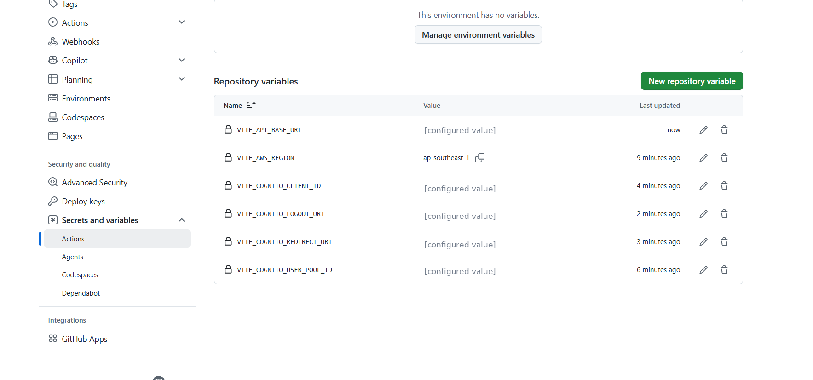
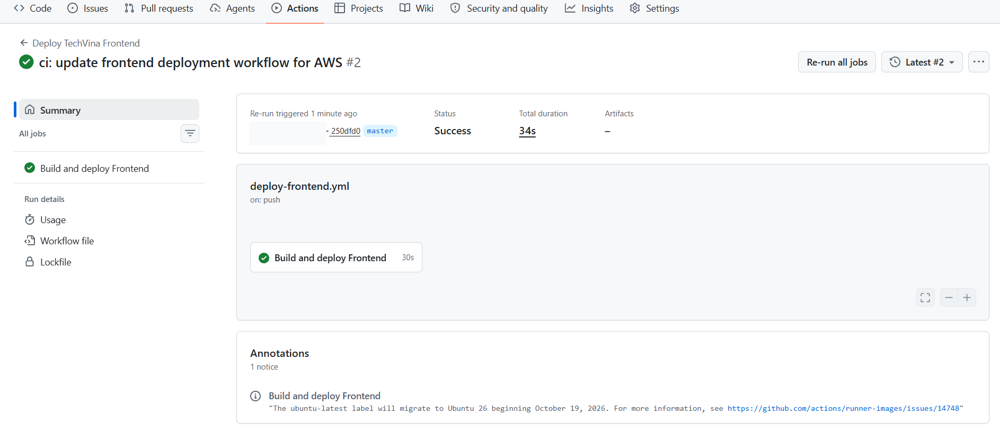
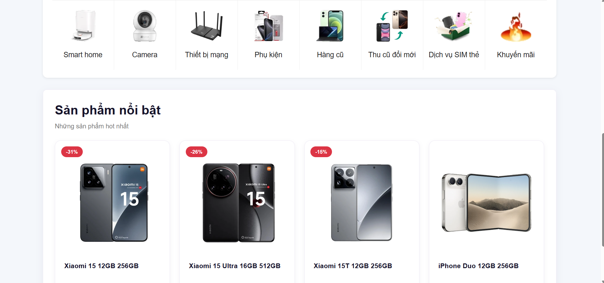

## Step 1 – Chuẩn bị mã nguồn Frontend trên GitHub

Repository **TechVina** sử dụng nhánh `master` để triển khai tự động. Kiểm tra dự án có các thành phần:

```text
TechVina/
├── frontend/
│   ├── package.json
│   ├── package-lock.json
│   ├── src/
│   └── public/
└── .github/
    └── workflows/
        └── deploy-frontend.yml
```

Trong **VS Code**, mở thư mục gốc dự án và kiểm tra nhánh Git:

```bash
git branch --show-current
```

Kết quả của nhánh triển khai:

```text
master
```

GitHub Actions sẽ sử dụng `frontend/package-lock.json` để cài đặt chính xác các phiên bản thư viện bằng `npm ci` trước khi build. Không cần build Frontend trên EC2: GitHub-hosted runner thực hiện quá trình này.

## Step 2 – Cấu hình GitHub Repository Variables

1. Mở repository **TechVina** trên GitHub.
2. Chọn **Settings → Secrets and variables → Actions → Variables**.
3. Nhấn **New repository variable** và tạo sáu biến:

| Repository Variable | Giá trị cấu hình |
|---|---|
| `VITE_API_BASE_URL` | `https://<CLOUDFRONT_DOMAIN>` (không có dấu `/` ở cuối) |
| `VITE_AWS_REGION` | `ap-southeast-1` |
| `VITE_COGNITO_USER_POOL_ID` | `<COGNITO_USER_POOL_ID>` |
| `VITE_COGNITO_CLIENT_ID` | `<COGNITO_APP_CLIENT_ID>` |
| `VITE_COGNITO_REDIRECT_URI` | `https://<CLOUDFRONT_DOMAIN>/` |
| `VITE_COGNITO_LOGOUT_URI` | `https://<CLOUDFRONT_DOMAIN>/` |



Địa chỉ CloudFront phải trùng với địa chỉ đã cấu hình trong Cognito App Client. Các biến `VITE_*` được đưa vào bản build chạy trên trình duyệt, vì vậy không lưu AWS Access Key, mật khẩu cơ sở dữ liệu hoặc thông tin bí mật tại đây.

## Step 3 – Cấu hình workflow triển khai Frontend

Mở file `.github/workflows/deploy-frontend.yml`. Workflow sử dụng **Node.js 22**, **GitHub OIDC** (đã tạo ở mục 5.8.1) và triển khai đến S3/CloudFront ở Region `ap-southeast-1`.

Cập nhật workflow theo cấu hình dưới đây. Thay `<AWS_ACCOUNT_ID>` và `<CLOUDFRONT_DISTRIBUTION_ID>` bằng các tài nguyên đã tạo trong tài khoản AWS:

```yaml
name: Deploy TechVina Frontend

on:
  push:
    branches:
      - master
    paths:
      - "frontend/**"
      - ".github/workflows/deploy-frontend.yml"
  workflow_dispatch:

permissions:
  contents: read
  id-token: write

concurrency:
  group: deploy-techvina-frontend
  cancel-in-progress: false

jobs:
  deploy:
    name: Build and deploy Frontend
    runs-on: ubuntu-latest
    defaults:
      run:
        working-directory: frontend

    steps:
      - name: Checkout source code
        uses: actions/checkout@v7

      - name: Setup Node.js
        uses: actions/setup-node@v7
        with:
          node-version: "22"
          cache: npm
          cache-dependency-path: frontend/package-lock.json

      - name: Install dependencies
        run: npm ci

      - name: Build Frontend
        env:
          VITE_API_BASE_URL: ${{ vars.VITE_API_BASE_URL }}
          VITE_AWS_REGION: ${{ vars.VITE_AWS_REGION }}
          VITE_COGNITO_USER_POOL_ID: ${{ vars.VITE_COGNITO_USER_POOL_ID }}
          VITE_COGNITO_CLIENT_ID: ${{ vars.VITE_COGNITO_CLIENT_ID }}
          VITE_COGNITO_REDIRECT_URI: ${{ vars.VITE_COGNITO_REDIRECT_URI }}
          VITE_COGNITO_LOGOUT_URI: ${{ vars.VITE_COGNITO_LOGOUT_URI }}
        run: npm run build

      - name: Configure AWS credentials
        uses: aws-actions/configure-aws-credentials@v6.3.0
        with:
          role-to-assume: arn:aws:iam::<AWS_ACCOUNT_ID>:role/techvina-github-actions-frontend-role
          aws-region: ap-southeast-1

      - name: Deploy to Amazon S3
        run: |
          aws s3 sync dist/ s3://techvina-frontend-<AWS_ACCOUNT_ID>/ \
            --exclude "images/*" \
            --no-progress \
            --only-show-errors

      - name: Invalidate CloudFront cache
        run: |
          aws cloudfront create-invalidation \
            --distribution-id <CLOUDFRONT_DISTRIBUTION_ID> \
            --paths "/*"
```

Workflow hoạt động theo thứ tự:

1. **Checkout source code:** Lấy mã nguồn của repository.
2. **Setup Node.js / Install dependencies:** Cài Node.js 22 và các thư viện từ `package-lock.json`.
3. **Build Frontend:** Truyền sáu Repository Variables và thực hiện `npm run build` để tạo thư mục `frontend/dist/`.
4. **Configure AWS credentials:** Sử dụng OIDC để nhận quyền tạm thời từ IAM Role `techvina-github-actions-frontend-role`, không sử dụng Access Key cố định.
5. **Deploy to Amazon S3:** Đồng bộ bản build mới vào bucket `techvina-frontend-<AWS_ACCOUNT_ID>`.
6. **Invalidate CloudFront cache:** Làm mới nội dung phân phối bằng CloudFront invalidation `/*`.

Trong bước S3 sync, tham số `--exclude "images/*"` giữ nguyên các đối tượng thuộc thư mục `images/` đã sử dụng ở **5.6.2**. Workflow cũng **không sử dụng `--delete`**, tránh xóa các đối tượng nằm ngoài bản build Frontend.

Workflow tự chạy khi có thay đổi trong `frontend/**` hoặc file workflow trên nhánh `master`; ngoài ra có thể chạy thủ công bằng **Run workflow** trong GitHub Actions.

## Step 4 – Commit, push và theo dõi GitHub Actions

Tại thư mục gốc của dự án, lưu file workflow, sau đó dùng Git Bash trong VS Code:

```bash
git add .github/workflows/deploy-frontend.yml
git commit -m "ci: update frontend deployment workflow for AWS"
git push origin master
```

Mở **GitHub → Actions → Deploy TechVina Frontend**, chọn lần chạy tương ứng với commit vừa push và kiểm tra job **Build and deploy Frontend**.

Trong quá trình triển khai thực tế, sau khi cập nhật Trust Policy OIDC theo GitHub Subject của repository ở **5.8.1**, workflow được chạy lại thành công với kết quả:

```text
Workflow: Deploy TechVina Frontend
Job: Build and deploy Frontend
Commit: 250dfd0
Status: Success
Total duration: 34s
```



Kiểm tra trong job các bước `Install dependencies`, `Build Frontend`, `Configure AWS credentials`, `Deploy to Amazon S3` và `Invalidate CloudFront cache` đều hoàn thành. Nếu bước xác thực AWS thất bại, đối chiếu IAM Trust Policy và OIDC `sub` theo mục **5.8.1**.

## Step 5 – Kiểm tra website sau khi triển khai

1. Mở **Amazon S3 → `techvina-frontend-<AWS_ACCOUNT_ID>` → Objects** và kiểm tra `index.html`, `assets/`, `images/`.
2. Mở **CloudFront → Distributions** và xác nhận bản invalidation đã được tạo.
3. Truy cập website thông qua tên miền CloudFront đã cấu hình ở **5.7.1**.
4. Kiểm tra trang chủ, banner, danh mục và danh sách sản phẩm nổi bật. Dữ liệu sản phẩm vẫn được tải từ Spring Boot Backend thông qua đường dẫn API của CloudFront.




Kết quả kiểm thử thực tế: GitHub Actions trả về **Success**, website qua CloudFront hiển thị giao diện, ảnh sản phẩm và dữ liệu sản phẩm. Pipeline Frontend đã triển khai thành công, không làm mất nội dung hình ảnh thuộc `images/` trên S3.
