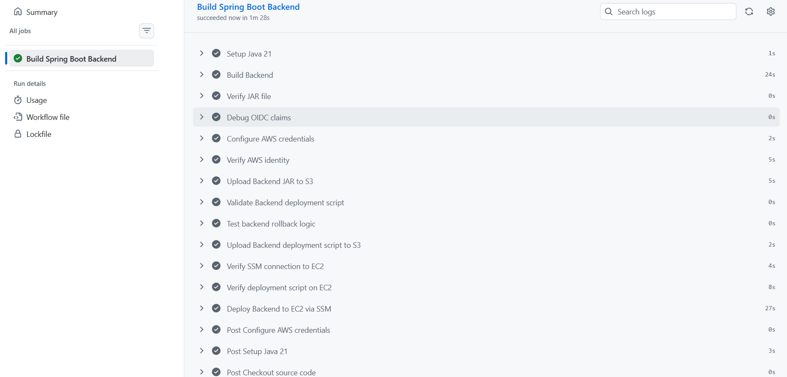
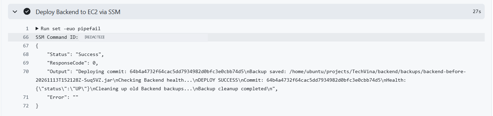
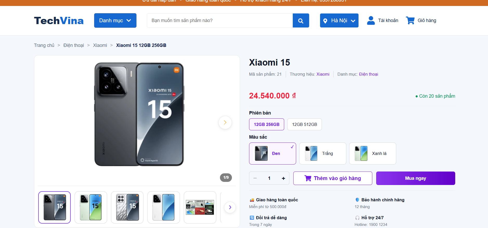

## Step 1 – Verify the Backend on EC2 before deployment

The **TechVina Backend** runs as a Spring Boot application on the `techvina-ec2-backend` EC2 instance (Ubuntu 24.04) in **Singapore (`ap-southeast-1`)**. The existing `techvina-backend.service` was configured in **section 5.5**. GitHub Actions updates the deployed JAR without recreating the EC2 instance or the RDS database.

1. Open **AWS Systems Manager → Session Manager** and connect to the Backend instance.
2. Verify the service and HTTP health endpoint:

```bash
sudo systemctl is-active techvina-backend.service
```

```text
active
```

```bash
curl -sS --max-time 5 http://127.0.0.1:8080/actuator/health
```

```json
{"status":"UP"}
```

3. Verify that AWS CLI, the JAR validation utility and the deployment lock utility are available:

```bash
aws --version
```

The AWS CLI version recorded during deployment was **v2.35.21**. The utility checks returned:

```bash
command -v flock
```

```text
/usr/bin/flock
```

```bash
command -v unzip
```

```text
/usr/bin/unzip
```

If `unzip` is not installed, install it on Ubuntu and verify the path:

```bash
sudo apt-get install -y unzip
command -v unzip
```

```text
/usr/bin/unzip
```

The EC2 instance role `techvina-ec2-ssm-role` grants `s3:GetObject` on `releases/*` in the Backend Artifacts bucket. The GitHub Actions Backend role and OIDC trust configuration were created in **section 5.8.1**.

## Step 2 – Prepare the GitHub workflow and deployment scripts

Open the **TechVina** repository in VS Code and work on the `master` branch. The deployment-related files are:

```text
TechVina/
├── backend/
│   ├── pom.xml
│   └── src/
└── .github/
    ├── workflows/
    │   └── deploy-backend.yml
    ├── scripts/
    │   └── deploy-backend.sh
    └── tests/
        └── test-backend-rollback.sh
```

The **`techvina-backend-artifacts-<AWS_ACCOUNT_ID>`** bucket stores two artifacts under `releases/`:

```text
releases/backend-<COMMIT_SHA>.jar
releases/deploy-backend-<COMMIT_SHA>.sh
```

In the configuration examples below, replace `<AWS_ACCOUNT_ID>` with the AWS account ID and `<EC2_INSTANCE_ID>` with the actual Backend EC2 instance ID. The deployed resources were verified in `ap-southeast-1`.

## Step 3 – Configure the deployment, backup and rollback script

Open `.github/scripts/deploy-backend.sh`. The script downloads the JAR identified by a commit SHA, validates its archive structure with `unzip`, backs up the live JAR and restarts the Spring Boot service through `systemctl`. If deployment fails after the JAR replacement begins, the `on_exit()` handler restores the backup and checks `/actuator/health`. A `flock` lock prevents overlapping deployments.

Use the following script and replace `<AWS_ACCOUNT_ID>` with the account used for deployment:

```bash
#!/usr/bin/env bash
set -Eeuo pipefail

# Cau hinh TechVina Backend
BASE="/home/ubuntu/projects/TechVina/backend"
LIVE="$BASE/target/backend-0.0.1-SNAPSHOT.jar"
SERVICE="techvina-backend.service"
BACKUP_DIR="$BASE/backups"

BUCKET="techvina-backend-artifacts-<AWS_ACCOUNT_ID>"
REGION="ap-southeast-1"
HEALTH_URL="http://127.0.0.1:8080/actuator/health"

# Nhan commit SHA tu GitHub Actions
COMMIT_SHA="${1:-}"

if [[ ! "$COMMIT_SHA" =~ ^[a-f0-9]{40}$ ]]; then
  echo "ERROR: Invalid commit SHA"
  exit 1
fi

# Script phai chay voi quyen root
if [[ "$EUID" -ne 0 ]]; then
  echo "ERROR: Root permission required"
  exit 1
fi

# Ngan hai lan trien khai chay dong thoi
exec 9>/run/lock/techvina-backend-deploy.lock
flock -n 9 || {
  echo "ERROR: Another deployment is running"
  exit 1
}

# Tao thu muc sao luu
install -d -o ubuntu -g ubuntu -m 700 "$BACKUP_DIR"

NEW_JAR=$(mktemp "$BASE/target/.deploy-XXXXXX.jar")
BACKUP=""
SWITCH_STARTED=false
DEPLOY_OK=false

# Kiem tra trang thai ung dung
wait_for_health() {
  for i in $(seq 1 45); do
    RESPONSE=$(curl -fsS --max-time 3 \
      "$HEALTH_URL" 2>/dev/null || true)

    if [[ "$RESPONSE" == '{"status":"UP"}' ]]; then
      return 0
    fi

    sleep 2
  done

  return 1
}

# Tu dong rollback neu trien khai that bai
on_exit() {
  STATUS=$?
  trap - EXIT

  rm -f "$NEW_JAR"

  if [[ "$SWITCH_STARTED" == true &&
        "$DEPLOY_OK" == false ]]; then

    echo "DEPLOY FAILED - Starting rollback"

    systemctl stop "$SERVICE" || true

    if install -o ubuntu -g ubuntu -m 600 \
      "$BACKUP" "$LIVE" &&
      systemctl start "$SERVICE"; then

      if wait_for_health; then
        echo "ROLLBACK SUCCESS"
      else
        echo "ERROR: Rollback health check failed"
      fi
    else
      echo "ERROR: Could not restore Backend"
    fi

    STATUS=1
  fi

  exit "$STATUS"
}

trap on_exit EXIT

echo "Deploying commit: $COMMIT_SHA"

# Buoc 1: Tai JAR moi tu Amazon S3
aws s3 cp \
  "s3://$BUCKET/releases/backend-$COMMIT_SHA.jar" \
  "$NEW_JAR" \
  --region "$REGION" \
  --only-show-errors

# Buoc 2: Kiem tra file JAR
test -s "$NEW_JAR"
unzip -tq "$NEW_JAR" >/dev/null

# Buoc 3: Kiem tra Backend hien tai
test -s "$LIVE"
systemctl is-active --quiet "$SERVICE"

# Buoc 4: Sao luu phien ban dang chay
BACKUP=$(mktemp \
  "$BACKUP_DIR/backend-before-$(date -u +%Y%m%dT%H%M%SZ)-XXXXXX.jar")

install -o ubuntu -g ubuntu -m 600 "$LIVE" "$BACKUP"

echo "Backup saved: $BACKUP"

# Buoc 5: Thay the JAR va khoi dong lai
SWITCH_STARTED=true

systemctl stop "$SERVICE"

install -o ubuntu -g ubuntu -m 600 \
  "$NEW_JAR" "$LIVE"

systemctl start "$SERVICE"

# Buoc 6: Kiem tra Health Check
echo "Checking Backend health..."

if wait_for_health; then
  DEPLOY_OK=true
  echo "DEPLOY SUCCESS"
  echo "Commit: $COMMIT_SHA"
  echo "Health: $RESPONSE"
else
  echo "ERROR: Backend health check failed"
  exit 1
fi


# Buoc 7: Don dep Backup cu sau khi Deploy thanh cong
echo "Cleaning up old Backend backups..."

# Lay danh sach Backup tu dong, moi nhat truoc
mapfile -t BACKUPS < <(
  find "$BACKUP_DIR" -maxdepth 1 -type f \
    -name 'backend-before-????????T??????Z-*.jar' \
    -printf '%f\n' | LC_ALL=C sort -r
)

# Chi giu lai 3 ban Backup tu dong moi nhat
if (( ${#BACKUPS[@]} > 3 )); then
  for OLD_BACKUP in "${BACKUPS[@]:3}"; do
    rm -f -- "$BACKUP_DIR/$OLD_BACKUP" ||
      echo "WARNING: Could not delete $OLD_BACKUP"
  done
fi

echo "Backup cleanup completed"
```

After a successful deployment, the script retains up to **the three newest automatically created backups** in `backend/backups/`. Rollback on the actual EC2 instance is only attempted if an error occurs after the JAR switch has started; no rollback happened during the successful deployment.

## Step 4 – Test rollback behavior using a mock environment

Open `.github/tests/test-backend-rollback.sh`. The test extracts the actual deployment script's `on_exit()` function, but mocks `systemctl`, `install`, JAR files and the health check in a temporary directory. It never stops the production Backend on EC2.

```bash
#!/usr/bin/env bash
set -Eeuo pipefail

# Xac dinh thu muc project
ROOT="$(cd "$(dirname "${BASH_SOURCE[0]}")/../.." && pwd)"
DEPLOY_SCRIPT="$ROOT/.github/scripts/deploy-backend.sh"

# Tao moi truong thu nghiem tam
TEST_DIR="$(mktemp -d)"
trap 'rm -rf "$TEST_DIR"' EXIT

LIVE="$TEST_DIR/backend.jar"
BACKUP="$TEST_DIR/backend-backup.jar"
NEW_JAR="$TEST_DIR/backend-new.jar"
SERVICE="techvina-backend.service"

# Gia lap JAR cu va JAR moi bi loi
printf 'BACKEND_VERSION_OK\n' > "$BACKUP"
printf 'BACKEND_VERSION_FAILED\n' > "$LIVE"
printf 'TEMPORARY_JAR\n' > "$NEW_JAR"

SWITCH_STARTED=true
DEPLOY_OK=false

# Gia lap systemctl, khong dung den EC2
systemctl() {
  case "$1" in
    stop|start) return 0 ;;
    *) return 1 ;;
  esac
}

# Gia lap lenh install de khoi phuc file
install() {
  local source_file="${@: -2:1}"
  local target_file="${@: -1}"
  cp "$source_file" "$target_file"
}

# Gia lap Health Check sau Rollback
wait_for_health() {
  cmp -s "$LIVE" "$BACKUP"
}

# Lay ham Rollback tu script trien khai that
source <(sed -n '/^on_exit() {/,/^}/p' "$DEPLOY_SCRIPT")

# Gia lap trien khai that bai
set +e
OUTPUT="$( (set +e; false; on_exit) 2>&1 )"
EXIT_CODE=$?
set -e

# Xac minh ket qua Rollback
[[ "$EXIT_CODE" -eq 1 ]]
[[ "$OUTPUT" == *"ROLLBACK SUCCESS"* ]]
cmp -s "$LIVE" "$BACKUP"
[[ ! -e "$NEW_JAR" ]]

echo "ROLLBACK_TEST_OK"
echo "Exit code: $EXIT_CODE"
echo "Backup restored successfully"
echo "Temporary JAR removed"
```

From the repository root, open **Git Bash** in VS Code on Windows and run:

```bash
bash .github/tests/test-backend-rollback.sh
```

**Actual Git Bash output:**

```text
ROLLBACK_TEST_OK
Exit code: 1
Backup restored successfully
Temporary JAR removed
```

`Exit code: 1` is the intentionally simulated failed deployment. The overall rollback test reports `ROLLBACK_TEST_OK`. This confirms the rollback logic in the mock environment, **not a deliberately induced production EC2 failure**.

## Step 5 – Configure the Backend GitHub Actions workflow

Open `.github/workflows/deploy-backend.yml`. This workflow uses **Java 21**, **Maven**, OIDC and SSM to deploy to the EC2 instance. The full workflow configuration is:

```yaml
name: Build TechVina Backend

on:
  push:
    branches:
      - master
    paths:
      - "backend/**"
      - ".github/workflows/deploy-backend.yml"
      - ".github/scripts/**"
      - ".github/tests/**"

  workflow_dispatch:
    inputs:
      deploy:
        description: "Deploy Backend to EC2"
        type: boolean
        required: true
        default: false

permissions:
  contents: read
  id-token: write

concurrency:
  group: deploy-techvina-backend
  cancel-in-progress: false

jobs:
  build:
    name: Build Spring Boot Backend
    runs-on: ubuntu-latest

    defaults:
      run:
        working-directory: backend

    steps:
      # Bước 1: Lấy source code
      - name: Checkout source code
        uses: actions/checkout@v7

      # Bước 2: Cài đặt Java 21
      - name: Setup Java 21
        uses: actions/setup-java@v6
        with:
          distribution: temurin
          java-version: "21"
          cache: maven
          cache-dependency-path: backend/pom.xml

      # Bước 3: Build Spring Boot bằng Maven
      - name: Build Backend
        run: mvn -B -ntp clean package -DskipTests

      # Bước 4: Kiểm tra file JAR
      - name: Verify JAR file
        run: test -s target/backend-0.0.1-SNAPSHOT.jar

      # Kiểm tra thông tin OIDC thực tế
      - name: Debug OIDC claims
        uses: actions/github-script@v8
        with:
          script: |
            const token = await core.getIDToken('sts.amazonaws.com');
            const payload = JSON.parse(
              Buffer.from(token.split('.')[1], 'base64url').toString('utf8')
            );
            core.info('OIDC sub: ' + payload.sub);
            core.info('OIDC aud: ' + payload.aud);
            core.info('OIDC iss: ' + payload.iss);

      # Bước 5: Xác thực AWS bằng GitHub OIDC
      - name: Configure AWS credentials
        uses: aws-actions/configure-aws-credentials@v6.3.0
        with:
          role-to-assume: arn:aws:iam::<AWS_ACCOUNT_ID>:role/techvina-github-actions-backend-role
          aws-region: ap-southeast-1

      # Bước 6: Kiểm tra xác thực AWS
      - name: Verify AWS identity
        run: aws sts get-caller-identity

      # Bước 7: Upload file JAR lên Amazon S3
      - name: Upload Backend JAR to S3
        run: |
          aws s3 cp target/backend-0.0.1-SNAPSHOT.jar \
            "s3://techvina-backend-artifacts-<AWS_ACCOUNT_ID>/releases/backend-${GITHUB_SHA}.jar" \
            --region ap-southeast-1 \
            --no-progress \
            --only-show-errors

      # Kiem tra cu phap script trien khai
      - name: Validate Backend deployment script
        run: bash -n "$GITHUB_WORKSPACE/.github/scripts/deploy-backend.sh"

      # Kiem thu logic Rollback
      - name: Test backend rollback logic
        shell: bash
        run: |
          set -euo pipefail
          bash "$GITHUB_WORKSPACE/.github/tests/test-backend-rollback.sh"

      # Upload script trien khai len Amazon S3
      - name: Upload Backend deployment script to S3
        run: |
          aws s3 cp \
            "$GITHUB_WORKSPACE/.github/scripts/deploy-backend.sh" \
            "s3://techvina-backend-artifacts-<AWS_ACCOUNT_ID>/releases/deploy-backend-${GITHUB_SHA}.sh" \
            --region ap-southeast-1 \
            --no-progress \
            --only-show-errors

      # Bước 8: Kiểm tra GitHub Actions gửi lệnh đến EC2
      - name: Verify SSM connection to EC2
        run: |
          COMMAND_ID=$(aws ssm send-command \
            --instance-ids <EC2_INSTANCE_ID> \
            --document-name AWS-RunShellScript \
            --parameters 'commands=["echo TechVina SSM connection OK"]' \
            --region ap-southeast-1 \
            --query 'Command.CommandId' \
            --output text)

          echo "SSM Command ID: $COMMAND_ID"

          aws ssm wait command-executed \
            --command-id "$COMMAND_ID" \
            --instance-id <EC2_INSTANCE_ID> \
            --region ap-southeast-1

          aws ssm get-command-invocation \
            --command-id "$COMMAND_ID" \
            --instance-id <EC2_INSTANCE_ID> \
            --region ap-southeast-1 \
            --query '{Status:Status,Output:StandardOutputContent}' \
            --output json

      # Bước 9: Kiểm tra script triển khai trên EC2 qua SSM
      - name: Verify deployment script on EC2
        shell: bash
        run: |
          set -euo pipefail

          cat > ssm-script-check.json <<EOF
          {
            "commands": [
              "aws s3 cp s3://techvina-backend-artifacts-<AWS_ACCOUNT_ID>/releases/deploy-backend-${GITHUB_SHA}.sh /tmp/deploy-backend-${GITHUB_SHA}.sh --region ap-southeast-1 --only-show-errors && bash -n /tmp/deploy-backend-${GITHUB_SHA}.sh && echo SSM_SCRIPT_CHECK_OK"
            ]
          }
          EOF

          COMMAND_ID=$(aws ssm send-command \
            --instance-ids <EC2_INSTANCE_ID> \
            --document-name AWS-RunShellScript \
            --parameters file://ssm-script-check.json \
            --region ap-southeast-1 \
            --query 'Command.CommandId' \
            --output text)

          echo "SSM Command ID: $COMMAND_ID"

          aws ssm wait command-executed \
            --command-id "$COMMAND_ID" \
            --instance-id <EC2_INSTANCE_ID> \
            --region ap-southeast-1

          aws ssm get-command-invocation \
            --command-id "$COMMAND_ID" \
            --instance-id <EC2_INSTANCE_ID> \
            --region ap-southeast-1 \
            --query '{Status:Status,Output:StandardOutputContent}' \
            --output json

      # Buoc 10: Tu dong trien khai Backend qua SSM
      - name: Deploy Backend to EC2 via SSM
        if: ${{ github.ref == 'refs/heads/master' && (github.event_name == 'push' || (github.event_name == 'workflow_dispatch' && inputs.deploy == true)) }}
        shell: bash
        run: |
          set -euo pipefail

          INSTANCE_ID="<EC2_INSTANCE_ID>"
          REGION="ap-southeast-1"

          # Tao lenh SSM de tai va chay script
          cat > ssm-deploy.json <<EOF
          {
            "commands": [
              "aws s3 cp s3://techvina-backend-artifacts-<AWS_ACCOUNT_ID>/releases/deploy-backend-${GITHUB_SHA}.sh /tmp/deploy-backend-${GITHUB_SHA}.sh --region ${REGION} --only-show-errors && bash -n /tmp/deploy-backend-${GITHUB_SHA}.sh && sudo bash /tmp/deploy-backend-${GITHUB_SHA}.sh ${GITHUB_SHA}"
            ],
            "executionTimeout": ["600"]
          }
          EOF

          COMMAND_ID=$(aws ssm send-command \
            --instance-ids "$INSTANCE_ID" \
            --document-name AWS-RunShellScript \
            --parameters file://ssm-deploy.json \
            --region "$REGION" \
            --query 'Command.CommandId' \
            --output text)

          echo "SSM Command ID: $COMMAND_ID"

          # Theo doi qua trinh trien khai
          STATUS="Pending"

          for i in $(seq 1 60); do
            STATUS=$(aws ssm get-command-invocation \
              --command-id "$COMMAND_ID" \
              --instance-id "$INSTANCE_ID" \
              --region "$REGION" \
              --query Status \
              --output text 2>/dev/null || echo Pending)

            case "$STATUS" in
              Success|Failed|Cancelled|TimedOut|DeliveryTimedOut|ExecutionTimedOut|Undeliverable|Terminated)
                break
                ;;
            esac

            sleep 10
          done

          # Hien thi ket qua trien khai
          aws ssm get-command-invocation \
            --command-id "$COMMAND_ID" \
            --instance-id "$INSTANCE_ID" \
            --region "$REGION" \
            --query '{Status:Status,ResponseCode:ResponseCode,Output:StandardOutputContent,Error:StandardErrorContent}' \
            --output json

          test "$STATUS" = "Success"
```

Execution sequence: `Checkout source code` → `Setup Java 21` → `mvn clean package -DskipTests` → JAR verification → AWS OIDC authentication → JAR upload to S3 → deployment script validation and mocked rollback test → script upload to S3 → SSM connectivity and remote script checks → deployment through SSM.

The `push` trigger handles changes under `backend/**`, `.github/workflows/deploy-backend.yml`, `.github/scripts/**` and `.github/tests/**` on `master`. The `workflow_dispatch` input `deploy` defaults to `false`, but this skips **only the final deployment step**: build, artifact uploads and SSM verification steps still run.

## Step 6 – Review changes, commit and push

In **Git Bash** at the `TechVina` repository root, review the updated deployment files:

```bash
git --no-pager diff -- .github/workflows/deploy-backend.yml .github/scripts/deploy-backend.sh
```

Ensure that the Backend role ARN, S3 bucket name and EC2 instance ID refer to the resources provisioned in your AWS account. Stage the updates:

```bash
git add .github/workflows/deploy-backend.yml .github/scripts/deploy-backend.sh
```

```bash
git status --short
```

**Actual Git Bash output:**

```text
M  .github/scripts/deploy-backend.sh
M  .github/workflows/deploy-backend.yml
```

Commit the changes:

```bash
git commit -m "ci: update backend deployment workflow for AWS"
```

```text
[master 64b4a47] ci: update backend deployment workflow for AWS
 2 files changed, 13 insertions(+), 13 deletions(-)
```

Push the commit to the deployment branch:

```bash
git push origin master
```

This push triggers the Backend deployment workflow. When its deploy step runs, it **replaces the live EC2 JAR and restarts Spring Boot**. Verify that the current Backend is healthy before pushing.

## Step 7 – Verify GitHub Actions and the SSM deployment results

1. Open **GitHub → Actions → Build TechVina Backend** and select the run for commit `64b4a47`.
2. Verify that **Build Spring Boot Backend** completed the Maven build, OIDC authentication, S3 artifact uploads, rollback test and `Deploy Backend to EC2 via SSM`.
3. Expand **Deploy Backend to EC2 via SSM** to inspect the SSM command status, JAR backup and health check.

Actual deployment result: **Success – 1 minute 28 seconds**.



**Actual SSM and deployment script output (excerpt):**

```text
SSM command status: Success
ResponseCode: 0
Deploying commit: 64b4a4732f64cac5dd7934982d0bfc3e0cbb74d5
Backup saved: /home/ubuntu/projects/TechVina/backend/backups/backend-before-20261113T152128Z-Suq5VZ.jar
Checking Backend health...
DEPLOY SUCCESS
Commit: 64b4a4732f64cac5dd7934982d0bfc3e0cbb74d5
Health: {"status":"UP"}
Cleaning up old Backend backups...
Backup cleanup completed
```



The backup file was created before the live JAR was replaced. Spring Boot subsequently restarted and returned `{"status":"UP"}`. The `DEPLOY SUCCESS` output confirms that this release succeeded without entering rollback.

## Step 8 – Verify the Backend and website after deployment

On EC2, use Session Manager to verify the Backend service and health endpoint:

```bash
sudo systemctl is-active techvina-backend.service
curl -sS --max-time 5 http://127.0.0.1:8080/actuator/health
```

```text
active
{"status":"UP"}
```

Open the website through CloudFront, browse the product list and open a product detail page. During the TechVina verification, the Xiaomi 15 page loaded product details, variants, colors, images and inventory information from the application.



The GitHub Actions pipeline built the JAR with Maven, uploaded the artifacts to S3, sent the SSM command to EC2, created a backup, replaced the JAR, restarted Spring Boot and passed its health check. The website and product data remained accessible after deployment.
