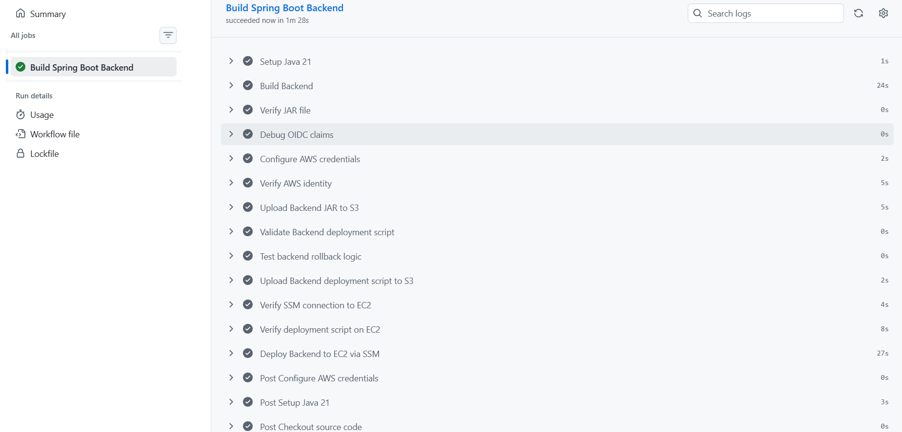
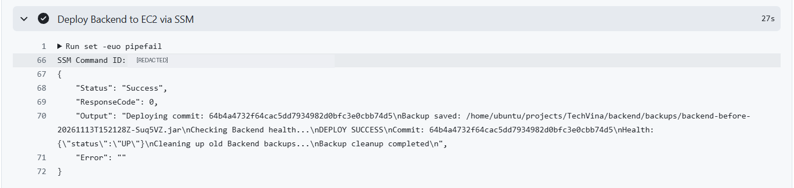
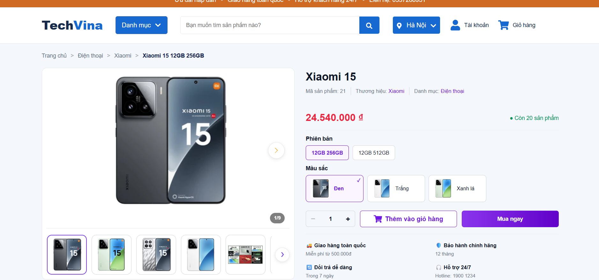

## Step 1 – Kiểm tra Backend trên EC2 trước khi triển khai

Ứng dụng **TechVina Backend** chạy bằng Spring Boot trên EC2 `techvina-ec2-backend` (Ubuntu 24.04), Region **Singapore (`ap-southeast-1`)**. Dịch vụ `techvina-backend.service` được cấu hình từ mục **5.5**; GitHub Actions chỉ cập nhật tệp JAR đã chạy sẵn, không tạo lại EC2 hoặc RDS.

1. Vào **AWS Systems Manager → Session Manager**, kết nối đến EC2 Backend.
2. Kiểm tra trạng thái dịch vụ và HTTP Health Check:

```bash
sudo systemctl is-active techvina-backend.service
```

```text
active
```

```bash
curl -sS --max-time 5 http://127.0.0.1:8080/actuator/health
```

```json
{"status":"UP"}
```

3. Kiểm tra công cụ tải JAR, kiểm tra file nén và khóa triển khai trên EC2:

```bash
aws --version
```

Phiên bản AWS CLI đã xác nhận trong quá trình thực hành là **v2.35.21**. Các lệnh kiểm tra công cụ trả về:

```bash
command -v flock
```

```text
/usr/bin/flock
```

```bash
command -v unzip
```

```text
/usr/bin/unzip
```

Nếu `unzip` chưa có trên Ubuntu, cài đặt và xác nhận:

```bash
sudo apt-get install -y unzip
command -v unzip
```

```text
/usr/bin/unzip
```

EC2 sử dụng IAM Role `techvina-ec2-ssm-role` có quyền `s3:GetObject` đối với `releases/*` trong bucket Backend Artifacts; IAM Role GitHub Actions Backend và Trust Policy OIDC đã được cấu hình ở **5.8.1**.

## Step 2 – Chuẩn bị workflow và các script trong repository

Mở repository **TechVina** bằng VS Code và chọn nhánh `master`. Cấu trúc các file triển khai:

```text
TechVina/
├── backend/
│   ├── pom.xml
│   └── src/
└── .github/
    ├── workflows/
    │   └── deploy-backend.yml
    ├── scripts/
    │   └── deploy-backend.sh
    └── tests/
        └── test-backend-rollback.sh
```

Sử dụng bucket **`techvina-backend-artifacts-<AWS_ACCOUNT_ID>`** để lưu hai loại artifacts trong `releases/`:

```text
releases/backend-<COMMIT_SHA>.jar
releases/deploy-backend-<COMMIT_SHA>.sh
```

Trong ví dụ cấu hình bên dưới, thay `<AWS_ACCOUNT_ID>` bằng Account ID của môi trường, `<EC2_INSTANCE_ID>` bằng ID của EC2 Backend. Tài nguyên triển khai thực tế đã được xác nhận ở Region `ap-southeast-1`.

## Step 3 – Cấu hình script triển khai, sao lưu và rollback

Mở `.github/scripts/deploy-backend.sh`. Script tải JAR theo Commit SHA từ S3, kiểm tra định dạng ZIP/JAR bằng `unzip`, sao lưu JAR đang chạy và khởi động lại dịch vụ qua `systemctl`. Nếu triển khai thất bại sau khi bắt đầu thay JAR, hàm `on_exit()` khôi phục bản backup và kiểm tra `/actuator/health`. Khóa `flock` ngăn hai quá trình triển khai chồng nhau.

Sử dụng nội dung script sau (thay `<AWS_ACCOUNT_ID>` bằng Account ID đang sử dụng):

```bash
#!/usr/bin/env bash
set -Eeuo pipefail

# Cau hinh TechVina Backend
BASE="/home/ubuntu/projects/TechVina/backend"
LIVE="$BASE/target/backend-0.0.1-SNAPSHOT.jar"
SERVICE="techvina-backend.service"
BACKUP_DIR="$BASE/backups"

BUCKET="techvina-backend-artifacts-<AWS_ACCOUNT_ID>"
REGION="ap-southeast-1"
HEALTH_URL="http://127.0.0.1:8080/actuator/health"

# Nhan commit SHA tu GitHub Actions
COMMIT_SHA="${1:-}"

if [[ ! "$COMMIT_SHA" =~ ^[a-f0-9]{40}$ ]]; then
  echo "ERROR: Invalid commit SHA"
  exit 1
fi

# Script phai chay voi quyen root
if [[ "$EUID" -ne 0 ]]; then
  echo "ERROR: Root permission required"
  exit 1
fi

# Ngan hai lan trien khai chay dong thoi
exec 9>/run/lock/techvina-backend-deploy.lock
flock -n 9 || {
  echo "ERROR: Another deployment is running"
  exit 1
}

# Tao thu muc sao luu
install -d -o ubuntu -g ubuntu -m 700 "$BACKUP_DIR"

NEW_JAR=$(mktemp "$BASE/target/.deploy-XXXXXX.jar")
BACKUP=""
SWITCH_STARTED=false
DEPLOY_OK=false

# Kiem tra trang thai ung dung
wait_for_health() {
  for i in $(seq 1 45); do
    RESPONSE=$(curl -fsS --max-time 3 \
      "$HEALTH_URL" 2>/dev/null || true)

    if [[ "$RESPONSE" == '{"status":"UP"}' ]]; then
      return 0
    fi

    sleep 2
  done

  return 1
}

# Tu dong rollback neu trien khai that bai
on_exit() {
  STATUS=$?
  trap - EXIT

  rm -f "$NEW_JAR"

  if [[ "$SWITCH_STARTED" == true &&
        "$DEPLOY_OK" == false ]]; then

    echo "DEPLOY FAILED - Starting rollback"

    systemctl stop "$SERVICE" || true

    if install -o ubuntu -g ubuntu -m 600 \
      "$BACKUP" "$LIVE" &&
      systemctl start "$SERVICE"; then

      if wait_for_health; then
        echo "ROLLBACK SUCCESS"
      else
        echo "ERROR: Rollback health check failed"
      fi
    else
      echo "ERROR: Could not restore Backend"
    fi

    STATUS=1
  fi

  exit "$STATUS"
}

trap on_exit EXIT

echo "Deploying commit: $COMMIT_SHA"

# Buoc 1: Tai JAR moi tu Amazon S3
aws s3 cp \
  "s3://$BUCKET/releases/backend-$COMMIT_SHA.jar" \
  "$NEW_JAR" \
  --region "$REGION" \
  --only-show-errors

# Buoc 2: Kiem tra file JAR
test -s "$NEW_JAR"
unzip -tq "$NEW_JAR" >/dev/null

# Buoc 3: Kiem tra Backend hien tai
test -s "$LIVE"
systemctl is-active --quiet "$SERVICE"

# Buoc 4: Sao luu phien ban dang chay
BACKUP=$(mktemp \
  "$BACKUP_DIR/backend-before-$(date -u +%Y%m%dT%H%M%SZ)-XXXXXX.jar")

install -o ubuntu -g ubuntu -m 600 "$LIVE" "$BACKUP"

echo "Backup saved: $BACKUP"

# Buoc 5: Thay the JAR va khoi dong lai
SWITCH_STARTED=true

systemctl stop "$SERVICE"

install -o ubuntu -g ubuntu -m 600 \
  "$NEW_JAR" "$LIVE"

systemctl start "$SERVICE"

# Buoc 6: Kiem tra Health Check
echo "Checking Backend health..."

if wait_for_health; then
  DEPLOY_OK=true
  echo "DEPLOY SUCCESS"
  echo "Commit: $COMMIT_SHA"
  echo "Health: $RESPONSE"
else
  echo "ERROR: Backend health check failed"
  exit 1
fi


# Buoc 7: Don dep Backup cu sau khi Deploy thanh cong
echo "Cleaning up old Backend backups..."

# Lay danh sach Backup tu dong, moi nhat truoc
mapfile -t BACKUPS < <(
  find "$BACKUP_DIR" -maxdepth 1 -type f \
    -name 'backend-before-????????T??????Z-*.jar' \
    -printf '%f\n' | LC_ALL=C sort -r
)

# Chi giu lai 3 ban Backup tu dong moi nhat
if (( ${#BACKUPS[@]} > 3 )); then
  for OLD_BACKUP in "${BACKUPS[@]:3}"; do
    rm -f -- "$BACKUP_DIR/$OLD_BACKUP" ||
      echo "WARNING: Could not delete $OLD_BACKUP"
  done
fi

echo "Backup cleanup completed"
```

Bản script thành công giữ lại tối đa **3 bản backup tự động mới nhất** trong `backend/backups/`. Việc rollback trên EC2 chỉ xảy ra khi quá trình triển khai sau lúc bắt đầu thay JAR gặp lỗi; đây không phải thao tác được chủ động kích hoạt trong lần triển khai thành công.

## Step 4 – Kiểm thử cơ chế rollback bằng dữ liệu giả lập

Mở `.github/tests/test-backend-rollback.sh`. Bài kiểm thử lấy hàm `on_exit()` từ script triển khai thật, nhưng mô phỏng `systemctl`, `install`, file JAR và Health Check trong thư mục tạm. Bài kiểm thử không dừng Backend trên EC2.

```bash
#!/usr/bin/env bash
set -Eeuo pipefail

# Xac dinh thu muc project
ROOT="$(cd "$(dirname "${BASH_SOURCE[0]}")/../.." && pwd)"
DEPLOY_SCRIPT="$ROOT/.github/scripts/deploy-backend.sh"

# Tao moi truong thu nghiem tam
TEST_DIR="$(mktemp -d)"
trap 'rm -rf "$TEST_DIR"' EXIT

LIVE="$TEST_DIR/backend.jar"
BACKUP="$TEST_DIR/backend-backup.jar"
NEW_JAR="$TEST_DIR/backend-new.jar"
SERVICE="techvina-backend.service"

# Gia lap JAR cu va JAR moi bi loi
printf 'BACKEND_VERSION_OK\n' > "$BACKUP"
printf 'BACKEND_VERSION_FAILED\n' > "$LIVE"
printf 'TEMPORARY_JAR\n' > "$NEW_JAR"

SWITCH_STARTED=true
DEPLOY_OK=false

# Gia lap systemctl, khong dung den EC2
systemctl() {
  case "$1" in
    stop|start) return 0 ;;
    *) return 1 ;;
  esac
}

# Gia lap lenh install de khoi phuc file
install() {
  local source_file="${@: -2:1}"
  local target_file="${@: -1}"
  cp "$source_file" "$target_file"
}

# Gia lap Health Check sau Rollback
wait_for_health() {
  cmp -s "$LIVE" "$BACKUP"
}

# Lay ham Rollback tu script trien khai that
source <(sed -n '/^on_exit() {/,/^}/p' "$DEPLOY_SCRIPT")

# Gia lap trien khai that bai
set +e
OUTPUT="$( (set +e; false; on_exit) 2>&1 )"
EXIT_CODE=$?
set -e

# Xac minh ket qua Rollback
[[ "$EXIT_CODE" -eq 1 ]]
[[ "$OUTPUT" == *"ROLLBACK SUCCESS"* ]]
cmp -s "$LIVE" "$BACKUP"
[[ ! -e "$NEW_JAR" ]]

echo "ROLLBACK_TEST_OK"
echo "Exit code: $EXIT_CODE"
echo "Backup restored successfully"
echo "Temporary JAR removed"
```

Trên máy Windows, mở **Git Bash** trong VS Code tại thư mục gốc dự án và chạy:

```bash
bash .github/tests/test-backend-rollback.sh
```

**Kết quả terminal thực tế:**

```text
ROLLBACK_TEST_OK
Exit code: 1
Backup restored successfully
Temporary JAR removed
```

`Exit code: 1` là mã lỗi triển khai giả lập đã được bài kiểm thử xác nhận; bản thân bài kiểm thử hoàn tất với thông báo `ROLLBACK_TEST_OK`. Đây là kiểm thử logic rollback, **không phải thử làm lỗi triển khai trên EC2 thật**.

## Step 5 – Cấu hình GitHub Actions cho Backend

Mở `.github/workflows/deploy-backend.yml`. Workflow dùng **Java 21**, **Maven**, OIDC và SSM để triển khai lên EC2. Cấu hình hoàn chỉnh:

```yaml
name: Build TechVina Backend

on:
  push:
    branches:
      - master
    paths:
      - "backend/**"
      - ".github/workflows/deploy-backend.yml"
      - ".github/scripts/**"
      - ".github/tests/**"

  workflow_dispatch:
    inputs:
      deploy:
        description: "Deploy Backend to EC2"
        type: boolean
        required: true
        default: false

permissions:
  contents: read
  id-token: write

concurrency:
  group: deploy-techvina-backend
  cancel-in-progress: false

jobs:
  build:
    name: Build Spring Boot Backend
    runs-on: ubuntu-latest

    defaults:
      run:
        working-directory: backend

    steps:
      # Bước 1: Lấy source code
      - name: Checkout source code
        uses: actions/checkout@v7

      # Bước 2: Cài đặt Java 21
      - name: Setup Java 21
        uses: actions/setup-java@v6
        with:
          distribution: temurin
          java-version: "21"
          cache: maven
          cache-dependency-path: backend/pom.xml

      # Bước 3: Build Spring Boot bằng Maven
      - name: Build Backend
        run: mvn -B -ntp clean package -DskipTests

      # Bước 4: Kiểm tra file JAR
      - name: Verify JAR file
        run: test -s target/backend-0.0.1-SNAPSHOT.jar

      # Kiểm tra thông tin OIDC thực tế
      - name: Debug OIDC claims
        uses: actions/github-script@v8
        with:
          script: |
            const token = await core.getIDToken('sts.amazonaws.com');
            const payload = JSON.parse(
              Buffer.from(token.split('.')[1], 'base64url').toString('utf8')
            );
            core.info('OIDC sub: ' + payload.sub);
            core.info('OIDC aud: ' + payload.aud);
            core.info('OIDC iss: ' + payload.iss);

      # Bước 5: Xác thực AWS bằng GitHub OIDC
      - name: Configure AWS credentials
        uses: aws-actions/configure-aws-credentials@v6.3.0
        with:
          role-to-assume: arn:aws:iam::<AWS_ACCOUNT_ID>:role/techvina-github-actions-backend-role
          aws-region: ap-southeast-1

      # Bước 6: Kiểm tra xác thực AWS
      - name: Verify AWS identity
        run: aws sts get-caller-identity

      # Bước 7: Upload file JAR lên Amazon S3
      - name: Upload Backend JAR to S3
        run: |
          aws s3 cp target/backend-0.0.1-SNAPSHOT.jar \
            "s3://techvina-backend-artifacts-<AWS_ACCOUNT_ID>/releases/backend-${GITHUB_SHA}.jar" \
            --region ap-southeast-1 \
            --no-progress \
            --only-show-errors

      # Kiem tra cu phap script trien khai
      - name: Validate Backend deployment script
        run: bash -n "$GITHUB_WORKSPACE/.github/scripts/deploy-backend.sh"

      # Kiem thu logic Rollback
      - name: Test backend rollback logic
        shell: bash
        run: |
          set -euo pipefail
          bash "$GITHUB_WORKSPACE/.github/tests/test-backend-rollback.sh"

      # Upload script trien khai len Amazon S3
      - name: Upload Backend deployment script to S3
        run: |
          aws s3 cp \
            "$GITHUB_WORKSPACE/.github/scripts/deploy-backend.sh" \
            "s3://techvina-backend-artifacts-<AWS_ACCOUNT_ID>/releases/deploy-backend-${GITHUB_SHA}.sh" \
            --region ap-southeast-1 \
            --no-progress \
            --only-show-errors

      # Bước 8: Kiểm tra GitHub Actions gửi lệnh đến EC2
      - name: Verify SSM connection to EC2
        run: |
          COMMAND_ID=$(aws ssm send-command \
            --instance-ids <EC2_INSTANCE_ID> \
            --document-name AWS-RunShellScript \
            --parameters 'commands=["echo TechVina SSM connection OK"]' \
            --region ap-southeast-1 \
            --query 'Command.CommandId' \
            --output text)

          echo "SSM Command ID: $COMMAND_ID"

          aws ssm wait command-executed \
            --command-id "$COMMAND_ID" \
            --instance-id <EC2_INSTANCE_ID> \
            --region ap-southeast-1

          aws ssm get-command-invocation \
            --command-id "$COMMAND_ID" \
            --instance-id <EC2_INSTANCE_ID> \
            --region ap-southeast-1 \
            --query '{Status:Status,Output:StandardOutputContent}' \
            --output json

      # Bước 9: Kiểm tra script triển khai trên EC2 qua SSM
      - name: Verify deployment script on EC2
        shell: bash
        run: |
          set -euo pipefail

          cat > ssm-script-check.json <<EOF
          {
            "commands": [
              "aws s3 cp s3://techvina-backend-artifacts-<AWS_ACCOUNT_ID>/releases/deploy-backend-${GITHUB_SHA}.sh /tmp/deploy-backend-${GITHUB_SHA}.sh --region ap-southeast-1 --only-show-errors && bash -n /tmp/deploy-backend-${GITHUB_SHA}.sh && echo SSM_SCRIPT_CHECK_OK"
            ]
          }
          EOF

          COMMAND_ID=$(aws ssm send-command \
            --instance-ids <EC2_INSTANCE_ID> \
            --document-name AWS-RunShellScript \
            --parameters file://ssm-script-check.json \
            --region ap-southeast-1 \
            --query 'Command.CommandId' \
            --output text)

          echo "SSM Command ID: $COMMAND_ID"

          aws ssm wait command-executed \
            --command-id "$COMMAND_ID" \
            --instance-id <EC2_INSTANCE_ID> \
            --region ap-southeast-1

          aws ssm get-command-invocation \
            --command-id "$COMMAND_ID" \
            --instance-id <EC2_INSTANCE_ID> \
            --region ap-southeast-1 \
            --query '{Status:Status,Output:StandardOutputContent}' \
            --output json

      # Buoc 10: Tu dong trien khai Backend qua SSM
      - name: Deploy Backend to EC2 via SSM
        if: ${{ github.ref == 'refs/heads/master' && (github.event_name == 'push' || (github.event_name == 'workflow_dispatch' && inputs.deploy == true)) }}
        shell: bash
        run: |
          set -euo pipefail

          INSTANCE_ID="<EC2_INSTANCE_ID>"
          REGION="ap-southeast-1"

          # Tao lenh SSM de tai va chay script
          cat > ssm-deploy.json <<EOF
          {
            "commands": [
              "aws s3 cp s3://techvina-backend-artifacts-<AWS_ACCOUNT_ID>/releases/deploy-backend-${GITHUB_SHA}.sh /tmp/deploy-backend-${GITHUB_SHA}.sh --region ${REGION} --only-show-errors && bash -n /tmp/deploy-backend-${GITHUB_SHA}.sh && sudo bash /tmp/deploy-backend-${GITHUB_SHA}.sh ${GITHUB_SHA}"
            ],
            "executionTimeout": ["600"]
          }
          EOF

          COMMAND_ID=$(aws ssm send-command \
            --instance-ids "$INSTANCE_ID" \
            --document-name AWS-RunShellScript \
            --parameters file://ssm-deploy.json \
            --region "$REGION" \
            --query 'Command.CommandId' \
            --output text)

          echo "SSM Command ID: $COMMAND_ID"

          # Theo doi qua trinh trien khai
          STATUS="Pending"

          for i in $(seq 1 60); do
            STATUS=$(aws ssm get-command-invocation \
              --command-id "$COMMAND_ID" \
              --instance-id "$INSTANCE_ID" \
              --region "$REGION" \
              --query Status \
              --output text 2>/dev/null || echo Pending)

            case "$STATUS" in
              Success|Failed|Cancelled|TimedOut|DeliveryTimedOut|ExecutionTimedOut|Undeliverable|Terminated)
                break
                ;;
            esac

            sleep 10
          done

          # Hien thi ket qua trien khai
          aws ssm get-command-invocation \
            --command-id "$COMMAND_ID" \
            --instance-id "$INSTANCE_ID" \
            --region "$REGION" \
            --query '{Status:Status,ResponseCode:ResponseCode,Output:StandardOutputContent,Error:StandardErrorContent}' \
            --output json

          test "$STATUS" = "Success"
```

Trình tự xử lý: `Checkout source code` → `Setup Java 21` → `mvn clean package -DskipTests` → kiểm tra JAR → xác thực AWS bằng OIDC → tải JAR lên S3 → kiểm tra cú pháp và test rollback → tải script lên S3 → kiểm tra kết nối SSM và cú pháp script trên EC2 → chạy script triển khai qua SSM.

Tác vụ `push` được kích hoạt khi có thay đổi trong `backend/**`, `.github/workflows/deploy-backend.yml`, `.github/scripts/**` hoặc `.github/tests/**` trên `master`. Trong `workflow_dispatch`, tham số `deploy` mặc định `false` chỉ bỏ qua **bước deploy cuối cùng**; các bước build, upload artifacts và kiểm tra SSM vẫn được chạy.

## Step 6 – Kiểm tra thay đổi, commit và push GitHub

Trong **Git Bash** ở thư mục `TechVina`, kiểm tra hai file cấu hình vừa thay đổi:

```bash
git --no-pager diff -- .github/workflows/deploy-backend.yml .github/scripts/deploy-backend.sh
```

Đảm bảo ARN Backend Role, tên S3 bucket và EC2 Instance ID đều trỏ về đúng tài nguyên đã tạo. Đưa thay đổi vào Git Staging:

```bash
git add .github/workflows/deploy-backend.yml .github/scripts/deploy-backend.sh
```

```bash
git status --short
```

**Output Git Bash thực tế:**

```text
M  .github/scripts/deploy-backend.sh
M  .github/workflows/deploy-backend.yml
```

Commit cấu hình:

```bash
git commit -m "ci: update backend deployment workflow for AWS"
```

```text
[master 64b4a47] ci: update backend deployment workflow for AWS
 2 files changed, 13 insertions(+), 13 deletions(-)
```

Đẩy commit lên nhánh triển khai:

```bash
git push origin master
```

Lệnh push sẽ kích hoạt workflow Backend và **thay thế JAR trên EC2, khởi động lại dịch vụ** khi job deploy được chạy. Cần bảo đảm Backend đang hoạt động bình thường trước khi push.

## Step 7 – Kiểm tra GitHub Actions và kết quả triển khai SSM

1. Trên GitHub, mở **Actions → Build TechVina Backend**, chọn lần chạy tương ứng commit `64b4a47`.
2. Xác nhận job **Build Spring Boot Backend** đã hoàn thành các bước build, xác thực OIDC, tải artifacts lên S3, kiểm thử rollback và `Deploy Backend to EC2 via SSM`.
3. Mở log của bước **Deploy Backend to EC2 via SSM** để kiểm tra trạng thái SSM, bản backup JAR và Health Check.

Kết quả triển khai thực tế: **Success – 1 phút 28 giây**.



**Trích kết quả thực tế của SSM và script triển khai:**

```text
SSM command status: Success
ResponseCode: 0
Deploying commit: 64b4a4732f64cac5dd7934982d0bfc3e0cbb74d5
Backup saved: /home/ubuntu/projects/TechVina/backend/backups/backend-before-20261113T152128Z-Suq5VZ.jar
Checking Backend health...
DEPLOY SUCCESS
Commit: 64b4a4732f64cac5dd7934982d0bfc3e0cbb74d5
Health: {"status":"UP"}
Cleaning up old Backend backups...
Backup cleanup completed
```



Đường dẫn backup được tạo trước khi script thay thế JAR, sau đó dịch vụ Spring Boot đã khởi động và trả về `{"status":"UP"}`. Kết quả `DEPLOY SUCCESS` xác nhận lần triển khai này thành công; không kích hoạt nhánh rollback.

## Step 8 – Kiểm tra Backend và website sau triển khai

Trên EC2 qua Session Manager, kiểm tra lại dịch vụ và HTTP Health Check:

```bash
sudo systemctl is-active techvina-backend.service
curl -sS --max-time 5 http://127.0.0.1:8080/actuator/health
```

```text
active
{"status":"UP"}
```

Truy cập CloudFront, mở danh sách sản phẩm, sau đó vào trang chi tiết sản phẩm. Trong lần kiểm thử TechVina, trang sản phẩm tải thành công thông tin Xiaomi 15, phiên bản, màu sắc, hình ảnh và số lượng tồn kho từ hệ thống.



Kết quả: GitHub Actions đã build JAR bằng Maven, upload artifacts lên S3, gửi lệnh SSM đến EC2, tạo backup, thay JAR, khởi động lại Spring Boot và hoàn thành Health Check. Luồng truy cập website và dữ liệu sản phẩm vẫn hoạt động sau triển khai.
