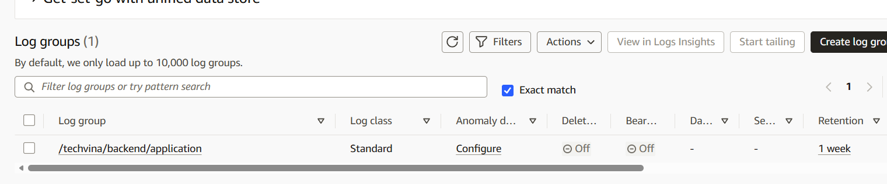
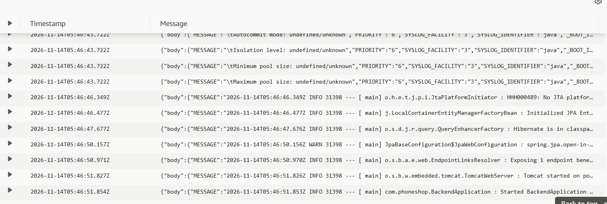
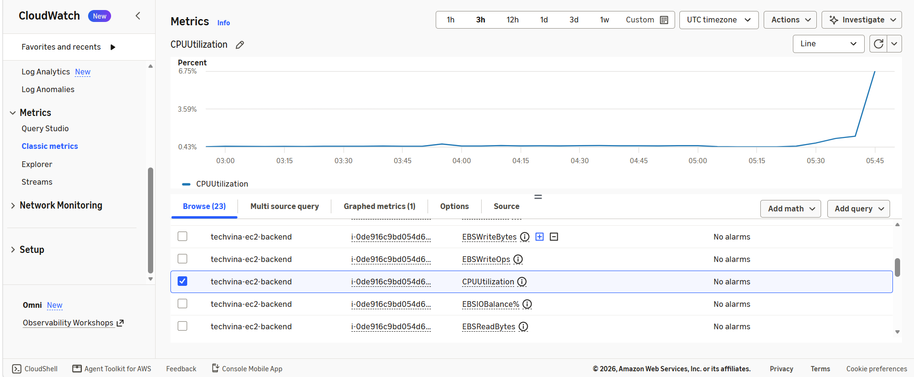
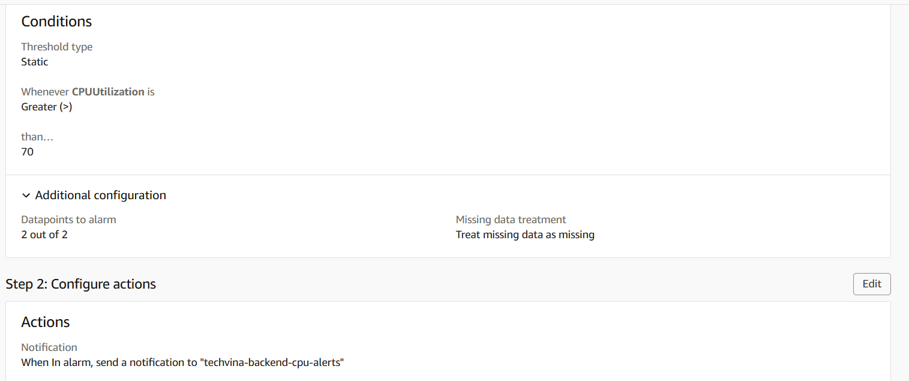
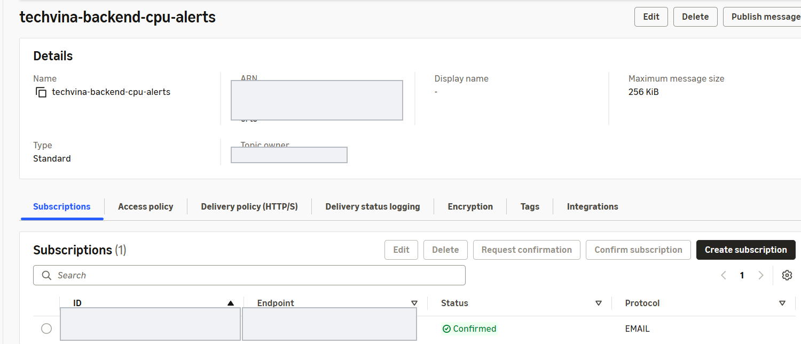
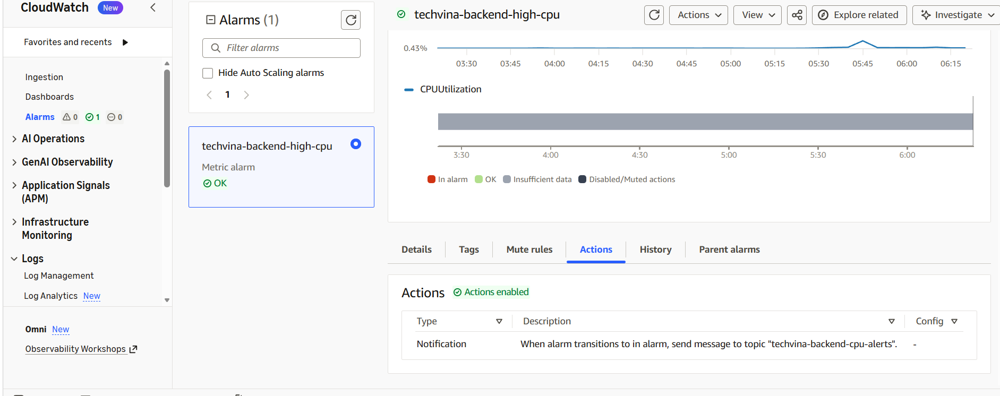
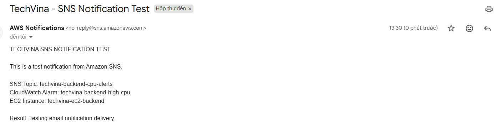

## Step 1 – Inspect Spring Boot logs on the EC2 instance

The **TechVina Backend** runs on the `techvina-ec2-backend` EC2 instance in **Singapore (`ap-southeast-1`)**. Spring Boot is managed by the `techvina-backend.service` systemd unit. The EC2 IAM role, `techvina-ec2-ssm-role`, includes `CloudWatchAgentServerPolicy`, allowing the instance to send monitoring data to Amazon CloudWatch.

1. Open **AWS Systems Manager → Session Manager** and connect to the Backend instance.
2. Inspect the service's logging destination:

```bash
sudo systemctl show techvina-backend.service -p StandardOutput -p StandardError
```

EC2 output:

```text
StandardOutput=journal
StandardError=inherit
```

Spring Boot therefore writes to the **systemd journal**. Inspect its recent log entries:

```bash
sudo journalctl -u techvina-backend.service -n 15 --no-pager
```

Selected lines from the observed output:

```text
Nov 13 15:21:46 ip-10-20-1-19 java[26448]: 2026-11-13T15:21:46.308Z  INFO 26448 --- [           main] o.s.b.w.embedded.tomcat.TomcatWebServer  : Tomcat started on port 8080 (http) with context path '/'
Nov 13 15:21:46 ip-10-20-1-19 java[26448]: 2026-11-13T15:21:46.333Z  INFO 26448 --- [           main] com.phoneshop.BackendApplication         : Started BackendApplication in 15.814 seconds (process running for 16.912)
```

The CloudWatch Agent can collect these entries directly from `journald`. There is no need to create `/var/log/techvina/backend.log` or change Spring Boot's systemd logging configuration.

## Step 2 – Install the Amazon CloudWatch Agent

Check whether the Agent is installed:

```bash
systemctl status amazon-cloudwatch-agent --no-pager
```

Output before installation:

```text
Unit amazon-cloudwatch-agent.service could not be found.
```

Download the official Ubuntu `amd64` package:

```bash
wget -O /tmp/amazon-cloudwatch-agent.deb https://amazoncloudwatch-agent.s3.amazonaws.com/ubuntu/amd64/latest/amazon-cloudwatch-agent.deb
```

Observed download output:

```text
HTTP request sent, awaiting response... 200 OK
Length: 77725146 (74M) [application/octet-stream]
Saving to: ‘/tmp/amazon-cloudwatch-agent.deb’
‘/tmp/amazon-cloudwatch-agent.deb’ saved [77725146/77725146]
```

Install the downloaded package:

```bash
sudo dpkg -i /tmp/amazon-cloudwatch-agent.deb
```

EC2 output:

```text
Selecting previously unselected package amazon-cloudwatch-agent.
Unpacking amazon-cloudwatch-agent (1.300074.1b2005-1) ...
Setting up amazon-cloudwatch-agent (1.300074.1b2005-1) ...
```

## Step 3 – Configure the Agent to collect journald logs

From Session Manager, create `/opt/aws/amazon-cloudwatch-agent/etc/amazon-cloudwatch-agent.json`:

```bash
sudo tee /opt/aws/amazon-cloudwatch-agent/etc/amazon-cloudwatch-agent.json > /dev/null <<'EOF'
{
  "agent": {
    "region": "ap-southeast-1"
  },
  "logs": {
    "logs_collected": {
      "journald": {
        "collect_list": [
          {
            "log_group_name": "/techvina/backend/application",
            "log_stream_name": "{instance_id}",
            "units": ["techvina-backend.service"],
            "retention_in_days": 7
          }
        ]
      }
    }
  }
}
EOF
```

- `units` restricts collection to `techvina-backend.service`.
- `log_group_name` sends events to `/techvina/backend/application`.
- `log_stream_name` uses the EC2 Instance ID as the log stream name.
- `retention_in_days` stores logs for **7 days**.

Load the configuration and start the Agent:

```bash
sudo /opt/aws/amazon-cloudwatch-agent/bin/amazon-cloudwatch-agent-ctl -a fetch-config -m ec2 -s -c file:/opt/aws/amazon-cloudwatch-agent/etc/amazon-cloudwatch-agent.json
```

Configuration validation output:

```text
I! Valid Json input schema.
Configuration validation first phase succeeded
Configuration validation second phase succeeded
Configuration validation succeeded
```

Confirm the Agent is running:

```bash
sudo systemctl status amazon-cloudwatch-agent --no-pager
```

Relevant observed output:

```text
Loaded: loaded (/etc/systemd/system/amazon-cloudwatch-agent.service; enabled; preset: enabled)
Active: active (running) since Sat 2026-11-14 05:39:44 UTC
Main PID: 31283 (amazon-cloudwat)
CGroup: /system.slice/amazon-cloudwatch-agent.service
        ├─31283 /opt/aws/amazon-cloudwatch-agent/bin/amazon-cloudwatch-agent ...
        └─31330 journalctl --utc --output=json --follow --lines=0 --unit techvina-backend.service --priority info
```

The collector uses `--lines=0` and `--follow`, so it initially processes **new log events**. In the actual setup, the following check found no new service entries:

```bash
sudo journalctl -u techvina-backend.service --since "2026-11-14 05:39:44 UTC" --no-pager
```

```text
-- No entries --
```

To generate fresh startup events for verification, the Backend service was restarted through Session Manager:

```bash
sudo systemctl restart techvina-backend.service
```

Restarting briefly interrupts the Backend during application startup, but does not replace the JAR or modify the database. The restarted application generated new events, which the Agent collected.

## Step 4 – Verify application logs in Amazon CloudWatch Logs

1. Open **CloudWatch → Logs → Log management → Log groups** in `ap-southeast-1`.
2. Open **`/techvina/backend/application`**. Verify Log Class **Standard** and a retention of **1 week**.
3. Select the log stream named after the `techvina-ec2-backend` Instance ID.
4. Open **Log events** and inspect entries from Hibernate, JPA, Tomcat and Spring Boot startup.





The received events include `Initialized JPA EntityManagerFactory`, `Tomcat started on port 8080` and `Started BackendApplication`. This confirms the **EC2 → journald → CloudWatch Agent → CloudWatch Logs** collection path.

## Step 5 – Monitor EC2 metrics using CloudWatch

1. Open **CloudWatch → Metrics → Classic metrics**.
2. Select **EC2 → Per-Instance Metrics**.
3. Locate the instance by its `InstanceId` and `techvina-ec2-backend` name.
4. Select **`CPUUtilization`** and display the graph over **3h**.



The chart shows the instance's actual CPU usage, including a brief rise near the end of the selected period. The **Per-Instance Metrics** page also provides `StatusCheckFailed`, `NetworkIn`, `NetworkOut` and `CPUCreditBalance` for the T3 EC2 instance.

## Step 6 – Create a CloudWatch Alarm and configure Amazon SNS

With the `CPUUtilization` metric selected, choose **Create alarm** and configure:

| Setting | Value |
|---|---|
| Namespace / Metric | `AWS/EC2` / `CPUUtilization` |
| EC2 instance | `techvina-ec2-backend` |
| Statistic | `Average` |
| Period | `5 minutes` |
| Threshold type | `Static` |
| Condition | `Greater than 70` (%) |
| Datapoints to alarm | `2 out of 2` |
| Missing data treatment | `Treat missing data as missing` |
| Evaluation window | `Default (Sliding window)` |
| Alarm name | `techvina-backend-high-cpu` |

Both consecutive 5-minute averages must exceed 70% for the alarm to transition to `ALARM`.



Under **Configure actions → Notification**:

1. Select **In alarm**.
2. Choose **Create new topic** and enter **`techvina-backend-cpu-alerts`**.
3. Enter the notification email address and select **Create topic**.
4. Open the AWS Notifications confirmation email and choose **Confirm subscription**.
5. Under **Add alarm details**, set the alarm name to `techvina-backend-high-cpu` and enter:

```text
Monitor CPU utilization of the TechVina Backend EC2 instance. Trigger an alarm when average CPU utilization exceeds 70% for 2 consecutive 5-minute periods. Send an email notification through Amazon SNS.
```

6. Review **Preview and create**, then select **Create alarm**.

Open **Amazon SNS → Topics → `techvina-backend-cpu-alerts`** and verify that the email subscription has **Confirmed** status and uses the **EMAIL** protocol.



## Step 7 – Verify the Alarm state and test SNS email delivery

After creation, `techvina-backend-high-cpu` initially displayed `Insufficient data`, then changed to **`OK`** once enough CPU datapoints were evaluated. On the **Actions** tab, the configuration shows `Actions enabled` and a notification sent to `techvina-backend-cpu-alerts` when the alarm enters the `ALARM` state.



To test email delivery without increasing EC2 CPU load:

1. Open **Amazon SNS → Topics → `techvina-backend-cpu-alerts` → Publish message**.
2. Enter the **Subject**:

```text
TechVina - SNS Notification Test
```

3. Choose **Identical payload for all delivery protocols**, then enter the **Message body**:

```text
TECHVINA SNS NOTIFICATION TEST

This is a test notification from Amazon SNS.

SNS Topic: techvina-backend-cpu-alerts
CloudWatch Alarm: techvina-backend-high-cpu
EC2 Instance: techvina-ec2-backend

Result: Testing email notification delivery.
```

4. Select **Publish message** and open the subscribed mailbox. The test message was successfully delivered by **AWS Notifications**.



This test verifies **SNS email delivery to a confirmed subscription**. It does not test a real CPU threshold breach or an actual transition into `ALARM`.

## Step 8 – Validate the Backend and website after deployment

Use Session Manager to check Spring Boot health:

```bash
curl -sS --max-time 5 http://127.0.0.1:8080/actuator/health
```

Observed EC2 output:

```json
{"status":"UP"}
```

Open the TechVina site through CloudFront and verify the home page, categories, featured product list and Xiaomi 15 product details. These user-facing checks were carried out after the Backend CI/CD deployment in **5.8.3** and are documented in **5.8.2** and **5.8.3**.

| Component | Verified result |
|---|---|
| Frontend GitHub Actions | Successful workflow in 5.8.2 |
| Backend GitHub Actions | `DEPLOY SUCCESS`, SSM `ResponseCode: 0`, Health `UP` in 5.8.3 |
| CloudWatch Agent | `active (running)`; collecting `journald` |
| CloudWatch Logs | Spring Boot log group, stream and events available |
| CloudWatch Metrics | EC2 `CPUUtilization` chart populated |
| CloudWatch Alarm | 70% threshold configured, `OK` state, SNS action enabled |
| Amazon SNS | Email subscription `Confirmed`; test email received |
| Website | Homepage, featured products and product details displayed following deployment |

