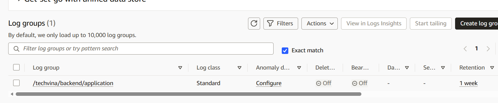
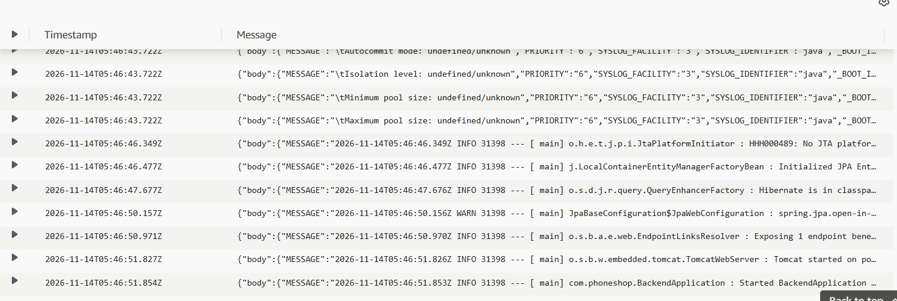
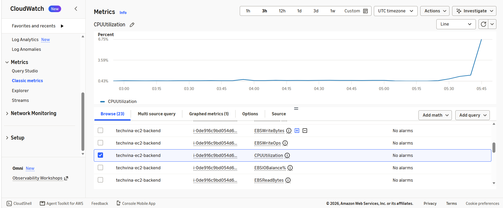
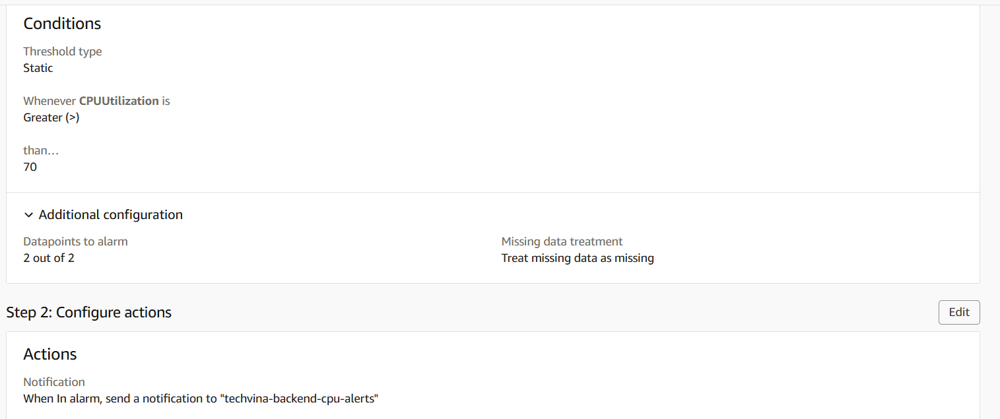
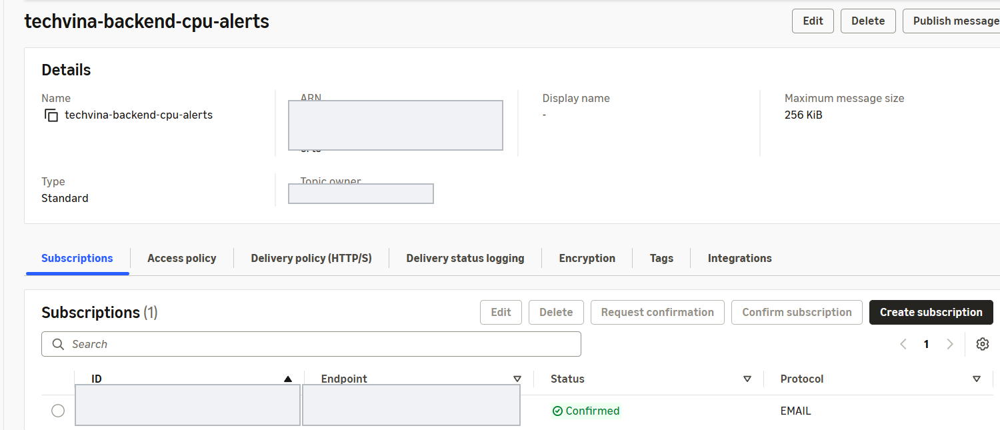
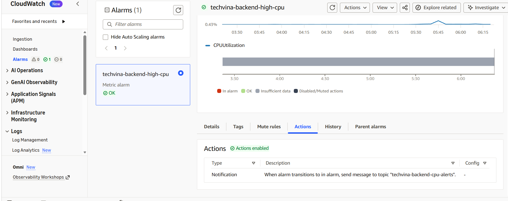
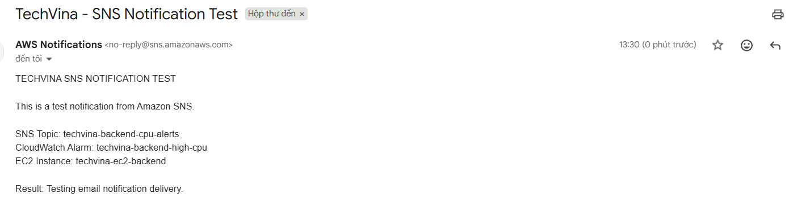

## Step 1 – Kiểm tra nhật ký Spring Boot trên EC2

Ứng dụng **TechVina Backend** chạy trên EC2 `techvina-ec2-backend` tại Region **Singapore (`ap-southeast-1`)**, được quản lý bằng dịch vụ `techvina-backend.service`. IAM Role của EC2 là `techvina-ec2-ssm-role`, đã được gắn chính sách `CloudWatchAgentServerPolicy` để gửi dữ liệu giám sát lên Amazon CloudWatch.

1. Mở **AWS Systems Manager → Session Manager** và kết nối đến EC2 Backend.
2. Kiểm tra đường ghi nhật ký của dịch vụ:

```bash
sudo systemctl show techvina-backend.service -p StandardOutput -p StandardError
```

Output trên EC2:

```text
StandardOutput=journal
StandardError=inherit
```

Như vậy, Spring Boot ghi nhật ký vào **systemd journal**. Kiểm tra các dòng nhật ký gần nhất:

```bash
sudo journalctl -u techvina-backend.service -n 15 --no-pager
```

Một số dòng output thực tế:

```text
Nov 13 15:21:46 ip-10-20-1-19 java[26448]: 2026-11-13T15:21:46.308Z  INFO 26448 --- [           main] o.s.b.w.embedded.tomcat.TomcatWebServer  : Tomcat started on port 8080 (http) with context path '/'
Nov 13 15:21:46 ip-10-20-1-19 java[26448]: 2026-11-13T15:21:46.333Z  INFO 26448 --- [           main] com.phoneshop.BackendApplication         : Started BackendApplication in 15.814 seconds (process running for 16.912)
```

CloudWatch Agent sẽ thu thập trực tiếp từ `journald`; không cần tạo thêm file `/var/log/techvina/backend.log` hoặc thay đổi cấu hình `systemd` của Spring Boot.

## Step 2 – Cài đặt Amazon CloudWatch Agent

Kiểm tra Agent trên EC2:

```bash
systemctl status amazon-cloudwatch-agent --no-pager
```

Output trước khi cài đặt:

```text
Unit amazon-cloudwatch-agent.service could not be found.
```

Tải gói cài đặt chính thức dành cho Ubuntu `amd64`:

```bash
wget -O /tmp/amazon-cloudwatch-agent.deb https://amazoncloudwatch-agent.s3.amazonaws.com/ubuntu/amd64/latest/amazon-cloudwatch-agent.deb
```

Output tải xuống ghi nhận:

```text
HTTP request sent, awaiting response... 200 OK
Length: 77725146 (74M) [application/octet-stream]
Saving to: ‘/tmp/amazon-cloudwatch-agent.deb’
‘/tmp/amazon-cloudwatch-agent.deb’ saved [77725146/77725146]
```

Cài đặt gói vừa tải:

```bash
sudo dpkg -i /tmp/amazon-cloudwatch-agent.deb
```

Output trên EC2:

```text
Selecting previously unselected package amazon-cloudwatch-agent.
Unpacking amazon-cloudwatch-agent (1.300074.1b2005-1) ...
Setting up amazon-cloudwatch-agent (1.300074.1b2005-1) ...
```

## Step 3 – Cấu hình Agent thu thập nhật ký từ journald

Trong Session Manager, tạo file cấu hình `/opt/aws/amazon-cloudwatch-agent/etc/amazon-cloudwatch-agent.json`:

```bash
sudo tee /opt/aws/amazon-cloudwatch-agent/etc/amazon-cloudwatch-agent.json > /dev/null <<'EOF'
{
  "agent": {
    "region": "ap-southeast-1"
  },
  "logs": {
    "logs_collected": {
      "journald": {
        "collect_list": [
          {
            "log_group_name": "/techvina/backend/application",
            "log_stream_name": "{instance_id}",
            "units": ["techvina-backend.service"],
            "retention_in_days": 7
          }
        ]
      }
    }
  }
}
EOF
```

- `units`: chỉ thu thập nhật ký thuộc `techvina-backend.service`.
- `log_group_name`: lưu nhật ký trong `/techvina/backend/application`.
- `log_stream_name`: dùng EC2 Instance ID làm tên luồng nhật ký.
- `retention_in_days`: lưu dữ liệu trong **7 ngày**.

Áp dụng cấu hình và khởi động Agent:

```bash
sudo /opt/aws/amazon-cloudwatch-agent/bin/amazon-cloudwatch-agent-ctl -a fetch-config -m ec2 -s -c file:/opt/aws/amazon-cloudwatch-agent/etc/amazon-cloudwatch-agent.json
```

Output xác thực cấu hình:

```text
I! Valid Json input schema.
Configuration validation first phase succeeded
Configuration validation second phase succeeded
Configuration validation succeeded
```

Xác nhận dịch vụ Agent đang chạy:

```bash
sudo systemctl status amazon-cloudwatch-agent --no-pager
```

Các dòng output thực tế:

```text
Loaded: loaded (/etc/systemd/system/amazon-cloudwatch-agent.service; enabled; preset: enabled)
Active: active (running) since Sat 2026-11-14 05:39:44 UTC
Main PID: 31283 (amazon-cloudwat)
CGroup: /system.slice/amazon-cloudwatch-agent.service
        ├─31283 /opt/aws/amazon-cloudwatch-agent/bin/amazon-cloudwatch-agent ...
        └─31330 journalctl --utc --output=json --follow --lines=0 --unit techvina-backend.service --priority info
```

Bộ thu thập sử dụng `--lines=0` và `--follow`, vì vậy Agent bắt đầu đọc **nhật ký phát sinh mới**. Trong lần thiết lập thực tế, lệnh kiểm tra sau chưa thấy sự kiện mới:

```bash
sudo journalctl -u techvina-backend.service --since "2026-11-14 05:39:44 UTC" --no-pager
```

```text
-- No entries --
```

Để tạo lại các nhật ký khởi động phục vụ xác minh, dịch vụ Backend đã được khởi động lại thông qua Session Manager:

```bash
sudo systemctl restart techvina-backend.service
```

Lệnh khởi động lại làm gián đoạn Backend trong khoảng thời gian ứng dụng khởi động, nhưng không thay đổi tệp JAR hoặc cơ sở dữ liệu. Sau khi Spring Boot khởi động lại, CloudWatch Agent nhận được các sự kiện nhật ký mới.

## Step 4 – Xác nhận nhật ký trong Amazon CloudWatch Logs

1. Mở **CloudWatch → Logs → Log management → Log groups** tại Region `ap-southeast-1`.
2. Mở Log Group **`/techvina/backend/application`**; xác nhận Log Class là `Standard` và **Retention = 1 week**.
3. Chọn Log Stream có tên là EC2 Instance ID của `techvina-ec2-backend`.
4. Mở **Log events** và kiểm tra nhật ký khởi tạo Hibernate, JPA, Tomcat và Spring Boot.





Các sự kiện đã được ghi nhận với các thông báo `Initialized JPA EntityManagerFactory`, `Tomcat started on port 8080` và `Started BackendApplication`. Điều này xác nhận đường gửi nhật ký **EC2 → journald → CloudWatch Agent → CloudWatch Logs** hoạt động.

## Step 5 – Theo dõi chỉ số EC2 bằng CloudWatch Metrics

1. Mở **CloudWatch → Metrics → Classic metrics**.
2. Chọn **EC2 → Per-Instance Metrics**.
3. Xác định EC2 theo `InstanceId` và tên `techvina-ec2-backend`.
4. Tích chọn **`CPUUtilization`** để hiển thị biểu đồ trong khoảng thời gian **3h**.



CloudWatch hiển thị đường sử dụng CPU của EC2 và một đợt tăng ngắn ở cuối khoảng thời gian theo dõi. Cũng tại **Per-Instance Metrics**, có thể xem các chỉ số `StatusCheckFailed`, `NetworkIn`, `NetworkOut` và `CPUCreditBalance` của EC2 T3.

## Step 6 – Tạo CloudWatch Alarm và thiết lập Amazon SNS

Từ chỉ số `CPUUtilization` đang chọn, nhấn **Create alarm**, sử dụng các thông số sau:

| Thuộc tính | Giá trị cấu hình |
|---|---|
| Namespace / Metric | `AWS/EC2` / `CPUUtilization` |
| EC2 | `techvina-ec2-backend` |
| Statistic | `Average` |
| Period | `5 minutes` |
| Threshold type | `Static` |
| Condition | `Greater than 70` (%) |
| Datapoints to alarm | `2 out of 2` |
| Missing data treatment | `Treat missing data as missing` |
| Evaluation window | `Default (Sliding window)` |
| Alarm name | `techvina-backend-high-cpu` |

Alarm được đặt để đánh giá **hai khoảng 5 phút liên tiếp**; nếu cả hai giá trị CPU trung bình đều vượt 70%, trạng thái chuyển sang `ALARM`.



Tại **Configure actions → Notification**:

1. Chọn trạng thái **In alarm**.
2. Chọn **Create new topic**, đặt tên **`techvina-backend-cpu-alerts`**.
3. Nhập email nhận cảnh báo và nhấn **Create topic**.
4. Mở thư xác nhận của AWS Notifications và chọn **Confirm subscription**.
5. Tại **Add alarm details**, đặt tên `techvina-backend-high-cpu` và nhập mô tả:

```text
Monitor CPU utilization of the TechVina Backend EC2 instance. Trigger an alarm when average CPU utilization exceeds 70% for 2 consecutive 5-minute periods. Send an email notification through Amazon SNS.
```

6. Xem lại cấu hình tại **Preview and create**, sau đó nhấn **Create alarm**.

Mở **Amazon SNS → Topics → `techvina-backend-cpu-alerts`**. Trong phần **Subscriptions**, email đã đăng ký có trạng thái **Confirmed**, giao thức **EMAIL**.



## Step 7 – Kiểm tra trạng thái Alarm và kiểm thử email SNS

Sau khi tạo, Alarm `techvina-backend-high-cpu` ban đầu hiển thị `Insufficient data`, sau đó chuyển sang **`OK`** khi đã có đủ dữ liệu đánh giá. Trong tab **Actions**, AWS xác nhận `Actions enabled` và gửi thông báo tới topic `techvina-backend-cpu-alerts` khi Alarm chuyển sang trạng thái `ALARM`.



Để kiểm tra khả năng gửi email mà không tăng tải CPU trên EC2:

1. Mở **Amazon SNS → Topics → `techvina-backend-cpu-alerts` → Publish message**.
2. Nhập **Subject**:

```text
TechVina - SNS Notification Test
```

3. Chọn **Identical payload for all delivery protocols** và nhập **Message body**:

```text
TECHVINA SNS NOTIFICATION TEST

This is a test notification from Amazon SNS.

SNS Topic: techvina-backend-cpu-alerts
CloudWatch Alarm: techvina-backend-high-cpu
EC2 Instance: techvina-ec2-backend

Result: Testing email notification delivery.
```

4. Nhấn **Publish message**, mở email đã đăng ký để xác nhận thư từ **AWS Notifications** được gửi đến thành công.



Bài thử nghiệm này xác nhận **Amazon SNS có thể gửi email đến subscription**, không phải kiểm thử ngưỡng CPU thực sự gây chuyển trạng thái `ALARM`.

## Step 8 – Kiểm tra Backend và website sau triển khai

Trong Session Manager, kiểm tra sức khỏe dịch vụ Spring Boot:

```bash
curl -sS --max-time 5 http://127.0.0.1:8080/actuator/health
```

Output trên EC2:

```json
{"status":"UP"}
```

Truy cập website TechVina qua CloudFront và kiểm tra trang chủ, danh mục, danh sách sản phẩm nổi bật và trang chi tiết sản phẩm Xiaomi 15. Các kết quả hiển thị sản phẩm và hình ảnh đã được kiểm tra sau khi CI/CD Backend hoàn tất tại **5.8.3**. Nội dung kiểm tra giao diện và ảnh sản phẩm được trình bày tại **5.8.2** và **5.8.3**.

| Hạng mục | Kết quả đã xác minh |
|---|---|
| GitHub Actions Frontend | Workflow hoàn thành thành công tại 5.8.2 |
| GitHub Actions Backend | `DEPLOY SUCCESS`, SSM `ResponseCode: 0`, Health `UP` tại 5.8.3 |
| CloudWatch Agent | `active (running)`, đã thu thập `journald` |
| CloudWatch Logs | Có Log Group, Log Stream và Log events của Spring Boot |
| CloudWatch Metrics | Biểu đồ `CPUUtilization` của EC2 hiển thị dữ liệu |
| CloudWatch Alarm | Đã cấu hình ngưỡng 70%, trạng thái `OK`, hành động SNS được bật |
| Amazon SNS | Email subscription `Confirmed`, nhận được email kiểm thử |
| Website | Trang chủ, danh sách và chi tiết sản phẩm hiển thị sau triển khai |

